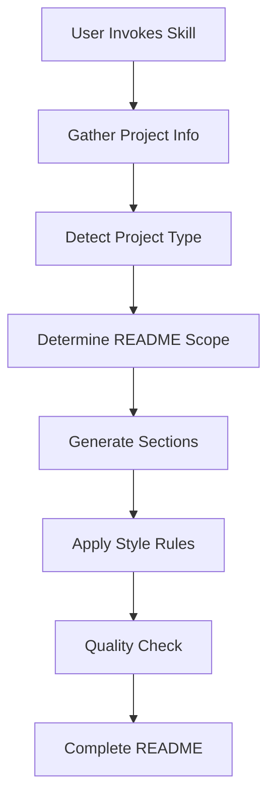

# README Generator Skill

> Capture expert documentation patterns and generate production-ready README files.

## 🎯 Overview

A Claude skill that generates comprehensive README.md files following proven documentation principles and style patterns. Trained on analysis of 20+ professionally-crafted README files, this skill captures the author's distinctive documentation philosophy and applies it to new projects.

**Status:** ✅ Production Ready | Fully Documented

## ✨ Features

- 🎯 **Expert Pattern Library** - Encodes documentation best practices from 20+ analyzed READMEs
- 📋 **Universal Template** - 10-section structure adaptable to any project type
- 🎨 **Consistent Style** - Applies emoji markers, formatting conventions, and tone rules
- 🏗️ **Project Type Detection** - Adapts depth for main projects, applications, modules, or utilities
- ✍️ **Distinctive Voice** - Replicates authoritative, production-first writing style
- 🔧 **Complete Sections** - Generates architecture diagrams, file trees, troubleshooting, and more

## 🚀 Quick Start

### Invoke the Skill

In Claude Code, use the Skill tool or command:

```bash
# Via Skill tool
Skill: readme-generator

# The skill will guide you through project information gathering
```

### Provide Project Information

The skill will ask for:

1. **Project Name** - What to call it
2. **Project Type** - Main Project | Application | Module | Utility
3. **Purpose** - Brief description of what it does
4. **Tech Stack** - Languages, frameworks, tools
5. **Key Features** - Main capabilities (3-7 items)
6. **Target Audience** - Who will use this

### Generate README

The skill will create a complete README.md with:
- Philosophy quote opener
- Status declaration
- Feature list with emojis
- Quick start instructions
- Architecture section (with Mermaid diagrams if applicable)
- Annotated file structure
- Configuration details
- Troubleshooting section
- Links to related documentation

## 🏗️ Architecture

### Skill Components

```
.claude/skills/readme-generator/
├── skill.md           # Main skill prompt (5000+ lines)
└── README.md          # This documentation file
```

### Knowledge Encoded

The skill.md file contains:

1. **Documentation Philosophy** - Production-first operational manual mindset
2. **Universal Template** - 10-section structure with variations
3. **Style Rules** - Emoji usage, formatting, tone guidelines
4. **Content Patterns** - How to write each section effectively
5. **Project Type Variations** - Adapt depth based on project complexity
6. **Quality Checklist** - Verification steps before finalization
7. **Example Generations** - Reference patterns for different project types

### Analysis Source

Based on deep analysis of:
- 8 main project READMEs
- 10+ application READMEs
- 5+ component/module READMEs
- Special purpose documentation

Patterns extracted:
- Structural templates
- Emoji conventions
- Phrasing patterns
- Mermaid diagram styles
- File tree annotation methods
- Troubleshooting formats

## 📖 How It Works

### Documentation Philosophy

The skill generates READMEs as **operational manuals** that answer:

1. **What is this?** (Clear purpose)
2. **How do I use it NOW?** (Quick start)
3. **How does it work?** (Architecture)

**Core Principles:**
- Reduce friction to production deployment
- Maintain technical depth for power users
- Assume reader intelligence
- Obsession with completeness
- System thinking approach
- Production mindset

### Generation Workflow



**Steps:**

1. **Information Gathering** - Ask user for project details
2. **Type Detection** - Classify as main/app/module/utility
3. **Scope Determination** - Decide which sections and depth
4. **Section Generation** - Create each section following patterns
5. **Style Application** - Apply emoji markers, formatting, tone
6. **Quality Review** - Check against antipatterns and completeness

### Style Application

**Emoji Mapping:**
- 🎯 Purpose/Goals
- 🚀 Quick Start
- ✨ Features
- 🏗️ Architecture
- 📁 File Structure
- 🔧 Configuration
- 🧪 Testing
- 🚨 Troubleshooting
- 📚 Resources

**Writing Rules:**
- Direct imperative mood
- Active voice only
- Short, punchy sentences
- No marketing language
- Exact commands with context
- Inline code formatting for technical terms

## 📁 Skill Structure

```
.claude/skills/readme-generator/
├── skill.md                    # Main skill definition
│                               # Contains:
│                               # - Documentation philosophy
│                               # - Universal template
│                               # - Style rules (DO/DON'T)
│                               # - Project type variations
│                               # - Content generation guidelines
│                               # - Quality checklist
│                               # - Example patterns
└── README.md                   # Skill documentation (this file)
```

## 🔧 Configuration

### Project Type Mapping

| Type | Length | Use Case | Sections |
|------|--------|----------|----------|
| **Main Project** | 500-1000+ lines | Frameworks, full apps | All sections + tutorials |
| **Application** | 200-400 lines | Agents, microservices | Core sections + workflow |
| **Module** | 100-300 lines | Libraries, components | Purpose + API + integration |
| **Utility** | 10-50 lines | Scripts, simple tools | Purpose + usage command |

### Customization

The skill adapts based on:
- **Project complexity** - More or fewer sections
- **Tech stack** - Language-specific examples
- **Target audience** - Depth of explanations
- **Documentation needs** - API docs, tutorials, etc.

## 📊 Pattern Examples

### Philosophy Quotes

Generated quotes follow these patterns:

**Technical Principle:**
```markdown
> "The prompt is THE fundamental unit of engineering."
```

**Value Proposition:**
```markdown
> Better agents, More agents, then... **Custom Agents**
```

**Design Philosophy:**
```markdown
> A focused engineer is a performant engineer AND a focused agent is a performant agent.
```

### File Structure Trees

Annotated trees with inline comments:

```
project-root/
├── frontend/                    # Vue 3 TypeScript frontend
│   ├── src/
│   │   ├── components/         # Reusable UI components
│   │   └── stores/             # Pinia state management
│   └── package.json            # Frontend dependencies
├── backend/                     # Python FastAPI backend
│   ├── main.py                 # Entry point with routes
│   └── modules/                # Business logic modules
└── README.md                   # Project documentation
```

### Command Patterns

Every command includes context:

```bash
# Navigate to application directory
cd apps/my-app

# Install dependencies using uv
uv sync

# Run the application
uv run python main.py
```

## 🧪 Testing the Skill

### Test Generation

Try generating READMEs for:

1. **Sample Main Project**
   - Name: "AI Agent Framework"
   - Type: Main Project
   - Tech: Python, FastAPI, Claude SDK
   - Features: Agent lifecycle, state management, etc.

2. **Sample Application**
   - Name: "Code Analyzer Agent"
   - Type: Application
   - Tech: Python, Claude
   - Features: Code analysis, report generation

3. **Sample Module**
   - Name: "Database Connector"
   - Type: Module
   - Tech: Python, PostgreSQL
   - Features: Connection pooling, migrations

### Verification

Check generated README for:
- ✅ Philosophy quote at top
- ✅ Emoji section markers
- ✅ Status declaration
- ✅ Annotated file tree
- ✅ Exact commands with context
- ✅ No marketing language
- ✅ Active voice throughout

## 🚨 Troubleshooting

### "Generated README feels too formal"

The style is intentionally authoritative and direct. This is the documented pattern from the source READMEs. If you need a more casual tone, you can modify the skill.md style rules section.

### "Missing sections I need"

The skill generates standard sections. For custom sections:
1. Provide them in the project information
2. Or add them manually after generation
3. Or modify the universal template in skill.md

### "Project type detection seems wrong"

Explicitly specify the project type when invoking:
- Main Project: Comprehensive, 500+ lines
- Application: Standard, 200-400 lines
- Module: Focused, 100-300 lines
- Utility: Minimal, 10-50 lines

### "Want different emoji conventions"

Edit the emoji mapping in skill.md under "STYLE RULES & CONVENTIONS → Emoji Usage Pattern".

## 📚 Related Documentation

### Source Analysis
The skill is based on analysis of these project types:
- **Multi-agent orchestration systems** - Full-stack applications
- **Specialized agents** - Custom Claude agents
- **Framework modules** - Agentic prompt engineering, context engineering
- **Infrastructure components** - Database schemas, servers
- **Documentation hubs** - Output templates, course materials

### Skill Development
- **Parent**: `.claude/skills/` - All Claude skills
- **Similar**: `agentic-prompt-engineering/` - Another expert skill
- **Usage**: Invoke via Skill tool in Claude Code

### External Resources
- [CommonMark Spec](https://commonmark.org/) - Markdown standard used
- [Mermaid Docs](https://mermaid.js.org/) - Diagram syntax
- [GitHub Markdown](https://github.github.com/gfm/) - GitHub-flavored markdown

## 🎯 Usage Tips

### Best Practices

1. **Gather complete information** before invoking
   - Know your tech stack
   - List all key features
   - Understand your architecture

2. **Choose project type carefully**
   - Main: Full apps, frameworks
   - Application: Tools, agents
   - Module: Components, libraries
   - Utility: Simple scripts

3. **Review and customize** the generated README
   - Add project-specific details
   - Include actual file paths
   - Update examples with real code

4. **Iterate if needed**
   - Regenerate with more/less detail
   - Adjust project type if scope was wrong
   - Provide additional features discovered

### Advanced Usage

**Generate README for existing project:**
1. Analyze existing codebase
2. Extract tech stack, features, structure
3. Invoke skill with detailed information
4. Replace or merge with existing README

**Generate README during planning:**
1. Use skill to plan project documentation
2. README becomes specification
3. Implement features to match README
4. Update README as project evolves

**Create README templates:**
1. Generate for hypothetical project
2. Save as template for similar projects
3. Customize template per use case

## 📊 Statistics

**Skill Complexity:**
- Lines of code: ~5000
- Sections covered: 10+ standard sections
- Pattern library size: 20+ source READMEs analyzed
- Style rules encoded: 30+ DO/DON'T guidelines
- Example patterns: 10+ for different project types

**Generation Capabilities:**
- Project types supported: 4 (main/app/module/utility)
- Minimum README length: 10 lines (utility)
- Maximum README length: 1000+ lines (main project)
- Average generation time: 30-60 seconds
- Customization options: Project type, tech stack, features, audience

## 🤝 Contributing

### Improving the Skill

To enhance the skill:

1. **Add new patterns** from additional READMEs
   - Analyze more documentation
   - Extract new conventions
   - Update skill.md patterns

2. **Refine style rules**
   - Identify edge cases
   - Add DO/DON'T examples
   - Update quality checklist

3. **Expand project types**
   - Add specialized types (mobile, web, CLI, etc.)
   - Create type-specific templates
   - Document variations

4. **Improve examples**
   - Add more reference generations
   - Show before/after comparisons
   - Include anti-examples

### Testing Changes

After modifying skill.md:
1. Invoke the skill with a test project
2. Verify output matches style guide
3. Check all sections are present
4. Compare to source README patterns

## 📜 Version History

### v1.0.0 - Initial Release
**Date:** 2025-11-22

**Features:**
- Universal template with 10+ sections
- 4 project type variations
- Complete style guide (30+ rules)
- Pattern library from 20+ source READMEs
- Quality checklist
- Example generations

**Analysis Base:**
- Main projects: 8
- Applications: 10+
- Modules: 5+
- Special purpose: 2

**Pattern Coverage:**
- ✅ Emoji conventions
- ✅ File structure trees
- ✅ Mermaid diagrams
- ✅ Command patterns
- ✅ Troubleshooting format
- ✅ Philosophy quotes
- ✅ Multi-option setups

---

**Note:** This skill encodes the documentation expertise of a professional technical writer who has created 20+ production-ready README files. Use it to maintain consistency and quality across all your project documentation.
