# live-bench

A LAN-only live benchmarking platform for streaming local-model evaluation results onto a presentation-grade dashboard. Built to answer one question on camera: **how close are local models to replacing the cloud?**

> Watch the [video](https://youtu.be/00Y-p62sk0s) — M5 Max vs M4 Max, Qwen 3.5 / 3.6 vs Gemma 4, GGUF vs MLX, with every chart in this repo running live.

<div align="center">
  
</div>

---

## Why this exists

Anthropic's API went down mid-recording for the launch video. That's the whole pitch: when your agent stack depends on a single provider, every outage is your outage. The way out is **private, cheap, fast, performant models running on your own hardware** — but you only know when "the time has arrived" if you've been measuring along the way.

This repo is the harness that does the measuring. M4 Max and M5 Max sit side-by-side, both pushing datapoints into the same dashboard over the LAN, so the bars fill in live as each model finishes a prompt. Five takeaways from the bake-off:

- **MLX wins on Apple Silicon, full stop.** Qwen 3.5 MLX hits ~118 tok/s vs ~50 tok/s on GGUF — almost 2× the decode speed for the same model. If you're on a Mac and you're not on MLX, you're leaving a free 2× on the table.
- **M5 Max is 15–50% faster than M4 Max on wall-clock**, with the largest gap on prefill — exactly the metric that dominates as prompts get longer.
- **Wall-clock is the only number that matters.** Tokens/sec is a vanity metric; the time you actually sit and wait end-to-end is what determines whether a model is usable inside an agent.
- **Context is the real ceiling, not intelligence.** Both Qwen 3.5 and Gemma 4 give correct GraphWalks answers up to 16K, but wall-clock falls off a cliff: 30+ seconds at 16K, unusable above 32K. Advertised context windows are not usable context windows on local hardware.
- **Local models can already do agentic work** — up to ~8–16K tokens of context. The viable pattern today is micro-agents and sub-agent processes that hand narrow tasks to a fast local model, not running the whole stack locally.

The platform itself is model-agnostic — anything that emits `(group, metric, value)` tuples can drive a chart. YAML files in `benchmarks/` define every chart; a tiny `live-bench` CLI POSTs datapoints from any host on the LAN; a Vue 3 frontend animates the bars in real time over SSE. Three apps in `apps/{backend,cli,frontend}`, one SQLite file, no external services.

---

## Prerequisites

| Tool                                  | Purpose                                     | Install                        |
| ------------------------------------- | ------------------------------------------- | ------------------------------ |
| [just](https://github.com/casey/just) | Task runner (every command below)           | `brew install just`            |
| [uv](https://github.com/astral-sh/uv) | Python package/tool manager (backend + CLI) | `brew install uv`              |
| [bun](https://bun.sh)                 | JS runtime (frontend dev server + tests)    | `brew install oven-sh/bun/bun` |
| Python 3.12+                          | Backend + CLI runtime                       | `uv python install 3.12`       |

**Optional:**

| Tool                                       | Purpose                                                 | Install               |
| ------------------------------------------ | ------------------------------------------------------- | --------------------- |
| [mprocs](https://github.com/pvolok/mprocs) | Run backend + frontend in one terminal (`just serve`)   | `brew install mprocs` |
| [Ollama](https://ollama.com)               | Local model inference for live benchmark client machines | `brew install ollama` |

> **Skip the manual checklist** — run `/install` from Claude Code in this repo and it walks every prerequisite, dependency, and optional model pull interactively.

---

## Quick start

### 60-second start

Local-only, no models required. Copy-paste in order:

```bash
git clone <this repo> && cd live-bench
just install-frontend          # bun install for the Vue frontend
just install-cli               # `live-bench` on your PATH (uv tool, editable)
just mock                      # boots backend + frontend, opens fake demo data
```

`just mock` boots both services, prints the dashboard URL (`http://127.0.0.1:5787/`), waits 8 seconds, then streams fake benchmark data with animated bars and clickable prompt/response modals. Open the URL it prints.

### Full platform (real or fake data)

```bash
just serve   # boots backend (:8787) + frontend (:5787) together via mprocs
```

Open <http://127.0.0.1:5787/>, pick a benchmark from the landing dropdown, then in another terminal emit a point against the built-in mock session:

```bash
just emit mock-test q1 model_a 142.7
just complete mock-test q1
```

Discover what's available with `just list` (every session) and `just show <session_id>` (config + current values for that session). Without `mprocs`, run `just backend` and `just frontend` in two terminals instead.

### Cross-device (LAN)

Both services bind `0.0.0.0` so the dashboard and ingest API are reachable from any device on the network. The CLI reads `LIVE_BENCH_SERVER` to know where to POST datapoints — default `http://127.0.0.1:8787` works for same-machine; for LAN you point benchmark machines at the dashboard host:

```
$ just lan-ip
LAN IP:    192.168.1.42
Dashboard: http://192.168.1.42:5787
Backend:   http://192.168.1.42:8787

On the benchmark machine, set:
  LIVE_BENCH_SERVER=http://192.168.1.42:8787
```

Three ways to point the CLI at a remote dashboard:

```bash
# 1. Persist via .env (cp .env.sample .env, then edit)
LIVE_BENCH_SERVER=http://192.168.1.42:8787

# 2. Inline, one-off
LIVE_BENCH_SERVER=http://192.168.1.42:8787 just bench-qg3-smoke-m5

# 3. Per-call --server flag
live-bench --server http://192.168.1.42:8787 emit ...
```

**Data flow:** benchmark script → `live-bench emit` → CLI POSTs over HTTP → backend stores in SQLite + assigns `seq` + broadcasts via SSE → frontend's session store does newer-wins on `client_ts` → animated bar transitions over 1s.

---

## Ports

| Service                     | Port   | Recipe          |
| --------------------------- | ------ | --------------- |
| backend (FastAPI / uvicorn) | `8787` | `just backend`  |
| frontend (Vite dev server)  | `5787` | `just frontend` |

Both recipes free their port before booting, so re-running never fails with `EADDRINUSE`. `just ports` shows what's holding each port; `just free-ports` clears both.

---

## Project structure

```
live-bench/
├── apps/
│   ├── backend/                — FastAPI + sqlite3 + sse-starlette (uv)
│   │   └── src/live_bench_server/
│   │       ├── main.py         — app factory, lifespan, YAML reconcile
│   │       ├── http_ingest.py  — POST /ingest
│   │       ├── sse_stream.py   — GET /stream/:sessionId
│   │       ├── rest.py         — /benchmarks, /reset, /healthz
│   │       ├── store.py        — repository over SQLite
│   │       ├── broker.py       — in-proc pub/sub fanout
│   │       └── models.py       — Pydantic schemas
│   ├── cli/                    — `live-bench` Click app (uv tool)
│   │   └── src/live_bench_cli/commands/   — emit, stream, complete, reset, ...
│   ├── frontend/               — Vue 3 + Pinia + Zod + hand-rolled SVG charts
│   │   └── src/
│   │       ├── pages/          — LandingPage.vue, BenchmarkPage.vue
│   │       ├── components/     — GroupedBarChart, AnimatedBar, NavBar, ...
│   │       ├── stores/         — session.ts (newer-wins on client_ts)
│   │       └── styles/         — themes.css (10 themes, obsidian default)
│   └── benchmarks/             — uv single-file benchmark scripts
│       ├── mock-test/          — fake data for UI smoke tests
│       ├── qwen35-vs-gemma4/   — 4-way raw inference (GGUF + MLX)
│       ├── qwen36-vs-qwen35-vs-gemma4/  — 6-way raw inference (3-way models)
│       ├── context-scaling{,-3way}/     — GraphWalks 200 → 32K tokens
│       └── pi-coding-agent{,-3way}/     — agentic coding tasks
├── benchmarks/                 — YAML chart definitions (loaded on backend boot)
├── specs/                      — design docs, including init_live_bench.md
├── .claude/commands/           — /install, /prime, /build, /commit-push, /plan-w-team
├── images/hero.svg             — README hero (architecture overview)
├── CLAUDE.md                   — project rules for AI agents
├── justfile                    — every recipe documented below
└── .env.sample                 — LIVE_BENCH_SERVER template
```

---

## CLI commands

Every command is wrapped by a `just` recipe. `just` with no args lists everything.

### Reading benchmarks

| Command               | Description                              |
| --------------------- | ---------------------------------------- |
| `just list`           | List all benchmark sessions              |
| `just show <session>` | Show config + latest values for a session |
| `just ports`          | Show what's holding the live-bench ports |
| `just lan-ip`         | Print LAN URLs to share with clients     |

### Writing/updating benchmarks (any session)

| Command                                        | Description                 |
| ---------------------------------------------- | --------------------------- |
| `just emit <session> <group> <metric> <value>` | Emit a single datapoint     |
| `just complete <session> <group>`              | Mark a group as complete    |
| `just reset <session>`                         | Wipe **all** data for a session |

> ⚠️ `reset` is destructive across the whole session — every chart, every hardware tag (`*_m4`, `*_m5`), every metric. See [CLAUDE.md](CLAUDE.md) for the rule that keeps real-inference recipes additive.

---

## Live benchmarks

All benchmark recipes are additive (M4 and M5 emit to the same session over the LAN). Each pair of `*-m4` / `*-m5` recipes runs on its respective Mac. Smoke variants run a single prompt for sanity-checking before kicking off a long run. Reset recipes wipe one session at a time.

### qwen35-vs-gemma4 — 4-way raw inference

Qwen 3.5 vs Gemma 4 across GGUF and MLX. 6 charts: prefill / decode / wall × M4 / M5.

| Command                  | Description                                    |
| ------------------------ | ---------------------------------------------- |
| `just bench-qg-m4`       | Full run on M4 Max                             |
| `just bench-qg-m5`       | Full run on M5 Max                             |
| `just bench-qg-smoke-m4` | 1-prompt validation on M4                      |
| `just bench-qg-smoke-m5` | 1-prompt validation on M5                      |
| `just bench-qg-reset`    | Wipe the session                               |

### qwen36-vs-qwen35-vs-gemma4 — 6-way raw inference

Adds the new Qwen 3.6 35B-A3B family. 8 charts: prefill / decode / wall / memory × M4 / M5.

**Prereq on each benchmark machine:**

```bash
ollama pull qwen3.6:35b-a3b
ollama pull qwen3.6:35b-a3b-nvfp4
```

| Command                   | Description                                    |
| ------------------------- | ---------------------------------------------- |
| `just bench-qg3-m4`       | Full run on M4 Max                             |
| `just bench-qg3-m5`       | Full run on M5 Max                             |
| `just bench-qg3-smoke-m4` | 1-prompt validation on M4                      |
| `just bench-qg3-smoke-m5` | 1-prompt validation on M5                      |
| `just bench-qg3-reset`    | Wipe the session                               |

### context-scaling-3way — GraphWalks context scaling

Qwen 3.6 MLX vs Qwen 3.5 MLX vs Gemma 4 MLX across 200 → 32K tokens. 8 charts: prefill / decode / wall / accuracy × M4 / M5.

| Command                    | Description                                    |
| -------------------------- | ---------------------------------------------- |
| `just bench-ctx3-m4`       | Full run on M4 Max                             |
| `just bench-ctx3-m5`       | Full run on M5 Max                             |
| `just bench-ctx3-smoke-m4` | Smallest context only                          |
| `just bench-ctx3-smoke-m5` | Same on M5                                     |
| `just bench-ctx3-reset`    | Wipe the session                               |

### pi-coding-agent-3way — agentic coding

5 models × 6 coding tasks. 8 charts: wall / score / tokens / tools × M4 / M5.

| Command                   | Description                                    |
| ------------------------- | ---------------------------------------------- |
| `just bench-pi3-m4`       | Full run on M4 Max                             |
| `just bench-pi3-m5`       | Full run on M5 Max                             |
| `just bench-pi3-smoke-m4` | T1 only, first model                           |
| `just bench-pi3-smoke-m5` | Same on M5                                     |
| `just bench-pi3-reset`    | Wipe the session                               |

### Combined runners

| Command                   | Description                                                     |
| ------------------------- | --------------------------------------------------------------- |
| `just bench-3way-m4`      | qg3 → ctx3 → pi3 sequentially on M4 (~70 min). **Additive.**    |
| `just bench-3way-m5`      | Same on M5 (~45–55 min). **Additive.**                          |
| `just bench-3way-reset`   | Wipe all three 3-way sessions (M4 + M5 data across all charts)  |
| `just bench-ping`         | 4-model smoke run with a one-line prompt (compare M4 vs M5)     |

---

## Architecture & design docs

- **[specs/init_live_bench.md](specs/init_live_bench.md)** — the source-of-truth spec: data model, wire protocol, animation state machine, theming, transport trade-offs.
- **[specs/qwen36-trio-benchmarks.md](specs/qwen36-trio-benchmarks.md)** — how the 3-way matrix was added.
- **[CLAUDE.md](CLAUDE.md)** — project rules for AI agents (especially the "never auto-reset" rule for benchmark recipes).

---

## Slash commands (`.claude/commands/`)

This repo ships Claude Code slash commands for common workflows:

| Command         | Description                                                                  |
| --------------- | ---------------------------------------------------------------------------- |
| `/install`      | Interactive setup — checks prereqs, installs deps, optionally pulls models   |
| `/prime`        | Loads foundational context about the codebase into a fresh session           |
| `/build`        | Implements an approved plan                                                  |
| `/plan-w-team`  | Generates a concise implementation plan from a request                       |
| `/commit-push`  | Validates changes, commits with `progress`, pushes to remote                 |

---

## What's next / improvements

A running list of follow-ups pulled from the M5 vs M4 video and live-bench dogfooding. Issues / PRs welcome.

### Stand up an MLX server for the Pi coding agent

Today the `pi-coding-agent-3way` runner drops the **Gemma 4 MLX** variant because the agent harness only knows how to talk to Ollama-backed models. Spin up a dedicated `mlx-vlm` HTTP server (or hook into Pi's provider interface) so the 5-model lineup becomes 6 and Gemma 4 MLX gets its bars in the agentic charts.

### Add a 50–70B parameter tier

The 26B / 35B-A3B band leaves a lot of M5 Max headroom on the table — decode speeds stayed strong even at 32K context. Find a viable Qwen / Gemma / Llama in the 50–70B range and add it to the `qg3` matrix to see where the M5 ceiling actually is.

### Re-introduce 64K context scaling

It was cut from `bench-ctx3-*` because runs took too long. Now that the bars stream additively across machines, re-enable it behind a `--include-64k` flag for overnight runs.

### Multimodal benchmarks

Both Gemma 4 (audio + image) and Qwen 3.6 (vision) accept multimodal input. Add a `bench-mm-*` family that emits prefill / decode / accuracy on image-captioning and audio-transcription tasks — same chart contract, same M4-vs-M5 lanes.

### Specialized Pi harness variants for SLMs

The default Pi system prompt assumes frontier-tier models. Build a lean SLM harness (tighter system prompt, smaller tool set, fewer planning loops) and add it as a parallel lineup in `pi-coding-agent-3way` so each SLM gets compared against both the generic and the SLM-tuned harness.

### Micro-agent / sub-agent benchmarks

Add chart variants that measure narrow, single-purpose agentic loops (parse → summarize → emit) — the "micro agent" pattern where local SLMs are most viable today. Track wall, token cost, and correctness on tasks under 8K context.

### Clarify the token counter on `pi-coding-agent` cards

The "tokens" metric currently shows total tokens *processed across the whole run*, not the agent's true context window at any point. Rename the chart label (e.g. `tokens_processed` vs `peak_context_tokens`) and / or split into two metrics so viewers don't conflate them.

### Per-card hardware filter

When only one of M4 / M5 is running, empty bars for the missing hardware are correct but visually noisy. Add a per-session toggle to hide a hardware lane until it has data.

### Auto-pin the dashboard URL on `just serve`

Print the LAN URL inline on boot (right now it's a separate `just lan-ip` call), and copy it to the clipboard on macOS so a presenter can paste it into a second device without context-switching.

### Outbox replay UI

The CLI already buffers failed POSTs to `.live-bench-outbox.jsonl`; add a `live-bench drain` subcommand and a small dashboard pill showing pending replay counts so a presenter can see ingest-side stalls without grepping logs.

### SSE reconnect smoke recipe

A recipe that boots the backend, opens an SSE tail, kills + restarts the backend, and asserts no points are lost — guards the §6 "reconnect story" from regressions.

---

## Resources

- [OpenAI GraphWalks dataset](https://huggingface.co/datasets/openai/graphwalks) — context-scaling benchmark fixtures
- [Pi Coding Agent](https://github.com/mariozechner/pi-coding-agent) — drives the agentic coding benchmark
- [Ollama model library](https://ollama.com/library) — Qwen and Gemma model tags

## Master Agentic Coding

> Prepare for the future of software engineering

Learn tactical agentic coding patterns with [Tactical Agentic Coding](https://agenticengineer.com/tactical-agentic-coding?y=livebench).

Follow the [IndyDevDan YouTube channel](https://www.youtube.com/@indydevdan) to improve your agentic coding advantage.
