# Board Memo: Which Shorts Platform Should We Lead With?

**Session:** d09uft
**Date:** 2026-03-17
**Decision Status:** DECIDED
**Budget:** $8,000/month content budget
**Horizon:** 6 months

---

## Final Decision

**YouTube Shorts as the primary short-form video platform — but embedded within a retention-first budget allocation.** The board unanimously rejected TikTok, multi-platform distribution, and Instagram Reels as primary bet. The more significant finding: the board reframed the question from "which platform?" to "should we be doing acquisition content at all before fixing churn?" The answer is both — in a specific sequence and ratio.

### Decision Map

---

## Top 3 Recommendations (Ranked)

### 1. Fix the Retention Engine — $5,000/month (62%)

The highest-leverage investment. At 6.1% monthly churn (target: 4%), BlendStack loses ~122 subscribers/month. The board's most compelling data point: users who customize their blend 2+ times in the first 60 days retain at **94%** vs. an 82% Month 1→2 baseline. That 12-point activation gap is the single most actionable lever in the business.

| Line Item | Budget | Timeline | Success Metric |
|---|---|---|---|
| Activation email sequence (Day 7/21/45 triggers targeting 2nd blend edit) | $2,500 | Ships Month 1 | M1→M2 retention moves from 82% toward 84%+ |
| Referral program redesign (double incentive + reposition ask to Day 45–60) | $1,500 | Ships Month 1 | Referral volume increases >20% at CAC ≤$30 |
| In-app blend prompt (Day 14 personalized ingredient recommendation) | $1,000 | 2-week eng sprint | 2nd blend edit rate increases in first-60-day cohort |

### 2. YouTube Shorts — $3,000/month (38%)

The only short-form platform that passes all constraints: right demo (25–40), search-based discovery that compounds, educational format native to FDA-compliant content, and content permanence (a video from Month 3 still drives traffic in Month 18).

| Line Item | Timeline | Success Metric |
|---|---|---|
| Production system design (formats, templates, batch workflow) | Weeks 1–2 | System supports 8–12 Shorts/month sustainably |
| Batch shooting + publication (5–8 Shorts/month) | Week 3+ | Trial attribution: view → email → trial → paid sub |
| Blog → script library migration (reduce blog from 4→2 posts/mo) | Immediate | Blog CAC maintained; freed time funds YT scripts |
| Attribution infrastructure (description links, lead magnets, landing page) | Before first video | Instrumented conversion path from YouTube to trial |

### 3. Parallel Churn Diagnosis — embedded in retention budget

Exit survey tooling ($500), cohort segmentation analysis, and qualitative interviews with recently churned users. Runs in background during Days 1–30. Informs the Day 30/45 decision gates.

---

## What We Are Explicitly Saying No To

| Rejected Option | Reason |
|---|---|
| **TikTok** | Wrong demographic (skews 18–24), US ban risk, entertainment format amplifies FDA claim violations, highest compliance surface area |
| **Multi-platform distribution** | 2-person team cannot sustain 3 platforms at meaningful cadence; mediocrity across 3 > excellence on 1 |
| **Instagram Reels as primary** | Channel already fatiguing at $72 CAC; adding organic Reels to a declining paid channel adds complexity without fixing the core problem |
| **Kill the blog** | $8 CAC is the cheapest acquisition channel; YouTube cannot replace it for 6–12 months; migrate, don't kill; data-gated kill decision at Day 90 |
| **Influencer scaling** | $110 CAC at 8% of new subs; cut first, not expand |
| **Acquisition-only content strategy** | Until churn moves from 6.1% to ≤4%, acquisition fills a leaky bucket |

---

## Board Member Stances

### Revenue
**Position:** Retention-first with a tightly scoped YouTube test. Deploy $5K against proven levers (activation emails, referral doubling, exit surveys) before spending on video.
**Key argument:** Fixing churn from 6.1% to 4% recovers $1,890/month in MRR permanently — compounding into every future cohort. No YouTube channel produces that return in year one.
**Key concern:** Compliant educational content may not convert. The hooks that drive DTC subscription sales are precisely the claims FDA prohibits. YouTube could generate views without revenue.

### Product Strategist
**Position:** 60/40 split, activation email sequence launches immediately without waiting for churn diagnosis (data already justifies it). Blog maintained as YouTube script input. Cut Instagram post volume from 12→5.
**Key argument:** The 94% retention signal is not a hypothesis — it's a correlation in our own product data. We don't need a diagnosis to act on it.
**Key concern:** Operational commitment asymmetry — YouTube is visible, retention work is invisible. In 60 days the team will instinctively gesture at the YouTube channel and underfund the activation work.

### Technical Architect
**Position:** YouTube Shorts, but only after a production system is designed (weeks 1–2). Blog migrated into script library, not killed. FDA compliance gate on every script before it reaches the camera.
**Key argument:** A 2-person team that has never made a short-form video cannot produce 20 videos/month. Build the workflow architecture first. Batch shooting is the only sustainable model.
**Key concern:** One non-compliant video triggers a second FDA warning letter, consuming engineering and content bandwidth across all workstreams simultaneously.

### Contrarian
**Position:** Parallel execution is viable, but pre-commit the Day 45 decision gate now — not at Day 45 under sunk-cost pressure. If churn diagnosis contradicts the activation hypothesis, redirect YouTube budget.
**Key argument:** The room is treating "Instagram ad fatigue" as the diagnosis when it's a symptom. The actual cause of growth deceleration has not been identified. We may be solving the wrong problem.
**Key concern:** The Day 45 gate gets treated as a checkpoint rather than a kill switch. Ambiguous data leads to inaction, and both workstreams drift without conviction.

### Compounder
**Position:** $4,800 retention / $2,200 YouTube / $1,000 diagnostic reserve released at Day 30. Concentrate on the activation email sequence as the single highest-confidence bet.
**Key argument:** At 6.1% monthly churn, 54% of every cohort is gone within 12 months. LTV of $387 on a $45/month product means average lifespan is 8.6 months. For a personalization product, that's a failure signal.
**Key concern:** Churn may not be an activation problem — it may be a product efficacy problem (users edit their blend but don't *feel* it working). If so, the entire retention spend is aimed at the wrong wall.

### Moonshot
**Position:** YouTube as a compounding search asset, not a social media channel. Shorts are the wedge into a long-form education ecosystem. Blog goes to half-cadence with a data-driven kill at Day 90.
**Key argument:** The 10x version: BlendStack becomes "the supplement education platform that manufactures your custom stack." 200 indexed YouTube videos become an SEO moat worth more than any paid media budget.
**Key concern:** The team treats YouTube like a social channel, optimizes for views, and never builds the attribution bridge from video → email → trial → paid subscriber. Views without conversion infrastructure produces a growing channel and flat MRR.

---

## Dissent and Unresolved Tensions

### Resolved
- **Platform selection:** Unanimous YouTube Shorts. No debate survived Round 1.
- **Blog fate:** Consensus to migrate (reduce to 2 posts/mo, use as script library), not kill. Data-gated kill at Day 90.
- **Parallel vs. sequential:** Consensus on parallel with decision gates, not sequential blocking.

### Unresolved
1. **Is churn an activation problem or an efficacy problem?** Compounder raised the possibility that users who churn *did* make a second blend edit — they just didn't feel the product working. If true, the 94% retention signal is misleading and the $5K retention spend misses the target. **Resolution requires:** pulling the second-blend-edit rate for churned vs. retained cohorts within 30 days.

2. **How much YouTube budget is enough to learn?** Moonshot argues $3K is the floor for meaningful signal (5 Shorts/month minimum). Compounder pushed for $2,200. Revenue supports $3K but with a hard attribution condition. **Resolution:** Hold at $3K with the attribution infrastructure as a non-negotiable prerequisite.

3. **What happens at Day 45 if data is ambiguous?** Contrarian flagged this as the highest-risk scenario. Pre-committed gates are only useful if the team agrees in advance what "ambiguous" means and what action it triggers. **Resolution required before Day 1:** define the specific thresholds for "confirm," "refute," and "inconclusive" on the activation hypothesis.

---

## Trade-offs and Risks

| Risk | Likelihood | Impact | Mitigation |
|---|---|---|---|
| Compliant content doesn't convert (views but no revenue) | Medium-High | High | Build attribution bridge before first video; instrument view → email → trial → paid sub path |
| Second FDA warning letter from YouTube content | Low-Medium | Critical | FDA compliance gate on every script; structure/function claims only; no outcome promises |
| Churn is efficacy-driven, not activation-driven | Medium | High | Pull churned-user blend-edit data by Day 30; include NPS/satisfaction for churned cohort |
| Day 45 gate produces ambiguous data | Medium | Medium | Pre-define decision thresholds before Day 1 |
| 2-person team burns out on video cadence | Medium | Medium | Production system designed before filming; batch shoot model (1 day = 2 weeks of content) |
| Blog traffic degrades faster than YouTube ramps | Low-Medium | Medium | Monitor Google Search Console monthly; restore blog cadence if organic drops >20% MoM |
| YouTube algorithm doesn't surface our content | Medium | Medium | Optimize for search intent (ingredient queries), not trending topics; 60-day review gate |

---

## Next Actions

| # | Action | Owner | Deadline | Gate/Dependency |
|---|---|---|---|---|
| 1 | Pull cohort data: 2nd blend edit rate for churned vs. retained users | Product/Analytics | Day 14 | None — highest priority |
| 2 | Launch exit survey for churning subscribers (3 questions, Typeform) | Product | Day 7 | None |
| 3 | Design and ship activation email sequence (Day 7/21/45 triggers) | Content + Product | Day 30 | Informed by #1 |
| 4 | Ship in-app blend prompt at Day 14 (personalized ingredient rec) | Engineering | Day 14 | 2-week sprint |
| 5 | Double referral incentive ($10→$20) + reposition ask to Day 45–60 | Growth | Day 14 | None |
| 6 | Design YouTube production system (formats, templates, batch workflow) | Content team | Day 14 | None — parallel with retention |
| 7 | Build YouTube attribution infrastructure (links, lead magnet, landing page) | Growth + Eng | Day 21 | Must be live before first video |
| 8 | FDA compliance review process for video scripts | Legal/Compliance | Day 14 | Gate for all video production |
| 9 | First YouTube Shorts batch published | Content team | Day 30 | Depends on #6, #7, #8 |
| 10 | Reduce blog from 4→2 posts/mo; redirect to YT script library | Content team | Day 14 | None |
| 11 | Cut Instagram posts from 12→5/month | Content team | Day 7 | None |
| 12 | **Day 30 checkpoint:** Activation data read + YouTube system operational | CEO | Day 30 | #1 complete |
| 13 | **Day 45 decision gate:** Confirm/refute activation hypothesis; adjust YouTube budget | CEO | Day 45 | #12 complete |
| 14 | **Day 60 review:** M1→M2 retention trend, referral volume, YouTube trial attribution | CEO | Day 60 | All streams |
| 15 | **Day 90 blog gate:** Compare YouTube vs. blog trial conversion on matched traffic | CEO | Day 90 | YouTube data mature |

---

## Deliberation Summary

The board was asked a platform selection question and immediately rejected the premise. Within the first round, all six members independently identified the same structural issue: BlendStack's 6.1% monthly churn rate is the primary constraint on growth, not brand awareness or content distribution. Revenue ran the math first — 122 subscribers walking out the door every month, requiring $7,500 in new MRR just to show net positive growth. The Contrarian named seven assumptions baked into the brief's framing, with "6.1% churn is not the root problem" as the most dangerous unexamined prior. The room converged faster than any recent session on the diagnosis: this is a retention problem wearing an acquisition problem's clothes.

On the platform question itself, unanimity was immediate and total. TikTok was rejected on demographic mismatch (skews 18–24 vs. BlendStack's 25–40), regulatory risk (US ban uncertainty), and FDA compliance surface area (entertainment-first format amplifies health claim violations). Multi-platform was rejected on capacity grounds — a 2-person team that has never produced short-form video cannot sustain 3 platforms at meaningful cadence. Instagram Reels was rejected as adding complexity to an already-fatiguing channel. YouTube Shorts won on five dimensions: demographic fit, search-based discovery that compounds, educational format native to FDA-compliant content, content permanence, and the Shorts-to-long-form flywheel that creates a single-platform content ecosystem.

The most productive tension emerged around budget allocation. Revenue pushed hard for retention-first spending with a minimal YouTube test ($2K). Moonshot argued for $3K as the floor for meaningful YouTube signal and proposed killing the blog to fund the transition. The blog debate sharpened the room: Technical Architect and Contrarian demonstrated that the blog's $8 CAC reflects accumulated domain authority that cannot be transferred to YouTube on Day 1, and killing it creates a 6–12 month organic acquisition gap. The consensus landed on migration — reduce blog from 4 to 2 posts per month, use the research as YouTube script input, and set a data-gated kill decision at Day 90 when YouTube has enough traffic data to compare.

The sequencing debate was the final resolved tension. Contrarian argued for diagnosing churn before committing YouTube budget. Technical Architect demonstrated that the two workstreams don't compete for the same resources — churn diagnosis is product/analytics work, YouTube system design is content team work. The compromise: parallel execution with hard decision gates at Day 30 (directional churn data read), Day 45 (confirm or refute activation hypothesis with pre-committed thresholds), and Day 60 (full review of all streams). The Contrarian's insistence on pre-committing the gate criteria before Day 1 — not at Day 45 under sunk-cost pressure — was accepted as a binding condition.

The board's single strongest consensus risk: compliant content may not convert. The hooks that drive DTC subscription sales — transformation stories, symptom resolution, outcome promises — are the same claims FDA prohibits. YouTube educational content (mechanistic explanations, ingredient science) builds an audience but does not automatically produce paying subscribers. Moonshot and Revenue converged on the same requirement: the attribution bridge from video view → email capture → trial → paid subscription must be designed and instrumented before the first Short is published, not retrofitted at Day 60 when the data looks ambiguous.
