# Board Memo: NutraHoldings $12M Acquisition Offer

**Session:** 9xfmor
**Date:** March 18, 2026
**Decision:** Accept the $12M acquisition offer with conditions
**Board Vote:** 5 Accept / 1 Reject
**Deliberation Cost:** $4.61 | Duration: 8.6 minutes

---

## Final Recommendation (Ranked)

### 1. Accept the $12M Offer with Conditions (RECOMMENDED)
Take the deal. Negotiate three additions before signing:
- **Retention-linked earnout:** $1.5–2M payable at month 18 if monthly churn falls below 4%. Captures the 94% retention signal upside without bearing execution risk.
- **90-day knowledge transfer period:** Contractual, milestone-based, compensated. Protects the asset NutraHoldings is paying a premium for and shields founders from post-close reputation risk.
- **Founder clarity question:** Before signing, founders confirm whether the second blend-edit retention signal was ever tested with an active intervention. Answer informs earnout negotiation posture.

### 2. Accept the $12M Offer as Structured (FALLBACK)
If NutraHoldings refuses all conditions — no earnout, no transfer period — accept anyway. The base offer at 11x ARR in a cooling DTC market with no competing bids is still the highest-leverage outcome. A buyer who refuses all protective conditions signals harvest intent, which the founders should note but not treat as a dealbreaker at this price.

### 3. Reject and Run a 30-Day Investor Signal Test (MINORITY POSITION)
Moonshot's final position: spend 30 days getting 10+ qualified investor meetings on the platform thesis. If meetings produce term sheets, decline NutraHoldings from a position of information. If they don't, accept the offer. This option was rejected by the board majority on grounds of timeline risk, category mismatch, and false floor assumptions, but is recorded as the strongest dissent case.

---

## Decision Framework

---

## Board Member Stances

| Member | Position | Reasoning | Key Concern |
|--------|----------|-----------|-------------|
| **Revenue** | Accept | 5 of 9 exit scenarios produce worse outcomes than $12M today. No capital to re-accelerate. Growth math doesn't work. | No identified capital source funds the re-acceleration thesis. $12K/month net is survival, not growth capital. |
| **Product Strategist** | Accept | No diagnosed churn cause after 3 rounds = no credible independence plan. The gate for rejection never opened. | If the product team noticed the 94% signal and didn't build against it in 18 months, that's a capacity signal about the team, not a bandwidth problem. |
| **Technical Architect** | Accept (conditional) | Blend engine is rebuildable in 3-6 months; manufacturing IP is the real moat. Platform pivot is a 24-30 month, $6-8M effort — a different company entirely. | Without a contractual knowledge transfer, NutraHoldings buys an asset they cannot operate. The underdocumented state of a 2-engineer startup is the default, not the exception. |
| **Contrarian** | Accept | Named 7 unexamined assumptions in the "reject" thesis. Nobody answered the decisive question: why has growth decelerated for 5 consecutive quarters? | The absence of a churn diagnosis after 3 rounds is itself the signal. The founders built this product. If the cause were diagnosable and fixable, they would have named it. |
| **Compounder** | Accept (conditional) | The 94% retention signal may represent a massive compound loop — but it's never been tested. Founders must answer one question honestly before signing. | Selling before running the experiment means the upside transfers to NutraHoldings. But an untested hypothesis does not justify declining $12M certain. |
| **Moonshot** | **Reject** | The blend engine is personalization infrastructure, not a supplement feature. Priced at DTC multiples, worth SaaS multiples. Platform ceiling: $35-80M. | Accepted corrections on timeline (24-30 months, not 12) and floor ($8-9M, not $12M). Still believes the expected value math favors rejection at 40%+ pivot success probability. |

---

## Dissent and Unresolved Tensions

### Recorded Dissent: Moonshot
Moonshot maintained a reject position through all rounds, arguing that the blend engine is being priced in the wrong market category. The platform thesis — licensing the blend engine as white-label infrastructure to supplement brands, health systems, and clinical nutrition providers — has a ceiling of $35-80M at SaaS multiples (20-25x ARR). Moonshot conceded two material corrections during deliberation: the platform build requires 24-30 months (not 12) and the floor if the pivot fails is $8-9M (not $12M). Even with those corrections, Moonshot argued the expected value math favors rejection at any pivot success probability above 40%.

The board majority rejected this on three grounds:
1. **No named investor:** Moonshot could not identify a specific fund or partner who writes a Series A check on this story.
2. **Category mismatch:** The NutraHoldings offer validates DTC value, not platform value. Health-tech VCs evaluate different metrics.
3. **False floor:** A company that declines $12M, fails to raise, and returns to market 18 months later with flat growth does not command 11x. The real floor is 7-8x on stagnating ARR.

### Unresolved Tension 1: The 94% Retention Signal
The most debated data point across all rounds. Users who edit their blend 2+ times in the first 60 days retain at 94%. This is real observed data from 18 months of blend records. The critical question — is this causal or correlative? — was never resolved. Revenue, Product Strategist, and Contrarian all flagged survivorship bias as the likely explanation. Compounder acknowledged the ambiguity but argued the experiment has never been run, making it impossible to dismiss.

**Resolution path:** Before signing, founders answer whether any intervention targeting second-edit behavior was ever tested. This answer determines earnout negotiation posture.

### Unresolved Tension 2: Root Cause of Growth Deceleration
Five consecutive quarters of decelerating MoM growth (8.1% → 4.2%) and nobody — across three rounds — named the root cause. This absence was cited by both the Contrarian and Product Strategist as the single most important signal in the deliberation. If the founders who built the product cannot diagnose their own deceleration, the "reject and grow" thesis rests on a hope, not a plan.

### Unresolved Tension 3: IP Value in the Wrong Hands
Compounder and Moonshot both argued that NutraHoldings — a PE-backed rollup optimizing for EBITDA — will not invest in the blend engine's compound potential. The 18 months of behavioral data, the 94% retention signal, and the personalization depth will be value-engineered for margin extraction, not deepened for customer value. This is the correct read of PE playbooks. The board accepted this as true and still recommended acceptance — the founders cannot capture that upside without capital they don't have.

---

## Trade-offs and Risks

| Trade-off | Accept Path | Reject Path |
|-----------|-------------|-------------|
| **Certainty** | $12M cash, wired, done | All outcomes probabilistic |
| **Founder outcome** | ~$4.56M each after tax | $0 to $30M+ each, 24-36 month timeline |
| **Team** | Retention packages offered; likely absorbed | Jobs intact short-term; uncertain long-term |
| **Brand identity** | Absorbed into portfolio | Preserved |
| **IP upside** | Transferred to NutraHoldings | Retained but unfunded |
| **Execution risk** | Zero | High — no diagnosed churn cause, $180K cash |
| **Capital requirement** | None | $3-8M raise in a hostile environment |
| **Time cost** | 30 days to close | 24-30 months to platform value |
| **Regret surface** | "We sold the infrastructure layer for $12M" | "We bet $12M on a hypothesis we'd never tested" |

| Risk | Severity | Likelihood | Mitigation |
|------|----------|------------|------------|
| NutraHoldings refuses all conditions | Medium | Low | Accept base offer anyway — $12M clean is still the best risk-adjusted outcome |
| Retention signal proves causal post-sale | High (regret) | Unknown | Earnout provision captures partial upside |
| Platform thesis proves correct in 3-5 years | High (regret) | Low-Medium | Acknowledged. Founders make peace with known unknowns. |
| Growth continues decelerating if we reject | High | Medium-High | No mitigation without diagnosed cause and capital |
| NutraHoldings hollows out the product post-close | Medium | High | Knowledge transfer period + clear-eyed acceptance |

---

## Next Actions

| Action | Owner | Timeline | Notes |
|--------|-------|----------|-------|
| Founders answer: was 2nd blend-edit behavior ever tested with an active intervention? | CEO + CTO | Day 1 | Binary answer. Determines earnout negotiation posture. |
| Draft earnout term: $1.5-2M tied to churn < 4% at month 18 | Legal counsel | Days 1-3 | Present to NutraHoldings as a single negotiation ask alongside knowledge transfer. |
| Draft 90-day knowledge transfer agreement | CTO + Legal | Days 1-5 | Milestone-based: manufacturing SOP documentation, blend engine architecture docs, interaction rule set rationale. Compensated. |
| Present conditions to NutraHoldings | CEO | Days 5-7 | Single package: earnout + transfer period. Don't negotiate piecemeal. |
| If conditions accepted: proceed to close | Both founders | Days 7-30 | Standard diligence and closing process. |
| If conditions fully refused: evaluate buyer intent signal, likely accept base offer anyway | Both founders | Day 10 | Refusal of knowledge transfer is the red flag. Earnout refusal is less concerning. |
| Notify team with retention package details | CEO | At signing | Be direct about PE rollup reality. Don't oversell continuity. |

---

## Deliberation Summary

The board convened to decide whether BlendStack should accept a $12M cash acquisition offer from NutraHoldings at 11x ARR — a premium in a cooling DTC supplement market — or reject it to pursue independent growth or a platform pivot. The decision was framed as irreversible with asymmetric consequences: certain liquidity versus uncertain but potentially much larger upside.

**Round 1** produced a clear skew toward acceptance. Revenue built an exit scenario matrix showing 5 of 9 scenarios producing worse outcomes than $12M today. Technical Architect argued the blend engine is rebuildable in 3-6 months and the real IP moat is the manufacturing process. Contrarian named seven load-bearing assumptions in the "reject" thesis and challenged the room to explain a five-quarter growth deceleration nobody had diagnosed. Product Strategist set a conditional gate: rejection only makes sense if someone can name a specific, costed product intervention that reverses the churn problem. Compounder introduced the session's most debated data point — a 94% retention rate for users who edit their blend 2+ times in 60 days — and argued this unactivated compound loop means we're selling at the bottom of the value curve. Moonshot made the strongest reject case: the blend engine is personalization infrastructure worth SaaS multiples (20-25x), not DTC multiples (8-11x), and a platform pivot to white-label licensing could produce a $35-80M outcome.

**Round 2** stress-tested two fault lines. On the 94% retention signal, Revenue and Contrarian dismantled the causal claim — highly engaged users self-select into editing behavior, and no intervention test has ever been run to prove the signal is activatable. Product Strategist delivered the sharpest critique: if the product team noticed this signal and didn't build a 3-week email experiment in 18 months, that is a signal about the team's capacity, not their bandwidth. On Moonshot's raise-in-parallel thesis, Revenue identified three compounding failure modes: category mismatch (DTC offer doesn't validate platform value to health-tech VCs), timeline incompatibility (Series A takes 90-120 days vs. 30-day clock), and capability gap (no B2B customers, no SOC 2, no enterprise sales motion). Technical Architect delivered the definitive technical assessment: the white-label platform requires multi-tenant re-architecture, HIPAA infrastructure, SOC 2 compliance, and 24-30 months of execution — fundamentally a different company, not a product extension.

**The closing round** crystallized the consensus. Five members recommended acceptance with complementary conditions that, taken together, form a coherent closing strategy: earnout for retention upside, knowledge transfer for asset protection, and a founder clarity question that resolves the single most debated data point. Moonshot maintained the reject position but made two important concessions — accepting the corrected 24-30 month timeline and the lower $8-9M floor. The Contrarian delivered the final statement that captured the deliberation's center of gravity: this is the right decision given what the room knows, but the founders should understand what they're selling. If the blend engine is what Moonshot believes it is, $12M is below-cost for the foundational IP of a category that doesn't yet exist. That question will only be answered in hindsight. It is not a reason to decline — but it is the honest weight of an irreversible choice.
