# Board Memo: $12M NutraHoldings Acquisition Offer

**Session:** k8wlei  
**Date:** 2026-03-18  
**Decision:** Accept the $12M acquisition offer — gated by a 72-hour cohort data pull and, if favorable, a 30-day parallel investor test  
**Board Vote:** 7–1 SELL (Moonshot dissenting)

---

## Final Recommendation (Ranked)

### 1. SELL at $12M — Default Path (Board Consensus: 7/8)

Accept the NutraHoldings offer. Negotiate hard on knowledge transfer (90–180 day structured transition with documentation milestones). Use the 94% engaged-cohort retention signal as leverage at the negotiating table for retention-linked earnout terms, not as a reason to decline.

**Why this wins:** The compounded probability of the rejection path reaching a superior outcome is under 10%. The $12M at 11x ARR is at the high end of PE supplement multiples, driven by blend engine IP and manufacturing moat. Growth has decelerated for five consecutive quarters with no diagnosed cause. $180K in the bank is insufficient to fund the churn fix, re-acceleration, and platform pivot simultaneously.

### 2. GATED REJECTION — Run 30-Day Investor Test (Conditional Path)

Before signing, execute a two-gate qualification process:

- **Gate 1 (Tonight):** Have a lawyer confirm whether the NutraHoldings LOI contains a no-shop/exclusivity clause. If yes → proceed directly to sell. If no → proceed to Gate 2.
- **Gate 2 (48–72 hours):** Pull cohort retention data. Specifically: do users who make a second blend edit within 60 days retain at 85%+ through month 6? If no → sell. If yes → proceed to Gate 3.
- **Gate 3 (Days 4–30):** Run Moonshot's parallel investor test — 5 targeted health-tech infrastructure VCs, founder-direct outreach, no bankers. Binary pass/fail: signed term sheet or LOI at pre-money >$18M = pass. Anything less = fail → sell immediately.

**Why this is ranked second:** The test is low-cost (CEO time only), bounded (30 days), and produces permanently valuable information. But the expected value of the rejection path still trails the certain $12M even with favorable assumptions.

### 3. REJECT and Raise — Platform Pivot (Moonshot's Position)

Decline NutraHoldings. Raise $3–4M to reposition the blend engine as B2B personalization infrastructure. Target health systems, white-label supplement brands, and pharma prevention programs at platform multiples (20–25x).

**Why this ranks last:** Requires raising capital from cold in 30 days with no VC pipeline, executing a platform pivot in 30 months with 2 engineers, and a receptive strategic acquirer market — compound probability ~5–10%. EV of this path is ~$10–11M versus $12M certain.

---

## Decision Framework

---

## Board Member Stances

| Member | Position | Core Reasoning | Key Concern |
|--------|----------|---------------|-------------|
| **Revenue** | SELL | 6.1% churn = structural bleed. Compounded probability of rejection path is ~4.6%. Peak valuation is now. | No mechanism identified to re-accelerate growth. Waiting = multiple compression. |
| **Product Strategist** | SELL | 18 months of building and nobody named the churn cause. Declining $12M to test an unidentified hypothesis is hope, not strategy. | Absence of cohort analysis after 18 months is itself the diagnostic signal. |
| **Technical Architect** | SELL | Manufacturing moat (not blend engine) is the non-rebuildable asset. Blend engine is 3–6 month rebuild. Platform pivot needs $6–8M and 24–30 months. | Negotiate knowledge transfer aggressively. Check for no-shop clause before any parallel process. |
| **Contrarian** | SELL | 8 assumptions required for "decline and grow" — compound probability is low. Pre-mortem scenarios all end worse than $12M. | $4.56M net per founder after tax is the real number. Frame the decision in post-tax liquidity, not headline price. |
| **Compounder** | SELL (conditional) | Won't endorse until cohort data is examined. But "fixable churn" alone isn't enough — need capital to execute the fix. | Cohort data + investor signal required in tandem to justify rejection. Either alone is insufficient. |
| **Customer Oracle** | SELL | 8.6-month average subscriber life = novelty purchase, not habit product. Near stall speed (growth ≈ churn). | 94% retention in engaged cohort suggests a different business hiding inside — but it needs capital to unlock. |
| **Market Strategist** | SELL | Consolidation window closing. Can't fund category awareness at $180K. 11x is the premium window — PE rollups set terms in 24 months. | No competing offers after 18 months of visible operation is a signal about how the market values re-acceleration. |
| **Moonshot** | DON'T SELL | Blend engine is infrastructure priced as DTC. 30-day test is an irreversibility hedge, not an EV bet. Information value exceeds test cost. | Conceded Revenue's compound probability math is correct (~5–10%, not 40%). Still argues the test is worth running for information value. |

---

## Dissent and Unresolved Tensions

### Moonshot's Dissent (Formally Recorded)
Moonshot argues that expected value is the wrong framework for a one-time irreversible decision. The 30-day investor test produces permanently valuable information at bounded cost (CEO time only). Even if the test fails, founders sell with full information rather than permanent uncertainty. Moonshot conceded Revenue's probability math but maintained the position on information-theoretic grounds.

### Unresolved Tensions

1. **Churn Diagnosis:** No one in the room — across two full rounds — named the primary cause of 6.1% monthly churn. Product Strategist flagged this as the central failure: 18 months of operation without a diagnosed churn cause. The cohort data pull is the minimum required to resolve this.

2. **Blend Engine Defensibility:** Technical Architect says the code is rebuildable in 3–6 months. Moonshot says the 18-month behavioral dataset is the unreplicable asset. These are different claims about different things, and neither was fully resolved.

3. **No-Shop Clause:** Multiple members flagged that a standard PE acquisition LOI likely contains an exclusivity clause, which would make Moonshot's parallel investor test a legal breach. This must be confirmed immediately — it is the first gate in the decision tree.

4. **NutraHoldings' Intentions:** Contrarian raised a question the room never answered: what happens to the team post-close? PE rollups consolidate operations. The founders owe themselves clarity on post-acquisition plans before signing.

---

## Trade-offs and Risks

| Path | Upside | Downside | Probability-Weighted EV | Key Risk |
|------|--------|----------|------------------------|----------|
| **Sell at $12M** | $4.56M net per founder, certain, immediate | Brand absorbed, platform upside surrendered | $12M (certain) | Selling a fixable business at a DTC multiple when platform value may exist |
| **Gated test → Sell** | Same as above + full information | NutraHoldings may reduce offer or walk if test leaks | ~$11.5M (small risk of offer degradation) | 15–20% chance of NutraHoldings discovering parallel process |
| **Reject → Raise → Pivot** | $15–17M+ net per founder if platform thesis works | 12–18 months of execution risk on $180K; multiple compression if growth continues decelerating | ~$10–11M (probability-weighted) | 5-quarter deceleration trend with no diagnosed cause; raise from cold VC pipeline |

---

## Next Actions

| # | Action | Owner | Timeline | Gate |
|---|--------|-------|----------|------|
| 1 | **Review NutraHoldings LOI for no-shop/exclusivity clause** | Legal counsel / CEO | Tonight | Gate 1 — if clause exists, proceed to sell |
| 2 | **Pull cohort retention data** — 2nd blend-edit users, 60-day activation window, M6 retention rate | CTO + Engineering | 48–72 hours | Gate 2 — if <85% retention, proceed to sell |
| 3 | **If Gates 1–2 clear:** Build 12–15 target investor list (health-tech infrastructure VCs) | CEO | Days 3–5 | Prerequisite for Gate 3 |
| 4 | **If Gates 1–2 clear:** Launch founder-direct outreach to top 5 targets | CEO | Days 5–8 | Gate 3 begins |
| 5 | **Day 30 decision:** Term sheet in hand = decline NutraHoldings. No term sheet = accept immediately. | Both founders | Day 30 | Binary. No extensions. |
| 6 | **Regardless of path:** Negotiate 90–180 day knowledge transfer period as deal condition | CEO + Legal | Before signing | Protects founders post-close |
| 7 | **Regardless of path:** Ask NutraHoldings about post-acquisition team retention plans | CEO | Before signing | Information founders owe themselves |

---

## Deliberation Summary

The board convened to decide whether BlendStack's two co-founders should accept a $12M all-cash acquisition offer from NutraHoldings, a PE-backed supplement rollup, at 11x ARR — or decline and bet on re-accelerating the business. The opening round produced a decisive 7–1 lean toward selling, with only Moonshot arguing for rejection. The strength of the sell case rested on three pillars: five consecutive quarters of growth deceleration with no diagnosed cause, 6.1% monthly churn rendering the subscriber base a leaky bucket rather than a compounding asset, and $180K in the bank — insufficient to fund the churn fix, growth re-acceleration, and platform pivot simultaneously.

Moonshot's counter-argument was the strongest dissent: the blend engine is personalization infrastructure being priced as a DTC supplement feature, and the 18-month behavioral dataset is an unreplicable asset worth multiples of $12M to the right buyer class. Moonshot proposed a 30-day parallel investor test — 5 targeted health-tech VCs, founder-direct, binary pass/fail on a term sheet — arguing the test costs only CEO time and produces permanently valuable information about whether the market agrees with the platform thesis. Revenue dismantled Moonshot's EV math in the second round, showing the compounded probability of the full rejection path (raise closes × pivot succeeds × market stays open) is ~5%, not the 40% Moonshot initially claimed. Moonshot conceded the probability math but held position on information-theoretic grounds: this is a one-time irreversible decision, and the information from the test has value beyond its expected monetary return.

The pivotal analytical contribution came from Compounder and Customer Oracle, who identified the cohort retention question as the swing variable: if users who make a second blend edit within 60 days retain at 85%+ through month 6, it reveals a fixable onboarding problem — not a structural product ceiling — and transforms the fundraising narrative from "decelerating DTC brand" to "diagnosed retention problem with a capital-efficient fix." This cohort query became the board's consensus gate: the one piece of data that could legitimately shift the calculus from sell to test-then-decide.

Technical Architect provided the critical asset reframe: the blend engine code is rebuildable in 3–6 months by a competent team, but the GMP-certified batch-of-one manufacturing facility requires 18–24 months and significant capital to replicate. The manufacturing process — not the software — is the true non-rebuildable moat, and NutraHoldings is pricing it correctly. This undermined Moonshot's thesis that the blend engine alone justifies a platform multiple while reinforcing the sell case: the premium in the 11x offer is real and reflects genuine asset scarcity.

The board's final recommendation is a gated decision tree: check the no-shop clause tonight, pull cohort data within 72 hours, and — only if both gates clear favorably — run Moonshot's 30-day investor test with Revenue's strict pass/fail criteria. At every gate, the default is sell. The burden of proof is on the rejection path. This structure respects Moonshot's irreversibility argument while honoring the overwhelming board consensus that $12M certain exceeds the probability-weighted value of every alternative path.

---

*Board session k8wlei • 8 members • 2 rounds + final statements • $3.55 deliberation cost*
