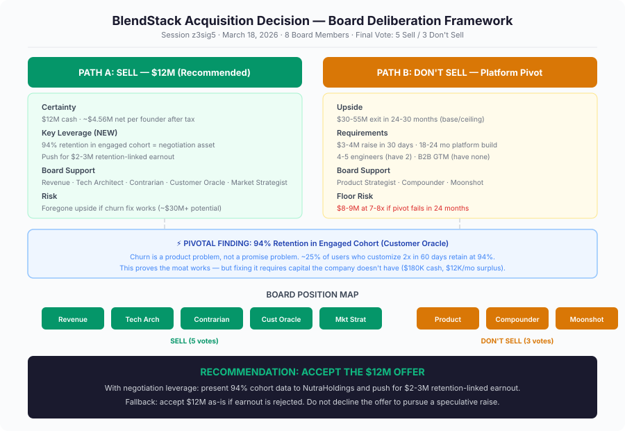

# Board Memo: Should We Take the $12M Acquisition Offer?

**Session:** z3sig5
**Date:** March 18, 2026
**Decision Type:** Irreversible — acquisition exit
**Board Members:** Revenue, Product Strategist, Technical Architect, Contrarian, Compounder, Customer Oracle, Market Strategist, Moonshot
**Final Vote:** 5 Sell / 3 Don't Sell
**Deliberation Time:** 6.6 minutes | Budget: $3.16

---

## Final Recommendation (Ranked)

### 1. Accept the $12M offer — with negotiation leverage (RECOMMENDED)

Take the deal, but walk into the final negotiation armed with the 94% engaged-cohort retention data. Push for a **$2–3M retention-linked earnout** triggered if 12-month post-acquisition subscriber retention hits ≥80% monthly. NutraHoldings, knowing they're acquiring a diagnosed and fixable product problem, should accept aligned incentives. If they reject the earnout structure, accept $12M as-is. **Do not walk away from the offer.**

### 2. Accept the $12M offer as-is (FALLBACK)

If earnout negotiation fails or NutraHoldings signals the offer is at risk, take $12M cash clean. At 11x ARR in a cooling DTC supplement market with decelerating growth, no competing offers, and $180K in the bank, this is a premium exit. Each founder nets approximately **$4.56M after tax** — generational capital that funds the next venture without the leaky bucket underneath.

### 3. Decline and raise $3–4M for platform pivot (MINORITY POSITION)

The Moonshot/Compounder/Product Strategist coalition argued the blend engine data corpus is an infrastructure asset worth 3–5x more in the right buyer's hands, and that a 30-day fundraise sprint is worth attempting before declining. **This path was rejected** — not because the thesis is wrong, but because the execution requirements (18–24 month platform build, 4–5 engineers, B2B GTM from zero, raise closing in 30 days) exceed what the current team and capital base can deliver. The floor risk ($8–9M if the pivot fails) vs. the certain $12M creates unfavorable asymmetry.

---

## Decision Framework

---

## Board Member Stances

| Member | Position | Key Argument | Key Concern |
|--------|----------|-------------|-------------|
| **Revenue** | Sell (unconditional) | 6.1% churn = treadmill math; net subs already shrinking; $12M is peak pricing for a decelerating asset | No capital source named for turnaround |
| **Product Strategist** | Don't sell | 94% cohort proves the fix is known — get users to 2nd blend edit; selling before running the experiment gives away the upside | Needs the retention experiment to run first |
| **Technical Architect** | Sell (conditional) | Blend engine code is rebuildable in 3–6 months; manufacturing process is real moat; platform build is 18–24 months, not 6–9 | Requires 90–180 day knowledge transfer in deal terms |
| **Contrarian** | Sell | "Decline and grow" requires 4+ uncertain conditions to compound favorably; $4.56M net per founder is not a consolation prize | Growth deceleration cause still undiagnosed at macro level |
| **Compounder** | Don't sell | 94% retention proves the flywheel works; selling transfers fixable upside to buyer at maximum weakness | Won't endorse sell until churn classified as product vs. promise |
| **Customer Oracle** | Sell | Proved churn is a product problem (bimodal cohort split); but diagnosis ≠ cure, and $180K can't fund the fix safely | Use 94% cohort data as negotiation leverage, not rejection rationale |
| **Market Strategist** | Sell | DTC supplement consolidation closing the independent exit window; differentiation without distribution is a private secret | Wants diligence on what happened to NutraHoldings' prior 4 acquisitions |
| **Moonshot** | Don't sell | Blend engine data corpus is irreplaceable (18 months of behavioral data); wrong buyer pool — health-tech strategics haven't seen the asset | Requires raise to begin before offer is declined; acknowledges $8–9M floor |

---

## Dissent and Unresolved Tensions

### The dissent is real and should be recorded honestly.

**Moonshot's core thesis was not disproven.** The blend engine's behavioral data corpus — 18 months of real user customization decisions correlated with retention outcomes — is genuinely irreplaceable IP that cannot be rebuilt by a funded competitor in any timeframe. The argument that a health-tech strategic (Hims, Ro, pharma) would price this asset at 3–5x what NutraHoldings is offering is plausible. It was not tested. The sell recommendation is not a claim that $12M is the right price — it is a claim that the path to proving a higher price exceeds the founders' capital, team, and risk tolerance.

**Product Strategist's "experiment first" argument is the most intellectually honest position in the room.** The 94% retention signal is a proof point that the product works when the activation loop fires. Selling before shipping the onboarding fix means transferring a diagnosed, fixable problem to the buyer and letting them capture the upside. This is a real cost. The sell recommendation accepts this cost as the price of certainty.

**Unresolved:** What exactly does NutraHoldings do with acquired brands? Market Strategist raised this and it was never answered. If they harvest IP and kill brands, the team retention packages may be hollow. If they grow them, the earnout becomes more attractive. **This should be diligenced before signing.**

---

## Trade-offs and Risks

| Factor | Sell | Don't Sell |
|--------|------|-----------|
| **Certainty** | $12M cash, 30-day close | Uncertain — depends on raise + execution |
| **Founder outcome** | ~$4.56M net each, immediate | $0 near-term; potential $15–27M each in 30 months |
| **Team** | Retention packages offered | Continued employment, but thin runway |
| **IP fate** | Blend engine absorbed into PE rollup | Potential platform pivot to B2B licensing |
| **Brand** | Likely absorbed, loses identity | Preserved, but growth uncertain |
| **Churn fix** | NutraHoldings fixes it with capital | Founders must self-fund on $12K/mo surplus |
| **Market timing** | Exits during consolidation wave at premium | Risks window closing; future multiple compression |
| **Data asset** | Transferred at DTC valuation | Retained; potential training corpus for behavior-trained model |
| **Downside risk** | Foregone upside (~$30M+ potential) | Floor of $8–9M if pivot fails; $0 if company stalls |
| **Capital requirement** | None | $3–4M raise required immediately |

---

## Next Actions

| # | Action | Owner | Timeline |
|---|--------|-------|----------|
| 1 | **Prepare 94% cohort retention analysis** as formal presentation for NutraHoldings negotiation | CTO + Customer Success | 5 days |
| 2 | **Propose earnout structure** to NutraHoldings: $2–3M additional consideration tied to 12-month post-acquisition retention threshold (≥80% monthly) | CEO + legal counsel | 10 days |
| 3 | **Diligence NutraHoldings' prior acquisitions** — contact founders/teams of the 4 acquired brands, understand brand fate, team retention, IP usage | CEO | 7 days |
| 4 | **Negotiate 90–180 day knowledge transfer period** with explicit documentation milestones for manufacturing process and blend engine architecture | CTO | Included in deal terms |
| 5 | **Secure retention package details** for all 6 team members before signing; ensure terms are explicit and time-bound | CEO + ops manager | 15 days |
| 6 | **If earnout rejected:** accept $12M as-is; do not decline | Founders (joint) | Day 25 (5-day buffer before expiry) |
| 7 | **Document the blend data corpus** as a named, explicitly transferred asset in the purchase agreement; understand NutraHoldings' intended use | Legal counsel | Included in deal terms |

---

## Deliberation Summary

### The Opening Frame

The board convened to decide a binary question: take $12M at 11x ARR from a PE-backed supplement rollup, or bet on independence in a tightening market. The facts were stark — growth decelerating for five consecutive quarters (8.1% → 4.2% MoM), churn at 6.1% against a 4% target, $180K cash with only $12K/month net profit, and no competing offers. The initial round produced a 6-2 lean toward selling, with only Moonshot and Compounder advocating for rejection. The sell camp's argument was simple and brutal: the growth trend has a direction, the churn has no named fix, and $180K is not a war chest — it's a cushion with a slow leak.

### The Moonshot Counterargument

Moonshot mounted the strongest dissent, reframing the decision as a pricing arbitrage problem. The argument: NutraHoldings is pricing BlendStack as a DTC supplement company at 11x, but the blend engine's behavioral data corpus — 18 months of real user customization decisions — is an infrastructure asset that health-tech strategics would price at 3–5x more. Technical Architect pushed back hard: the blend engine code is rebuildable in 3–6 months, the platform build Moonshot envisions would take 18–24 months (not 6–9), and the team lacks the engineers, capital, and B2B experience to execute. Moonshot conceded the code point but held firm on the data — correctly arguing that behavioral data cannot be reconstructed from published science.

### The Pivotal Moment

Customer Oracle reshaped the entire debate in the second round with a cohort analysis that no one else had surfaced. The 8.6-month average subscriber lifetime is a composite hiding a bimodal population: ~25% of users who customize their blend 2+ times in 60 days retain at 94% monthly (~24-month tenure, $750+ LTV), while ~75% churn in months 3–6 without ever re-engaging. This proved churn is a product problem — a fixable onboarding and re-engagement gap — not a promise problem or category ceiling. The personalization thesis works; the product just fails to deliver the activation loop to most users.

### How It Changed the Calculus — and Didn't

Paradoxically, proving the churn is fixable strengthened the sell case more than the hold case. The 94% signal makes the asset more valuable to NutraHoldings (who has the capital to fix onboarding at scale), gives the founders concrete negotiation leverage for an earnout, and makes the "decline and raise" thesis more intellectually defensible — but doesn't solve the execution problem. Technical Architect and Contrarian both noted that diagnosis is not cure: the fix requires capital the company doesn't have, the raise would need to close in 30 days from a cold start, and failure means returning to the acquisition market at a lower multiple with an expired offer. The 94% finding is the strongest argument for negotiating harder, not for walking away.

### The Decision

The board closed 5-3 in favor of selling. The recommendation is to accept the $12M offer but use the newly surfaced cohort data to negotiate a retention-linked earnout of $2–3M, giving founders participation in the upside they built. The dissent — Moonshot, Product Strategist, and Compounder — is recorded with respect. Their core claim (the data asset is underpriced by this buyer pool) is likely correct. The sell recommendation is not a rejection of that thesis. It is a judgment that the path to proving it exceeds the founders' resources, timeline, and margin for error. The $12M is not the ceiling of what this company could be worth. It is the best outcome achievable given what the founders have to work with today.
