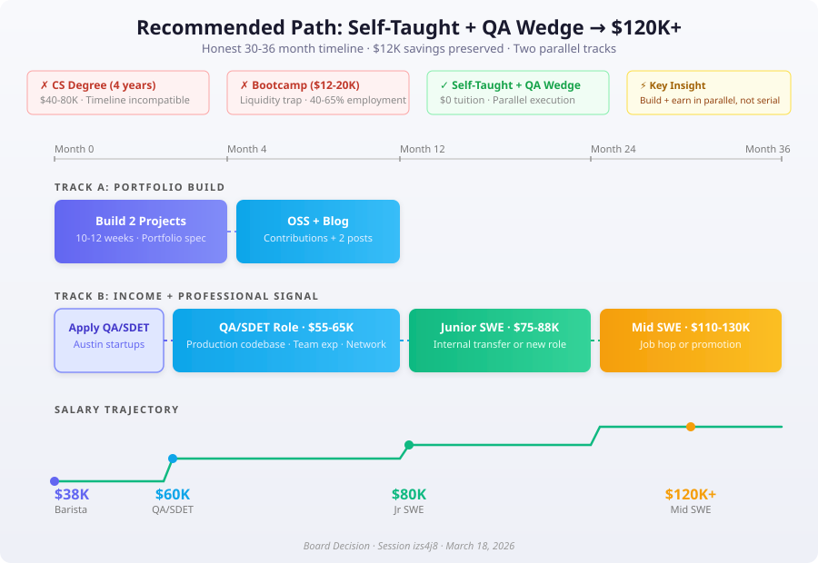

# Board Decision Memo: Fastest Path to a $120K+ Software Engineering Career

**Session:** izs4j8  
**Date:** March 18, 2026  
**Board:** Revenue, Product Strategist, Technical Architect, Contrarian  
**Decision Status:** Unanimous convergence with timeline adjustment  

---

## Final Recommendation

**Path: Structured Self-Taught + QA/SDET Wedge Role — executed in parallel, not sequentially.**

The board unanimously rejected the CS degree and coding bootcamp paths on financial and timeline grounds. The recommended strategy combines portfolio building with an immediate adjacent-role job search to solve the two hardest problems simultaneously: skill credibility and professional signal.

**The honest timeline is 30-36 months to $120K+, not 24.** The board explicitly reframed the target: first engineering income at $75-88K by month 10-14, then compound to $120K+ by month 30-36 through a job change or promotion. This is not a concession — it is the only plan that survives contact with reality.

---

## Ranked Recommendations

### 1. Self-Taught + QA/SDET Wedge (RECOMMENDED)
- **Cost:** $0-2K
- **Time to first engineering income:** 10-14 months
- **Time to $120K+:** 30-36 months
- **Risk:** Requires sustained self-direction and discipline; no structural accountability
- **Why it wins:** Preserves $12K savings, generates income from month 2-4 via adjacent role, builds professional signal and portfolio in parallel

### 2. Bootcamp (Conditional — Recurse Center only)
- **Cost:** Free (Recurse Center) or $12-20K (others)
- **Time to first engineering income:** 8-14 months
- **Risk:** 40-65% employment rate; $12-20K tuition eliminates financial buffer; ISA structure extracts 15% of salary for 2 years
- **When to consider:** Only if after Month 4, application volume is high and interview conversion is zero — meaning professional signal gap is provably blocking. Only Recurse Center (free, prestigious network) makes financial sense.

### 3. CS Degree (REJECTED)
- **Cost:** $40-80K
- **Time to first engineering income:** 4+ years
- **Risk:** Timeline incompatible with 24-36 month goal; opportunity cost exceeds $320K
- **When to reconsider:** Never, given these constraints. A part-time online degree could be pursued *after* employment if credential matters for long-term career ceiling.

---

## The Execution Plan

| Phase | Months | Actions | Target Outcome |
|-------|--------|---------|----------------|
| **Build + Search** | 0-4 | Build 2 portfolio projects to spec; apply to QA/SDET roles at Austin startups; attend meetups weekly | One production-grade project live; QA role secured ($55-65K) |
| **Compound from Inside** | 4-12 | Work QA/SDET; build second project evenings/weekends; OSS contributions; 2 technical blog posts; network inside company | Professional signal accumulated; engineering referral pipeline open |
| **Transition to SWE** | 10-14 | Internal transfer or external application to junior SWE roles at Austin startups (Series A/B) | Junior SWE role ($75-88K) |
| **Reach $120K+** | 24-36 | Ship consistently; develop AI-native workflow; strategic job change or promotion | Mid-level SWE ($110-130K) |

### Portfolio Spec (Non-Negotiable)

**Project A — Backend system with real complexity (8-10 weeks):**
- PostgreSQL with 3+ tables, foreign keys, migrations
- REST API with proper error handling and HTTP status codes
- Background job processing (Redis queue), webhook or external API integration
- 15-20+ meaningful tests (unit + integration)
- GitHub Actions CI pipeline
- README with architecture decisions documented
- Deployed and live

**Project B — AI-native tool (6-8 weeks):**
- Non-trivial LLM API integration (not a chatbot wrapper)
- Example: code review assistant that fetches PR diffs, categorizes issues via structured LLM output, posts formatted comments
- Error handling, rate limiting, streaming
- Basic test coverage on parsing/categorization logic

**Technical blog — 2 posts minimum:**
- Not "what I learned" journaling — genuine technical writing about debugging, architectural decisions, or trade-offs encountered during the build

---

## Board Member Stances

### Revenue
**Position:** Self-taught with ruthlessly structured monetization milestones.  
**Key argument:** The $12K savings means no path can front-load all spend. Bootcamp zeroes the account before month 4 with no cushion for job search. Self-taught keeps $10K+ liquid. Treat the career transition like a product launch with ship dates, not a self-improvement journey.  
**Key concern:** Without hard deadlines and revenue milestones, self-taught degenerates into endless learning.

### Product Strategist
**Position:** Self-taught + adjacent role wedge, with the QA role as the sequencing unlock.  
**Key argument:** The three paths are a false choice — this is a sequencing problem. The QA role solves income, professional signal, network, and production exposure simultaneously. Portfolio gets built against real problems seen at work, creating stronger interview narratives.  
**Key concern:** The adjacent role must not be a trap — must have documented internal transfer path to engineering.

### Technical Architect
**Position:** Self-taught is correct by elimination — the other paths have hard failure modes this person cannot financially absorb.  
**Key argument:** "Self-taught" is an empty box without architecture. Specified the exact portfolio bar a senior engineer scans for in 5 minutes: README quality → test suite → real data layer → CI/CD pipeline. The target company matters as much as the target role — seek strong engineering culture, not highest starting salary.  
**Key concern:** Portfolio building and job searching must be parallel, not sequential. The market provides feedback no amount of solo building can.

### Contrarian
**Position:** The $120K-in-24-months framing is the most dangerous assumption in the room.  
**Key argument:** Forced the board to confront six unexamined assumptions, most critically that the timeline is achievable and that self-taught employment rates are unknown (not just "flexible"). Pre-mortemed all three failure scenarios. Validated adjacent-role wedge but insisted on QA/SDET specifically — tech support and data analyst roles don't compound toward SWE.  
**Key concern:** This person's current learning habits (tutorial consumption, 350 lines of total code) may not predict self-directed execution ability. The plan assumes stronger self-direction than demonstrated.

---

## Dissent and Unresolved Tensions

**No major dissent on path choice.** All four members converged on self-taught + adjacent role. This is unusual — the Contrarian validated the core strategy while stress-testing assumptions.

**Unresolved tension 1: Can this person execute?** The Contrarian flagged that current habits (YouTube tutorials, building along, 350 lines of code total) are consumption-heavy and production-light. The plan requires a fundamental shift to self-directed building. No board member offered a mechanism to ensure this shift happens — it is an assumed behavior change.

**Unresolved tension 2: Timeline honesty.** The brief asks for $120K in 24 months. The board unanimously says 30-36. The gap matters psychologically — if the person expects 24 and experiences 36, they may abandon the plan at month 18. Expectations must be set correctly from day one.

**Unresolved tension 3: QA/SDET availability.** The plan assumes QA/SDET roles at Austin startups are available and accessible to someone with this profile. No market data was presented on QA hiring volume or requirements. This is a plan dependency that hasn't been validated.

---

## Trade-offs and Risks

| Risk | Likelihood | Impact | Mitigation |
|------|-----------|--------|------------|
| Can't land QA/SDET role within 4 months | Medium | Delays income, burns savings | Expand search to remote QA roles; consider contract/freelance for income |
| Portfolio takes longer than 12 weeks | Medium | Delays job applications | Set hard ship dates; accept "good enough" over perfect |
| Self-direction stalls without external structure | Medium-High | Months lost to tutorial loops | Weekly accountability check-ins (find a study partner online); hard deadlines |
| Austin junior market tightens further | Medium | Fewer entry points | Expand geographic search; consider remote-first companies |
| AI tools commoditize current skill set | Low-Medium | Skills become less differentiated | Focus on system thinking and debugging, not just AI-assisted coding |
| QA role becomes a comfort trap | Medium | Never transitions to SWE | Set 12-month hard deadline for transition; start SWE applications at month 10 |

---

## Next Actions (This Week)

| # | Action | Owner | Deadline |
|---|--------|-------|----------|
| 1 | Stop all tutorials immediately. Open a new repository for Project A. | You | Today |
| 2 | Set up PostgreSQL locally and write the initial schema with migrations | You | Day 3 |
| 3 | Create a LinkedIn profile optimized for QA/SDET roles; list current technical skills | You | Day 3 |
| 4 | Identify 10 Austin startups (50-500 employees) with QA/SDET openings | You | Day 5 |
| 5 | Submit first 5 QA/SDET applications | You | Day 7 |
| 6 | Find 2 Austin tech meetups happening this month and RSVP | You | Day 7 |
| 7 | Finish CS50 — set a hard deadline (2 weeks max) | You | Day 14 |

---

## Deliberation Summary

The board convened to evaluate three paths for a 24-year-old barista with $12K savings and 6 months of self-teaching to reach a $120K+ software engineering career. The opening round saw immediate and unanimous elimination of the CS degree — the 4-year timeline and $40-80K cost were arithmetically incompatible with the constraints. The bootcamp was rejected on financial grounds: spending $12-20K on a 40-65% employment probability eliminates the financial buffer entirely, and the ISA alternative extracts $22.5K over two years from a $75K salary. All four members converged on self-taught as the only financially viable path.

The critical pivot came when the Contrarian challenged the room's six unexamined assumptions, most importantly the $120K-in-24-months target itself. Austin junior SWE salaries cap at $95K; $120K requires mid-level compensation, which requires 2-4 years of professional experience. The board recalibrated to a two-phase plan: first engineering income at $75-88K by month 10-14, then compound to $120K+ by month 30-36. This reframe changed the optimization function from "highest starting salary" to "fastest path into a production codebase at a company with strong engineering culture."

The second major innovation was the QA/SDET wedge role, surfaced by the Contrarian and immediately validated by all members. This adjacent role solves four problems simultaneously: income ($55-65K preserves savings), professional signal (a real company on the resume), production codebase exposure, and engineering network access. The board specified that QA/SDET is the only adjacent role that compounds toward SWE — tech support and data analyst roles were explicitly rejected as signal-negative or laterally divergent.

The Technical Architect and Product Strategist jointly specified the portfolio bar: one backend system with real complexity (PostgreSQL, background jobs, webhook integration, test suite, CI/CD) and one AI-native tool demonstrating non-trivial LLM integration. Total build time: 10-12 weeks at 2-3 hours per day. The board insisted on parallel execution — portfolio building and job searching must happen simultaneously, not sequentially. Every final statement from the board carried the same message: stop learning, start building, and start applying today.

The remaining unresolved risk is execution discipline. The current evidence — 350 lines of tutorial-adjacent code, YouTube-heavy learning habits — does not strongly predict the self-directed intensity this plan requires. The plan is sound; the variable is the person. That variable is only tested by starting.

---

*Board deliberation concluded March 18, 2026 · Session izs4j8 · Elapsed: 2.7 min · Cost: $0.42*
