# Board Memo: Fastest Path to a $120K+ Software Engineering Career

**Session:** mjma3a
**Date:** 2026-03-18
**Decision Type:** Career strategy — irreversible resource allocation under constraint
**Board:** Revenue, Product Strategist, Technical Architect, Contrarian, Compounder, Moonshot

---

## Decision Framework

---

## Final Recommendation

### Ranked Paths

| Rank | Path | Verdict | Rationale |
|------|------|---------|-----------|
| **1** | **AI-Native Portfolio Sprint (Structured Self-Taught)** | ✅ Recommended | Preserves $12K as runway, bounded downside, highest optionality, aligned with what 2026 market actually screens for |
| **2** | **Coding Bootcamp (as fallback trigger at month 6)** | ⚠️ Conditional | Only if Sprint stalls — no interviews by month 6. Avoid ISA structure. Pursue only with scholarship or employment-gated payment. |
| **3** | **CS Degree** | ❌ Eliminated | Breaks the 24-month constraint. $40-80K cost is 3-7x available capital. Unanimous reject. |

### The Core Reframe

**The board unanimously agreed that "$120K within 24 months" is the wrong first target.** The realistic path is:

1. **Employed at $75-85K within 12 months** — at a growth-stage Austin startup with mentorship and a promotion track
2. **$100-120K by month 24** — via demonstrated output, promotion, or one strategic job change

The $120K target is a compounding outcome, not a first-job outcome. Optimizing for $120K directly leads to worse decisions than optimizing for "employed and learning in a real codebase fast."

---

## Board Member Stances

| Member | Position | Key Reasoning | Primary Concern |
|--------|----------|--------------|-----------------|
| **Revenue** | Self-taught Sprint | Portfolio is the credential in 2026. $12K is runway, not tuition. 30-day shipping phases create forcing function. | Variance — self-taught has no built-in accountability. Needs hard milestones. |
| **Product Strategist** | Self-taught Sprint | Optimize for trajectory (right company), not speed (any company). First job selection determines whether $120K is reachable. | Landing at the wrong company makes $120K structurally impossible regardless of path. |
| **Technical Architect** | Self-taught Sprint (conditional) | Only works with output-driven milestones, not tutorial consumption. Needs depth wedge, not breadth. | "Structured" is doing too much work — without precise go/no-go criteria, this collapses into tutorial hell. |
| **Contrarian** | Self-taught Sprint (reframed) | Least financial risk. But objective must be reframed to "employed within 12 months" and hard 6-month gate is non-negotiable. | Base rate for this profile reaching $120K in 24 months is likely 10-15%. Market may deteriorate further. The room is selling a narrative. |
| **Compounder** | Self-taught Sprint | Asymmetric downside: Sprint failure leaves $8-10K + portfolio + options. Bootcamp failure leaves $0 + ISA debt + no fallback. Public portfolio signals compound retroactively. | Isolation trap — self-taught without external accountability dies quietly. Needs manufactured forcing functions from day 1. |
| **Moonshot** | AI-Native Portfolio Sprint | Target emerging role categories (AI tools engineer, dev experience) not generic "junior SWE." AI-native habits are already ahead of most bootcamp grads. | Requires accurate self-assessment and relentless self-direction — the one thing no external program can provide. |

---

## Dissent and Unresolved Tensions

### Named Dissent (Contrarian)
> "The base rate for this exact profile — self-taught, no network, 2 CRUD apps, 6 months experience — landing a $120K role within 24 months is almost certainly below 10-15%. If no one can name that number, we are making a major life recommendation on narrative coherence alone."

This was not refuted. The board acknowledged the $120K/24-month target is aspirational, not median. The reframe to "employed at $75-85K within 12 months" partially resolves this, but the Contrarian's deeper point stands: **we don't have base-rate data for this profile's success probability on any path.**

### Unresolved Tensions

1. **Market deterioration risk** — AI tooling caused a 35% drop in junior hiring and the trend is accelerating. The self-taught path takes 6-12 months. The market this person enters may be materially worse than today's. No board member could counter this with data.

2. **"AI-native" as self-teachable skill** — The room assumed AI-native workflows can be learned solo. The Contrarian argued that production-context AI judgment (knowing when AI output is wrong) requires engineering context you can't get from solo projects. This was acknowledged but not resolved.

3. **Network bootstrapping probability** — Every member flagged the network gap as critical. The proposed solution (Austin meetups, open source, cold outreach) is directionally correct but unproven for this specific profile. The person has zero engineering contacts today and no evidence of networking ability.

---

## Trade-offs and Risks

| Risk | Probability | Impact | Mitigation |
|------|------------|--------|------------|
| Tutorial hell / no output | High (if unstructured) | Fatal — 6+ months wasted | Weekly shipped artifacts, public build log, accountability partner |
| Network never materializes | Medium | Severe — no warm intros = no interviews | Austin meetups from week 1, open-source PRs, 10 informational interviews by month 3 |
| Market further deteriorates | Medium | Severe — fewer junior roles available | Target emerging categories (AI tools, dev experience), not generic junior SWE |
| Financial runway exhausted | Low (on Sprint path) | Moderate — forces premature job search | $12K preserved, part-time income continues, $2-4K max Sprint spend |
| Self-assessment is wrong (not close to hireable) | Medium | Moderate — timeline extends | External calibration: mock interview in week 1, open-source PR feedback, 6-month gate |
| Bootcamp fallback fails (if triggered) | Medium | Catastrophic — $0 savings, ISA debt | Only trigger bootcamp with scholarship/no-ISA terms. Consider QA/support roles as alternative on-ramp. |

---

## Next Actions — This Week

| # | Action | Purpose | Cost |
|---|--------|---------|------|
| 1 | Attend one Austin tech meetup in person. Ask 3 engineers: "What would make you refer a junior candidate?" | Network bootstrap + market calibration | $0 |
| 2 | Add test suite to TaskFlow, write a post explaining decisions, publish both | First unit of real signal + closes biggest portfolio gap | $0 |
| 3 | Start a public build log (GitHub, blog, or X) announcing the Sprint and a 6-week ship date for first AI-native project | Public accountability = forcing function | $0 |
| 4 | Book a 1-hour mock technical interview with a working Austin engineer (cold LinkedIn DM or Intro.co) | Honest external calibration of actual gap | $0-100 |
| 5 | Write down the 6-month gate criteria on paper and put it somewhere visible: "If no technical interviews by [date], pivot to bootcamp or adjacent tech role" | Pre-commitment device against indefinite deferral | $0 |

## Next Actions — 90-Day Milestones

| Month | Milestone | Go/No-Go |
|-------|-----------|----------|
| **Month 1** | 1 AI-native project deployed (LLM integration, not CRUD). Public build log active. 3+ meetup connections. | Must have shipped artifact and made 3+ contacts |
| **Month 3** | 1 open-source PR merged. 10 informational interviews completed. Depth wedge chosen (TypeScript + testing + AI integration recommended). Project with test suite + CI. | Must have external code feedback and 10+ contacts |
| **Month 6** | ⚡ **HARD GATE**: Technical interviews scheduled? If YES → continue targeting startups via warm intros. If NO → trigger bootcamp (scholarship/no-ISA only) or take adjacent tech role (QA, support engineering, technical writing) to enter a real codebase. | Binary. No renegotiation. |

---

## Deliberation Summary

The board convened to evaluate three paths for a 24-year-old barista with $12K in savings, 6 months of self-teaching, and a goal of reaching $120K+ in software engineering within 24 months. The CS degree was eliminated by every member before substantive debate — the 4-year timeline and $40-80K cost break the stated constraints on contact. This freed the room to focus on the real decision: bootcamp versus structured self-taught.

The bootcamp case was systematically dismantled across financial, probabilistic, and market-fit dimensions. Revenue and Compounder led the financial argument: spending $12-24K (upfront or via ISA) on a 40-65% employment probability, when $12K is the entire safety net with no family backstop, is a catastrophic-risk bet with no rebuy. Technical Architect and Moonshot attacked the market-fit angle: bootcamps teach 2020-era patterns (write CRUD from scratch) to students entering a 2026 market that values AI-native workflows and independent shipping. The cohort network — often cited as the bootcamp's unique value — was reframed as a peer group of equally inexperienced candidates competing for the same shrinking pool of junior roles, not a network of senior engineers or hiring managers.

The board converged unanimously on the structured self-taught path, but the Contrarian forced a critical reframe that shaped the final recommendation. The $120K/24-month target, when tested against market data (junior SWE tops at $95K in Austin, mid-level requires 2-4 years of employment), is an aspirational outlier — not a median outcome. The Contrarian estimated a 10-15% base rate for this profile achieving it. The board accepted this and reframed the primary objective to "employed and learning in a real codebase within 12 months," with $120K as a compounding outcome achievable through promotion or strategic job change in the following 12 months.

The deepest tension was around execution risk. Every member acknowledged that self-taught without external forcing functions is the #1 failure mode — and this candidate already shows the pattern (YouTube tutorials, building along, no study group, no mentor). The resolution was structural: public build logs, weekly shipped artifacts, a pre-committed 6-month gate with a binary pivot decision, and immediate network-building in Austin's tech ecosystem. Moonshot pushed the room further by arguing the candidate should target emerging role categories (AI tools engineer, developer experience, internal tools) rather than the generic "junior SWE" pool that's down 35%.

The board's final position represents genuine consensus with meaningful dissent preserved: the structured self-taught AI-Native Sprint is the highest-leverage path given the constraints, but it works only with precise milestones, manufactured accountability, and a hard gate that prevents indefinite deferral. The bootcamp remains a live fallback option — not a competitor — to be triggered if and only if the Sprint stalls by month 6.

---

*Memo prepared by CEO / Chief Decider — Session mjma3a*
*Board: Revenue, Product Strategist, Technical Architect, Contrarian, Compounder, Moonshot*
*Deliberation: 3.6 min · $1.24 spent*
