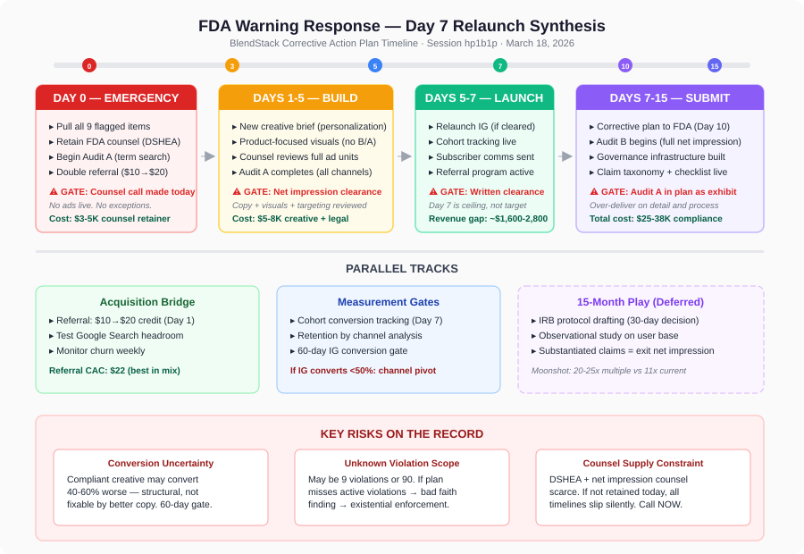

# Board Memo: FDA Warning Letter Response — BlendStack

**Session:** hp1b1p
**Date:** March 18, 2026
**Decision:** How to respond to the FDA warning letter within 15 days while minimizing acquisition disruption
**Status:** DECIDED — Unanimous on tactical path; strategic extension unresolved

---

## Final Recommendation (Ranked)

### 1. Execute the "Day 7 Relaunch" Synthesis (APPROVED — Unanimous)

Pull all flagged content immediately. Retain FDA regulatory counsel today. Counsel reviews complete creative units (copy + visuals + targeting) for net impression compliance. Relaunch with new, personalization-led creative by Day 7 — but only after counsel clearance. Submit corrective action plan by Day 10 with full Audit A results and a committed Audit B timeline.

**Sequencing:**
- **Day 0 (Today):** Pull all 9 flagged items. Retain FDA regulatory counsel on emergency scope ($3-5K). Begin Audit A (flagged-term search across all channels).
- **Days 1-3:** Creative team drafts new brief around personalization engine, not word-swapped versions of flagged ads. Visual direction: product-focused (sachet, ingredient selection UI, stack design flow) — no before/after transformation imagery.
- **Days 3-5:** Counsel reviews complete ad units for net impression compliance. Audit A completes.
- **Days 5-7:** If counsel clears creative → relaunch Instagram. If counsel flags visuals → extend timeline, no override.
- **Days 7-10:** Submit corrective action plan to FDA showing: (a) all flagged content removed Day 0, (b) full Audit A results, (c) governance process for preventing recurrence, (d) named Audit B commitment with completion date.
- **Days 10-15:** Audit B (full net impression review of all channels) runs with compliance consultant.

**Hard gates (non-negotiable):**
1. FDA regulatory counsel retained by end of business today — not tomorrow, not next week.
2. Counsel reviews the full creative unit, not just copy text.
3. If counsel flags visuals as net-impression-non-compliant, relaunch extends. No acquisition pressure overrides this gate.
4. Day 7 is a ceiling, not a commitment.

### 2. Build Compliance Governance Infrastructure (APPROVED — Board consensus)

In parallel with the corrective plan, build the four-layer governance system:
- **Claim taxonomy document** (2 pages — what's permissible under structure/function, what's not)
- **Pre-publish checklist** (3 questions: Does it make a disease/drug claim? Does the net impression imply one? Has the named approver signed off?)
- **Named approver** for any content touching health outcomes
- **Content register** logging what's live, who approved it, and when

This is 4 hours/week of operational overhead. Without it, we are back in this room in 18 months.

### 3. Initiate IRB Protocol Drafting (NOTED — Not formally decided; championed by Moonshot)

Begin scoping an IRB-approved observational study on existing user base. Costs $50-80K over 4-6 months. The board did not reach consensus on this initiative, but Moonshot's argument — that substantiated structure/function claims permanently exit the net impression trap — was not rebutted on the merits. This decision is deferred to a follow-up session within 30 days.

---

## Board Member Stances

| Member | Position | Key Reasoning | Key Concern |
|--------|----------|---------------|-------------|
| **Revenue** | Day 7 relaunch (revised from 48-hr swap) | Revenue gap of ~$1,600-2,800 vs. $13-17K under full pull. Preserves campaign infrastructure, pixel data, algorithm optimization. | Compliant creative may convert 40-60% worse than disease-claim ads — structural, not fixable by better copywriting. Need conversion tracking at relaunch. |
| **Product Strategist** | Day 7 relaunch with new creative brief | Current marketing sells pharmaceutical outcomes for a personalization product. Rebuild around actual differentiator. | If personalization-led creative underperforms permanently, channel mix problem doesn't resolve with compliance investment. Wants 60-day conversion measurement gate. |
| **Technical Architect** | Day 7 relaunch with governance layers | Compliance gate must exist before anything goes live. Audit A (2-3 days) + Audit B commitment in corrective plan. | Governance infrastructure is the only thing that prevents recurrence. Without it, $25-38K compliance spend is a patch on a system that will fail again. |
| **Contrarian** | Conditional support for Day 7 synthesis | Named 8 smuggled assumptions. Forced the room to confront net impression risk, counsel supply constraints, and unknown violation scope. | Counsel availability is a supply constraint, not just a budget line. If the engagement call doesn't happen today, every timeline has already slipped. |
| **Compounder** | Day 7 relaunch (revised from full pull) | Trust accounting: bad faith finding from inadequate response is existential. Counsel review gate converts Option 2 from theater to real compliance. | Full audit may reveal 90 violations, not 9. Submitting a plan that misses active violations = documented bad faith = company-ending enforcement path. |
| **Moonshot** | Day 7 relaunch + initiate clinical moat play | FDA warning reveals structural Instagram vulnerability. Only longitudinal outcome data permanently exits the net impression trap. IRB protocol costs weeks of attention, not cash. | The 15-month window is the consequential decision. Competitors will eventually comply. The question is whether we build assets they can't replicate during the gap. |

---

## Dissent and Unresolved Tensions

### Resolved
- **Option 2 vs. Option 1:** Revenue's original 48-hour swap was challenged by Contrarian on net impression grounds. Revenue conceded and accepted the counsel review gate. Compounder dropped the "red line" against Option 2 once counsel review was added. The room converged on a 7-day timeline with hard compliance gates.
- **Audit scope:** Technical Architect provided concrete estimates (Audit A: 2-3 days, Audit B: 5-10 days). Room agreed to include Audit A results in corrective plan with Audit B commitment.

### Unresolved
1. **Compliant creative conversion rates:** Nobody knows what personalization-led, structure/function Instagram ads convert at. Revenue flagged this as the unpriced risk. Product Strategist wants a 60-day measurement gate. This is the scenario where the Day 7 relaunch "succeeds" technically but fails economically — and the channel diversification question becomes urgent, not strategic.
2. **Instagram subscriber LTV vs. referral LTV:** Product Strategist hypothesized Instagram-acquired subscribers churn faster due to outcome-claim marketing self-selecting for churn-prone users. No data exists to confirm or deny. If true, the "38% acquisition loss" framing overstates the actual value at risk. If false, the full revenue impact stands.
3. **Clinical moat play (IRB study):** Moonshot's strongest argument — that substantiated claims permanently exit the net impression trap — was acknowledged but not decided. The $50-80K cost against $180K cash reserves is the constraint. Deferred to a 30-day follow-up.
4. **FTC co-referral risk:** Contrarian flagged that FDA and FTC co-refer supplement marketing cases. This risk was named but not priced or planned for. Legal counsel should advise on FTC exposure as part of the engagement.

---

## Trade-offs and Risks

| Trade-off | Accepted | Rejected | Rationale |
|-----------|----------|----------|-----------|
| 7-day acquisition gap vs. 48-hour gap | 7-day gap | 48-hour unreviewed swap | Net impression risk on unreviewed creative = potential bad faith finding. 4 additional days of downtime (~$800 in new MRR) is trivial against existential enforcement risk. |
| New creative brief vs. word-swap | New brief | Word-swap | Word-swapped ads with same visuals carry net impression liability. Personalization-led creative is structurally different and aligns with actual product differentiator. |
| $3-5K emergency counsel engagement vs. using existing legal | Emergency engagement | Existing counsel only | FDA regulatory counsel with DSHEA and net impression experience is not optional. General counsel cannot certify net impression compliance. |
| Submit Day 10 vs. Day 15 | Day 10 target | Using full window | Earlier submission signals seriousness. Leaves buffer if audit reveals scope expansion. |
| Governance overhead (4 hrs/week) vs. no process change | Governance built | Status quo | Without prevention infrastructure, compliance spend is a one-time patch. The system will produce violations again. |

| Risk | Likelihood | Impact | Mitigation |
|------|-----------|--------|------------|
| Compliant creative converts 40-60% worse | Medium-High | High — channel produces 20-25 subs/month instead of 46 | 60-day conversion measurement gate. Pre-agree decision rule on channel mix if numbers don't recover. Activate referral scaling ($20 credit) immediately. |
| Audit reveals 30+ additional violations | Medium | High — corrective plan scope expands, timeline may extend | Audit A starts Day 0, results in plan. Honest scoping in submission. |
| Counsel unavailable on 48-hour notice | Low-Medium | High — all timelines slide | CEO makes engagement call today, before end of business. Not assigned — made. |
| FDA finds Day 7 creative non-compliant | Low (with counsel review) | Very High — bad faith finding | Hard gate: no relaunch without written counsel clearance on full creative unit. |
| FTC co-referral inquiry | Low-Medium | High — civil penalties, parallel enforcement | Include FTC exposure assessment in counsel engagement scope. |

---

## Next Actions

| Action | Owner | Deadline | Dependencies |
|--------|-------|----------|--------------|
| Pull all 9 flagged content items | Marketing lead | Today (Day 0) | None |
| Retain FDA regulatory counsel (DSHEA + net impression experience) | CEO | Today (Day 0) | Phone call before end of business |
| Begin Audit A — flagged term search across all channels | Marketing lead + ops | Day 0-3 | Counsel provides flagged terms list Day 1 |
| Draft new creative brief (personalization-led, product-focused visuals) | Content team | Day 1-3 | None |
| Counsel reviews full creative units (copy + visuals + targeting) | FDA counsel | Day 3-5 | Creative drafts complete |
| Double referral incentive from $10 to $20 | Marketing lead | Day 1 | None |
| Relaunch Instagram with counsel-cleared creative | Marketing lead | Day 5-7 (ceiling, not commitment) | Written counsel clearance |
| Submit corrective action plan to FDA | CEO + counsel | Day 10 | Audit A results, governance plan |
| Build compliance governance infrastructure (taxonomy, checklist, approver, register) | Ops lead | Day 15 | Claim taxonomy from counsel |
| Instrument cohort-level conversion tracking by acquisition channel | Product/eng | Day 7 (relaunch) | None |
| Begin Audit B (full net impression review, all channels) | Compliance consultant | Day 10-20 | Consultant retained |
| Proactive subscriber communication ("why we updated our messaging") | Customer success | Day 3-5 | Messaging approved by counsel |
| Schedule follow-up board session on IRB study / clinical moat play | CEO | Within 30 days | Corrective plan submitted |

---

## Decision Architecture

---

## Deliberation Summary

The board convened to address a 15-business-day FDA compliance deadline that threatened 38% of BlendStack's new subscriber acquisition. The opening round revealed a sharp fault line: Revenue and Moonshot advocated keeping Instagram ads live with swapped compliant copy (Option 2), while Compounder called that approach a "red line" and Contrarian refused to endorse any path until prerequisite questions were answered — specifically whether FDA regulatory counsel was retained, whether the full violation scope was known, and whether the FTC co-referral risk had been priced.

The pivotal moment came when the Contrarian introduced the net impression argument: the FDA evaluates the totality of an ad — visuals, copy, targeting, context — not just the text. A before/after image of a stressed person becoming calm, even with compliant copy like "supports a calm mood," could still constitute an implied disease claim. Revenue acknowledged this was a legitimate hit and revised their timeline from 48 hours to 7 days, adding a regulatory counsel review gate. This concession unlocked Compounder's conditional support, collapsing the fault line.

The room then converged rapidly on a synthesis: pull all flagged content Day 0, retain FDA regulatory counsel the same day, have counsel review complete creative units by Day 5, relaunch with new personalization-led creative by Day 7 (contingent on clearance), and submit the corrective action plan by Day 10. Technical Architect anchored the audit timeline (2-3 days for term search, 5-10 days for full net impression review) and insisted on building governance infrastructure — claim taxonomy, pre-publish checklist, named approver, content register — to prevent recurrence.

Two tensions remained unresolved. First, nobody could estimate what compliant Instagram creative actually converts at — Revenue flagged this as the largest unpriced risk, and Product Strategist requested a 60-day measurement gate with a pre-agreed decision rule. Second, Moonshot pressed hard for initiating an IRB-approved observational study as the only mechanism that permanently exits the net impression trap through substantiated claims. The argument was strong on the merits but the $50-80K cost against $180K cash reserves kept it from reaching consensus. It was deferred to a 30-day follow-up session.

The decisive factor in this deliberation was the Contrarian forcing the room to reckon with the net impression standard. Without that intervention, Revenue's 48-hour swap would have been the consensus path — and it would have been the highest-risk option on the table. The final synthesis is slower by 4 days but categorically safer, and it positions BlendStack to submit a corrective action plan that demonstrates genuine understanding of the violation, not just speed of remediation.
