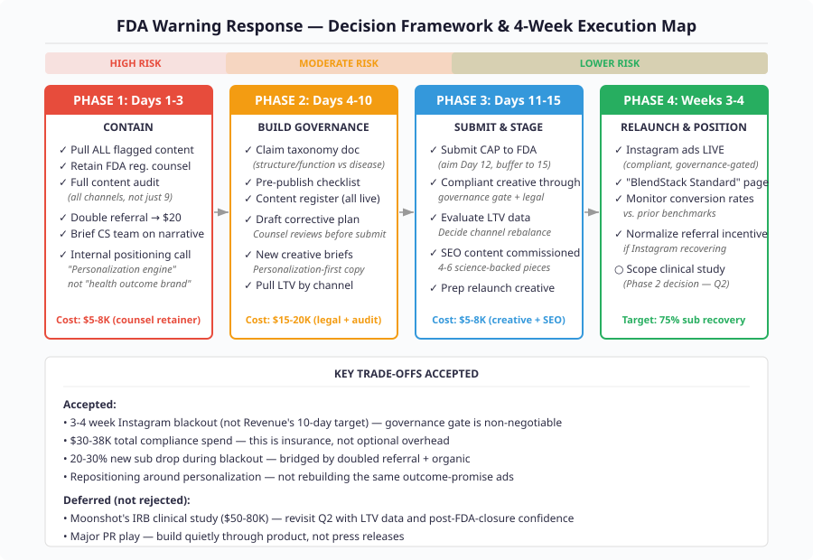

# CEO Decision Memo — FDA Warning Letter Response

**Session:** huj4cc  
**Date:** 2026-03-18  
**Decision:** How to respond to the FDA warning letter without killing growth  
**Status:** DECIDED  

---

## Final Recommendation (Ranked)

### 1. Contain & Comply — Full Pull, Full Audit, Governance-First (PRIMARY)

Pull all flagged content on Day 1. Retain FDA regulatory counsel (not a generalist) immediately. Execute a complete content audit across every customer-facing touchpoint — not just the 9 cited claims — within 72 hours. Build a lightweight compliance governance gate (claim taxonomy, pre-publish checklist, content register) before any new creative goes live. Submit corrective action plan by Day 12. Relaunch compliant Instagram ads in weeks 3-4 after passing through the governance gate.

**Why this wins:** The board was unanimous that the FDA response cannot be half-measures. The Technical Architect's argument that governance must precede any creative relaunch was the strongest structural insight: re-violating during the corrective action window converts a warning letter into an injunction. Revenue's 10-day relaunch target was rejected as taking on unacceptable tail risk. The 3-4 week timeline accepts a larger acquisition gap in exchange for zero probability of the existential outcome.

### 2. Reposition Around Personalization Engine (CONCURRENT)

Use this forced pause to shift marketing language from health outcome claims to product differentiation claims: personalization, combination safety, ingredient transparency. This is structurally compliant (product claims, not disease claims) and more differentiating than compliant versions of the old ads.

**Why this matters:** Product Strategist's argument was decisive — "reduces anxiety → supports a calm mood" is table stakes. "The only supplement company that won't let you build a stack that harms you" is a genuine moat. Rebuilding the same marketing machine in sanitized language is the most expensive possible version of doing nothing.

### 3. Defer Clinical Study to Q2 Decision (STAGED)

Moonshot's IRB observational study proposal ($50-80K) is the right long-term play but the wrong timing. With $180K cash and $30-38K in immediate compliance costs, committing another $50-80K before we have (a) LTV data by channel, (b) conversion rate signal on compliant creative, and (c) FDA closure confidence is premature. Scope the study in weeks 3-4. Make the funding decision in Q2.

**Why defer, not reject:** The clinical credibility white space is real. No DTC supplement company has moved there. But the Contrarian's point holds: we can't compound from a consent decree. Sequence matters — survive first, then differentiate.

---

## Decision Framework

---

## Board Member Stances

| Member | Position | Key Reasoning | Primary Concern |
|---|---|---|---|
| **Revenue** | Relaunch Instagram in 10-14 days via parallel workstreams | Every week dark costs ~$4K in lost ARR; the copy changes are "an afternoon" not 6 weeks | Letting legal process create unnecessary delay in revenue recovery |
| **Product Strategist** | Posture C — reposition first, rebuild second | The flagged claims were a symptom of misaligned positioning; build around personalization engine | Restoring volume before pulling LTV data by channel leads to expensive repetition |
| **Technical Architect** | Build compliance governance pipeline before any creative goes live | No governance gate = guaranteed re-violation; the system failed, not the copywriter | Premature relaunch without process creates existential enforcement risk |
| **Contrarian** | Retain FDA regulatory counsel; treat as 3-12 month process | 7 unstated assumptions; compliance is not a moat; need conversion data before planning recovery | Room is pricing enforcement risk at zero and treating 15-day deadline as the finish line |
| **Compounder** | Pull everything Day 1; trust is the real currency | Full audit scope (not just 9 claims); $38K is insurance premium, not crisis cost | Board treating acquisition gap as the crisis while minimizing regulatory risk |
| **Moonshot** | Use FDA letter as pivot point toward clinical-grade evidence platform | IRB observational study creates 3-5 year lead; compliance alone is table stakes | Thinking too small — returning to baseline is the most expensive mistake |

---

## Dissent & Unresolved Tensions

### Revenue vs. Technical Architect (UNRESOLVED — decided by CEO)
Revenue argued for 10-14 day Instagram relaunch with parallel workstreams. Technical Architect insisted governance gate must exist first, supporting a 6-8 week timeline. **CEO decision: 3-4 weeks.** A lightweight governance gate (2-page claim taxonomy + checklist + lawyer sign-off) is sufficient for first relaunch. It does not require an enterprise system. But it must exist before ads go live. This splits the difference but leans toward Technical Architect's constraint.

### Compliance as Moat (PARTIALLY RESOLVED)
Contrarian argued compliance is not a moat — following federal law isn't differentiation, and competitors copy compliant language in 90 days. Product Strategist and Compounder argued the moat is deeper: it's credibility + product transparency + first-mover positioning. **Resolution:** Compliance alone is not a moat. Compliance + repositioning around personalization + ingredient transparency library = defensible differentiation. The moat is not "we have compliant ads." The moat is "we built trust infrastructure that compounds."

### Clinical Study Timing (DEFERRED)
Moonshot pushed for immediate IRB study scoping ($50-80K). Contrarian and Compounder flagged cash position risk. **Deferred to Q2.** This is a Phase 2 decision contingent on: FDA closure trajectory, LTV channel data, and compliant creative conversion rates.

### LTV by Channel (DATA NEEDED)
Product Strategist flagged this repeatedly: if Instagram-acquired subscribers have 40-50% the LTV of referral subs, the "38% acquisition loss" is a volume story, not a revenue story. **This data must be pulled in Phase 2 (Days 4-10) and presented before any channel rebalancing budget is committed.**

---

## Trade-offs & Risks

| Trade-off | What We Accept | What We Gain | Risk Level |
|---|---|---|---|
| 3-4 week Instagram blackout | ~$8-12K in lost new ARR potential | Zero chance of re-violation during CAP window | LOW (survivable) |
| $30-38K compliance spend | 17-21% of cash reserves | Clean FDA relationship + governance infrastructure | LOW (insurance) |
| Slower relaunch than Revenue wants | 2 extra weeks of acquisition softness | Governance gate prevents existential repeat violation | LOW-MED |
| Repositioning creative (not just rewording) | Longer creative development cycle | Durable differentiation beyond compliant language | MED (unproven) |
| Deferring clinical study | Miss potential first-mover window by 1 quarter | Preserve cash for compliance + survival margin | MED (reversible) |
| NOT expanding to influencer channel | Miss some gap-fill volume | Avoid $110 CAC (worst channel) during cash-sensitive period | LOW |

---

## Next Actions

| Action | Owner | Deadline | Cost |
|---|---|---|---|
| Pull all 9 flagged content pieces | Marketing lead | Day 1 (today) | $0 |
| Retain FDA regulatory counsel (supplement enforcement specialist) | CEO | Day 1 (today) | $5-8K retainer |
| Full content audit — all channels, all touchpoints | Marketing + Legal | Day 3 | Included in counsel |
| Double referral incentive to $20 | Marketing lead | Day 3 | ~$2-4K/mo incremental |
| Brief CS team on subscriber-facing narrative | CS lead | Day 3 | $0 |
| Build claim taxonomy + pre-publish checklist | Legal counsel + Marketing | Day 7 | Included in counsel |
| Pull LTV data by acquisition channel | Data/Analytics | Day 7 | $0 |
| Draft corrective action plan | FDA regulatory counsel | Day 10 | Included in counsel |
| New creative briefs (personalization-first positioning) | Marketing + Product | Day 10 | $0 |
| Submit corrective action plan to FDA | FDA regulatory counsel | Day 12 | Included in counsel |
| Compliant creative through governance gate | Marketing + Legal | Day 18-21 | $5-8K creative costs |
| Instagram ads relaunch | Marketing lead | Day 21-28 | Existing ad budget |
| "BlendStack Standard" transparency page | Product + Marketing | Day 28 | $0 |
| Commission 4-6 SEO science-backed articles | Content team + freelancer | Day 14 | $3-5K |
| Scope IRB observational study (proposal only) | CEO + external CRO | Week 4 | $0 (scoping only) |
| Ongoing: compliance consultant retainer | CEO | Monthly from Day 15 | $3-5K/mo |

**Total estimated cost: $30-42K (one-time) + $3-5K/month ongoing**

---

## Deliberation Summary

The board convened around a deceptively simple question — how to respond to an FDA warning letter — that quickly revealed itself as a strategic identity decision for BlendStack. All six members achieved immediate consensus on the non-negotiable first move: pull all flagged content on Day 1 and retain FDA regulatory counsel (not a generalist) immediately. The Contrarian's insistence on specialized counsel and the Compounder's framing of compliance spend as "insurance we should have been paying from day one" anchored the room early and prevented any temptation to negotiate with the timeline.

The sharpest disagreement emerged between Revenue and the Technical Architect on relaunch timing. Revenue argued the copy changes are trivial — "reduces anxiety" becomes "supports a calm mood" — and pushed for a 10-14 day Instagram recovery with parallel workstreams. The Technical Architect countered that the root cause was not bad copy but a missing compliance governance pipeline, and that any creative launched without a governance gate during the corrective action window creates the single worst outcome: repeat violation signaling bad faith to the FDA. This was the central tension of the deliberation and the one I had to resolve by executive decision. The 3-4 week timeline accepts Revenue's point that the governance gate needn't be enterprise-grade while honoring the Technical Architect's non-negotiable that it must exist before ads go live.

Product Strategist introduced the most consequential reframe: the flagged claims weren't just non-compliant — they were symptoms of misaligned positioning. BlendStack's actual differentiator (personalization engine, combination safety validator) has never appeared in its marketing. Rebuilding the same outcome-promise ads in softer language is a missed opportunity. This argument won. The creative rebuild will center on product differentiation, not sanitized health claims. The Contrarian's challenge — that "compliance as moat" is overstated because following federal law isn't proprietary — was partially absorbed: compliance alone is not a moat, but compliance + transparency infrastructure + repositioning creates defensible ground.

Moonshot pushed the most ambitious play: an IRB-approved observational study using BlendStack's existing user cohort to generate the first real evidence base in consumer supplements. The vision is compelling and the white space is real. But at $50-80K against $180K cash with $30-38K in immediate compliance costs, the timing is wrong. This was deferred to Q2, contingent on FDA closure trajectory and LTV data. The Compounder's closing statement captured the sequencing logic: "You cannot compound from a consent decree." Survive, stabilize, then differentiate.

The most important unresolved data point — LTV by acquisition channel — was flagged by Product Strategist and must be pulled by Day 7. If Instagram-acquired subscribers churn at materially higher rates than referral-acquired subscribers, the urgency (and budget) allocated to restoring Instagram volume should be cut significantly. This single number may change the entire channel strategy going forward.

---

*Decision made by CEO. Dissent recorded. Execution begins today.*
