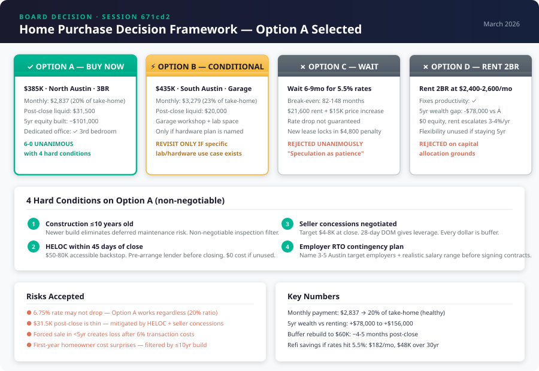

# Board Decision Memo — Home Purchase & WFH Infrastructure
**Session:** 671cd2 · **Date:** March 18, 2026 · **Duration:** ~12 min · **Cost:** $3.91

---

## Final Recommendation

**Buy Option A — $385K, 3BR/2BA, North Austin — now, at 6.75%, with four hard conditions.**

The board voted **6-0 in favor of Option A** with no dissent on the core decision. All members converged after two rounds of deliberation. The Contrarian tested five embedded assumptions, accepted the capital allocation rebuttal, and endorsed Option A with conditions.

### Ranked Options

| Rank | Option | Verdict | Rationale |
|------|--------|---------|-----------|
| **1** | **Option A — Buy $385K now** | **Selected** | Best risk-adjusted capital allocation. 20% housing ratio, dedicated office, $78-156K 5yr wealth advantage over renting. |
| **2** | Option B — Buy $435K now | Conditional hold | Only revisit if a specific hardware/lab project is named. $20K post-close buffer fails stacking test otherwise. |
| **3** | Option D — Rent 2BR | Rejected | Fixes productivity but costs $60-78K in foregone wealth over 5 years. Flexibility premium unused for a 5yr+ Austin commitment. |
| **4** | Option C — Wait for 5.5% | Rejected | Break-even on waiting is 82-148 months. $21,600 in rent + $15K price appreciation vs. $182/mo rate savings. "Speculation dressed as patience." |

---

## Four Hard Conditions (Non-Negotiable)

These are not suggestions. They are requirements the board agreed must be met for Option A to hold.

1. **Construction age ≤10 years.** Homes built 2015 or later have dramatically lower first-year maintenance costs ($1-3K vs $5-15K). This single filter eliminates the repair shock scenario that makes $31.5K inadequate. If the best available property is older, get an expanded pre-purchase inspection with a written contractor estimate of 5-year maintenance costs.

2. **HELOC within 45 days of close.** Pre-arrange a lender before closing day. A HELOC on $385K with 20% equity provides $50-80K in accessible backstop at $0 cost if unused. This transforms the buffer from $31.5K flat to $81-111K accessible. The stacking scenario (concurrent job disruption + major repair) is survivable with this in place.

3. **Seller concessions at negotiation.** Target $4,000-8,000 in concessions applied to closing costs. In a market with 28-day DOM (down from 42), sellers have motivation. Every dollar recovered at the table goes directly to the post-close buffer — the single variable the entire board flagged as the weakest point.

4. **Employer RTO contingency plan — written, before contracts.** Name 3-5 specific Austin-based employers that would be targets if current employer mandates return-to-SF. Include realistic salary ranges and estimated time-to-offer. This is the tail risk that turns a sound purchase into a forced sale under duress. It must be managed, not assumed away.

---

## Decision Framework

---

## Board Member Stances

| Member | Position | Key Argument | Key Concern |
|--------|----------|-------------|-------------|
| **Revenue** | Option A | The 5-year wealth gap vs. renting ($78-156K) closes the case. Productivity is the argument for leaving the 1BR; capital allocation is the argument for buying. | $31.5K post-close survives isolated shocks but fails stacked ones. Every dollar in seller concessions matters. |
| **Product Strategist** | Option A | Reframed as "own vs. rent the workflow." Buy decision is about capital deployment, not just office space. Seller concessions solve the buffer without delaying close. | Employer RTO mandate + job transition is the compound scenario that breaks Option A. Demands written contingency plan. |
| **Technical Architect** | Option A | Applied 3am test, scale cliff test, rewrite horizon. Option A's failure modes cluster in low-probability zones. The 20% housing ratio means the refi is pure upside, not load-bearing. | Construction age is the execution-level variable that determines whether $31.5K is adequate or dangerously thin. Non-negotiable filter. |
| **Contrarian** | Option A (with conditions) | Named 5 smuggled assumptions. Strongest contribution: Option D also solves productivity — the buy case rests on capital allocation, not office space. Forced the room to strengthen its reasoning. | Holding horizon was never stated. A forced sale in years 2-4 creates a loss after 6% transaction costs. Wants 5yr+ commitment on record. |
| **Compounder** | Option A | The compound wealth argument is the strong one: fixed mortgage vs. escalating rent, equity accumulation, appreciation capture. HYSA rates will fall with the same Fed cuts that lower mortgage rates. | Originated the HELOC solution. Initially proposed a 60-day delay, then withdrew it when inventory risk was quantified. The HELOC is the answer to buffer adequacy. |
| **Moonshot** | Option A (yielded from B) | Argued Option B's garage is a career platform, not a feature. Proved co-working workshop pricing in Austin ($400-500/mo) nearly eliminates the monthly delta. Conceded that without a named hardware project, Option A is correct. | Option B should be revisited if a hardware/lab ambition surfaces. The decision log should note Option B was declined on liquidity grounds, not strategic ones. |

---

## Dissent and Unresolved Tensions

### Resolved Tensions
- **Option D vs. Option A on productivity:** The Contrarian correctly identified that Option D also provides a dedicated office. The board resolved this by separating the productivity argument (applies to leaving the 1BR) from the capital allocation argument (applies to buying vs. renting). Revenue quantified the gap at $78-156K over 5 years.
- **60-day delay vs. inventory risk:** Compounder proposed delaying close by 60 days to build buffer. Technical Architect and Product Strategist showed the net buffer improvement is only ~$2,800 after rent costs, while inventory risk in a 28-day DOM market is material. Resolved by: HELOC + seller concessions achieve the same goal without the delay.
- **Refi dependency:** The Contrarian flagged that "buy now, refi later" treats the rate drop as load-bearing. Technical Architect defused this: at 20% housing cost ratio, Option A works permanently at 6.75%. The refi is upside, not thesis.

### Unresolved Tensions
- **Holding horizon commitment.** The Contrarian's strongest surviving point: every buy-vs-rent argument assumes 5+ years in Austin. A sale in years 2-4 creates a net loss after 6% transaction costs and minimal equity accumulation. This assumption was never explicitly stated or committed to in the brief. **Action required: state the holding horizon before closing.**
- **Option B revisit trigger.** Moonshot conceded Option A but established that if a hardware/lab project is named, Option B's premium nearly disappears after realistic co-working pricing. The board did not resolve *when* or *how* to revisit this. **Action required: set a 6-month check-in to evaluate whether lab infrastructure needs have materialized.**

---

## Trade-offs and Risks

| Risk | Probability | Severity | Mitigation | Status |
|------|------------|----------|------------|--------|
| Rates stay at 6.75%+ through 2028 | 35-45% | Low | Option A works at 6.75% permanently. 20% housing ratio. Refi is upside, not requirement. | Accepted |
| First-year repair shock ($5-15K) | 25-40% (age-dependent) | Medium | Construction ≤10yr filter + pre-purchase inspection + HELOC backstop | Mitigated |
| Concurrent job loss + repair event | 5-10% | High | HELOC provides $50-80K accessible. Austin job market supports 3-5 month placement for senior engineers. | Mitigated |
| Employer RTO mandate | 10-20% | High | Written contingency plan with named Austin employers required before contracts. | Requires action |
| Austin price depreciation (5-8%) | 15-25% | Medium | At 6.75%, year 1-2 principal paydown is $8,700. A 5% decline (-$19K) creates negative equity. Only matters if selling. | Accepted (hold 5yr+) |
| Forced sale in years 2-4 | 5-15% | High | 6% transaction costs + minimal equity = net loss. Mitigated only by holding 5+ years. | Accepted with caveat |

---

## Next Actions

| # | Action | Owner | Deadline |
|---|--------|-------|----------|
| 1 | **State holding horizon commitment** — confirm 5+ year Austin intention on record | Buyer | Before offer |
| 2 | **Write employer RTO contingency plan** — name 3-5 Austin employers, salary ranges, time-to-offer estimates | Buyer | Before contracts signed |
| 3 | **Engage buyer's agent** with specific filter: North Austin, 3BR, $350-400K, built 2015 or later, fiber internet available | Buyer | This week |
| 4 | **Pre-qualify HELOC lender** — identify a lender that allows HELOC application within 30-45 days post-close | Buyer | Before close |
| 5 | **Negotiate seller concessions** — target $4-8K applied to closing costs; use 28-day DOM trend as leverage | Buyer's agent | At offer |
| 6 | **Order expanded pre-purchase inspection** — specifically scope HVAC, roof, foundation, plumbing with written 5yr maintenance estimate | Buyer | During due diligence |
| 7 | **Budget $3,350 for WFH setup** — standing desk, Aeron, triple monitors, acoustic treatment. Order day of close. | Buyer | Close day |
| 8 | **Set 6-month check-in** — evaluate whether hardware/lab ambitions warrant revisiting Option B or adding co-working | Buyer | September 2026 |

---

## Deliberation Summary

The board convened to stress-test a proposed home purchase for a senior remote software engineer in Austin, TX. The brief presented four options ranging from buying now at 6.75% to waiting for projected rate drops to continuing to rent. The proposed direction — Option A at $385K with a plan to refinance later — was the starting point, and the board was asked to find the flaws.

**Round 1** produced an immediate and strong consensus around Option A, with five of six members endorsing it and Moonshot making a spirited case for Option B ($435K with garage workshop). Revenue demolished Option C's rate-waiting thesis with break-even math showing 82-148 months to recoup the cost of waiting. The Contrarian delivered the room's sharpest contribution: five assumptions smuggled into the Option A framing, the most dangerous being Assumption ⑤ — that only buying solves the productivity problem, when renting a 2BR achieves the same result. This forced the entire room to separate the productivity argument from the capital allocation argument, which ultimately strengthened the case for buying.

**Round 2** resolved the key tensions. Revenue and Compounder quantified the 5-year wealth gap between buying and renting at $78,000-$156,000, establishing that the buy case rests on capital allocation, not office space. The Compounder withdrew a proposed 60-day close delay after the room showed the net buffer improvement was only $2,800 against material inventory risk, and instead originated the HELOC solution — a $50-80K accessible backstop at zero cost if unused. Product Strategist contributed the seller concessions mechanism as the right way to improve the post-close buffer without delaying. Moonshot conceded Option B's financial case but proved that Austin co-working workshop pricing ($400-500/mo) nearly eliminates the monthly delta — establishing that Option B should remain in the decision log for potential future revisit.

**The Contrarian's strongest surviving point** — that the holding horizon was never explicitly stated despite being the load-bearing assumption for every buy-vs-rent calculation — remains unresolved and is captured as a required action before closing. The board's final vote was unanimous: Option A with four hard conditions that transform a tight-but-workable financial position into a robust one.

---

*Decision rendered by CEO / Chief Decider · Session 671cd2 · Board: Revenue, Product Strategist, Technical Architect, Contrarian, Compounder, Moonshot*
