# Board Memo: Home Purchase Decision for Remote Engineer

**Session:** uxjhib
**Date:** March 18, 2026
**Board Members:** Revenue, Product Strategist, Technical Architect, Contrarian, Compounder, Moonshot
**Decision:** **Buy Option A — $385K 3BR/2BA in North Austin — with three mandatory conditions**

---

## Final Recommendation (Ranked)

### 1. ✅ Option A: Buy $385K Home in North Austin — NOW
- **Monthly cost:** $2,837 (20% of take-home — healthy ratio)
- **Post-close savings:** $31,500 (thin but survivable with conditions)
- **Why:** Starts equity compounding immediately (~$18,700 Year 1 wealth creation), solves office problem, positions for refinance when rates drop. 5-year wealth advantage over renting: ~$44,000.
- **Conditions (mandatory, not optional):**
  1. Have an explicit, documented conversation with employer confirming remote permanence **before signing**
  2. Open a HELOC within 30 days of close ($50-80K standby at $0 carry cost)
  3. Commit to 12-month liquidity rebuild: stage WFH setup spending, bank first RSU vest, target $50K+ in reserves by month 12

### 2. ⚡ Option D: Rent 2BR — FALLBACK
- **Monthly cost:** $2,400-$2,600
- **When this becomes the answer:** If RTO probability exceeds 30%, if employer conversation is ambiguous, or if the engineer cannot commit to the 12-month savings rebuild discipline
- **Why it's not #1:** $15,440/year wealth gap vs. Option A. HYSA at 4.8% cannot compete with leveraged real estate appreciation in a tightening Austin market.

### 3. ✗ Option C: Wait for Rate Drop — ELIMINATED
- **Why:** 4% annual price appreciation + 9 months of rent ($21,600) produces a 7-year break-even against projected rate savings. Post-close reserves (~$10,700) are worse than any other option. Rate speculation with asymmetric downside.

### 4. ✗ Option B: Buy $435K in South Austin — ELIMINATED
- **Why:** $20,000 post-close reserves is below every safety floor. One major repair event puts the engineer in financial distress. The garage is a lifestyle feature, not a financial justification.

---

## Decision Matrix

---

## Board Member Stances

| Member | Position | Core Reasoning | Key Concern |
|--------|----------|---------------|-------------|
| **Revenue** | Option A | Leverage math wins — 24% return on $77K down payment in Year 1 via appreciation + principal. The wealth gap over renting is $18,700/year. | Anyone advocating D must name a specific employment risk, not a vibe. |
| **Product Strategist** | Option A | 3.7x wealth creation advantage over D. Productivity argument is identical across A and D — don't use it to justify buying. | RTO is the only variable that changes the answer. Needs a number, not a narrative. |
| **Technical Architect** | Option A (conditional) | Systems resilience framing — $31.5K is in "warning zone," not "critical." Self-corrects in 2.4 months if hit. | Stage WFH setup: buy chair + desk first ($1,450), defer monitors + panels ($1,900) until buffer rebuilds. |
| **Contrarian** | Option A (conditional) | Narrowly wins on expected value even at 22% RTO probability. But the room is smuggling in 8 unexamined assumptions. | RTO risk is completely unmodeled. Employer conversation is a precondition, not a recommendation. |
| **Compounder** | Option A (conditional) | Wealth compounding starts at close, but the thin buffer is a structural fragility. HELOC converts fragility to managed contingency. | Open HELOC at close — $0 carry cost, $50-80K available. This is the answer nobody else named. |
| **Moonshot** | Option A | Asymmetric bet with bounded downside. 10-year wealth gap: ~$110K vs. Option D. The cost of not buying is real and irrecoverable. | Option D is "cowardly incrementalism" — paying a massive premium for theoretical optionality. |

---

## Dissent and Unresolved Tensions

**There was no dissent on the final recommendation.** All six members chose Option A. This is unusual and should give pause — unanimous rooms can be wrong. The Contrarian's value was in naming the conditions, not in opposing the direction.

### Unresolved Tensions

1. **RTO probability remains an estimate, not a fact.** Board range: 12-22%. Flip threshold: 30-35%. The employer conversation is the single action that converts this from assumption to data. If that conversation reveals ambiguity, the decision should flip to Option D immediately — no further deliberation needed.

2. **The 4% appreciation assumption is doing heavy lifting.** At 2% appreciation, Option A's 5-year advantage over D narrows to near-zero. At 1%, D wins outright. The board accepted 4% as the base case given current Austin market data (inventory down 15%, days-on-market declining), but this is a market-dependent assumption, not a guarantee.

3. **RSU vesting is treated as reliable income.** Multiple members built recovery plans around quarterly $10K RSU vests. RSU grants can be altered, delayed, or eliminated by the employer. The savings rebuild plan should not depend solely on RSUs — monthly surplus from base salary alone ($3,500-4,000/month) is the reliable engine.

---

## Trade-offs and Risks

| Risk | Probability | Impact | Mitigation |
|------|------------|--------|------------|
| RTO/hybrid mandate within 24 months | 12-22% | High — forced sale costs ~$23-27K | Employer conversation before close; Austin job market as fallback |
| Major repair in Year 1 (HVAC, roof, plumbing) | 25-30% | Medium — $6-15K hit to thin buffer | HELOC at close; 0% contractor financing; staged WFH spending |
| Rates don't drop (no refi opportunity) | 20-30% | Low — stuck at 6.75% but still affordable at 20% of take-home | $2,837/month is sustainable long-term; refi is upside, not requirement |
| Austin market flattens or declines | 15-20% | Medium — wealth advantage over D narrows or inverts | 3-5 year hold horizon absorbs short-term volatility |
| Job loss within 12 months | 8-10% | High — 7.7 months runway at $31.5K | HELOC backstop; Austin tech market for re-employment; zero debt profile |
| Compound event (repair + job loss, same quarter) | 2-3% | Severe — forced sale territory | Tail risk; HELOC + brokerage ($22K) as emergency bridge |

---

## Next Actions

| # | Action | Timeline | Owner |
|---|--------|----------|-------|
| 1 | **Have explicit remote permanence conversation with employer** — get documented answer, not assumption | Before any home search | Engineer |
| 2 | **If RTO >30% likely:** stop here, sign 2BR lease, revisit in 12 months | Immediate | Engineer |
| 3 | **If remote confirmed:** begin active search in North Austin, $360-400K range, 3BR minimum | April 2026 | Engineer |
| 4 | **Get pre-approved at 6.75%** — 790 credit score should yield competitive rate | April 2026 | Engineer + Lender |
| 5 | **Budget $3,350 for WFH setup but stage spending** — chair + desk at close ($1,450), monitors + acoustics after buffer clears $35K | At close + month 2-3 | Engineer |
| 6 | **Open HELOC within 30 days of close** — $50-80K standby line at $0 carry cost | Close + 30 days | Engineer + Lender |
| 7 | **Declare 12-month liquidity rebuild posture** — $2,000/mo minimum to HYSA, first RSU vest banked entirely | Close through month 12 | Engineer |
| 8 | **Set refinance alert** — monitor rates, trigger refi evaluation when 30yr fixed hits 5.75% or below | Ongoing | Engineer |
| 9 | **Home inspection with maintenance focus** — budget $15-20K mentally for Year 1 systems; verify HVAC age, roof condition, plumbing at inspection | During purchase | Engineer + Inspector |

---

## Deliberation Summary

The board convened to evaluate four options for a senior remote engineer deciding between buying a home now, waiting for rates to drop, or continuing to rent. The framing question was whether this was truly a career infrastructure decision or a financial optimization problem — since both buying (Option A) and renting a 2BR (Option D) solve the immediate productivity need for a dedicated office.

**Options B and C were eliminated unanimously in the first round.** Option B ($435K South Austin) leaves only $20,000 in post-close savings — below every reasonable safety floor for a homeowner. One major repair event puts the engineer in financial distress. Option C (wait for rates) was the most surprising consensus kill: the board's math showed that 4% annual price appreciation plus 9 months of additional rent produces a 7-year break-even against projected rate savings, with post-close reserves ($10,700) actually worse than Option B. The Contrarian called it "a trap dressed as patience." No member defended either option.

**The substantive debate was Option A vs. Option D**, and it centered on two tensions: the RTO/relocation risk and the adequacy of $31,500 in post-close reserves. The Contrarian anchored the RTO discussion at 20-30% probability, forcing the room to disaggregate hybrid mandates (20-25%) from forced relocation (8-12%). The board converged on a 12-22% range with a flip threshold of 30-35% — below which Option A wins on expected value even accounting for the forced-sale scenario. This was the most valuable analytical contribution of the session: transforming a vague "what if I have to move" anxiety into a quantified risk with a clear decision threshold.

**On the liquidity question**, Compounder delivered the session's most actionable insight: open a HELOC at close. This converts the thin-buffer problem from a structural fragility into a managed contingency at zero carrying cost. Revenue and Moonshot ran the HVAC stress test and showed that a $9K repair at month 3 is recovered within one RSU vesting cycle (90 days), while the Contrarian noted that 0% HVAC contractor financing — which nobody else mentioned — eliminates the cash hit entirely. The Technical Architect proposed staging the WFH setup to preserve $1,900 in liquidity during the vulnerable early months.

**The final consensus was unanimous but conditional.** All six members chose Option A, but the Contrarian and Technical Architect insisted the employer conversation is a precondition, not a recommendation. The board's position is clear: if the engineer can confirm remote permanence, Option A is the right call by a wide margin ($44K+ in 5-year wealth creation over renting). If the employer conversation reveals ambiguity, Option D becomes the correct answer immediately — not as a compromise, but as the rational choice when the key assumption underlying Option A cannot be verified. The decision is not "buy vs. rent." The decision is "confirm the assumption, then buy."
