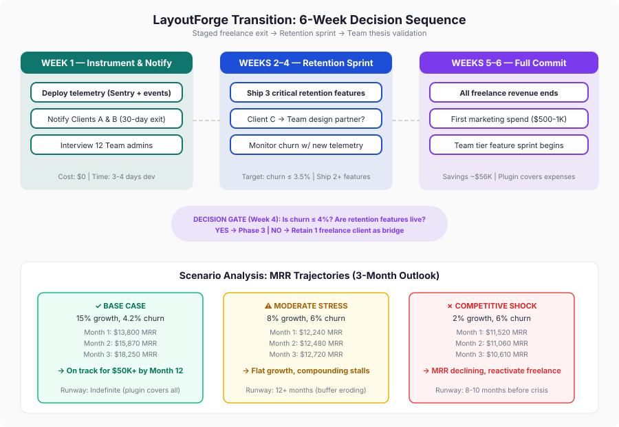

# Decision Memo: Should I Quit Freelancing to Go All-In on LayoutForge?

**Session:** ela4qq  
**Date:** 2026-03-18  
**Board:** Revenue, Product Strategist, Technical Architect, Contrarian  
**Decision Type:** Irreversible career/income transition  
**Deliberation Cost:** $0.43 | Duration: 3.7 minutes

---

## Final Recommendation (Ranked)

### 1. Staged Transition — Compressed to 6 Weeks (RECOMMENDED)

**Execute this week:** Deploy telemetry (Sentry + 3 plugin events: forge initiated, completed, failed). Give Clients A and B 30-day notice. Interview all 12 Team account admins. Let Client C's contract expire naturally (or convert to Team design partner).

**Weeks 2–4:** Sprint on the 3 critical retention features. Monitor churn with new instrumentation. Explore Client C → Team partnership conversion.

**Decision Gate at Week 4:** If churn holds ≤ 4% and at least 2 retention features are live, proceed to full commit. If churn is accelerating or features are delayed, retain one freelance client as a bridge.

**Weeks 5–6:** All freelance income ends. First marketing spend ($500–1K). Begin Team tier feature sprint based on admin interview insights.

**Why this wins:** Captures ~$19K in remaining freelance revenue, arrives at full-time with ~$56K savings, plugin covering all expenses with $6K/month buffer, and — critically — with telemetry data proving whether the product can carry the weight.

### 2. Immediate All-In (30 Days)

Drop all clients immediately, sprint on plugin full-time. **Rejected** because it sacrifices ~$15K in near-certain freelance revenue for 3 extra weeks of plugin time — a poor trade when the 6-week plan achieves the same outcome with a stronger financial position and a decision gate.

### 3. Hire/Outsource to Preserve Both

Keep freelance, hire a contractor for plugin dev. **Rejected unanimously.** The 4,000-line custom constraint solver is the core moat. A contractor needs 4–8 weeks to onboard, introduces quality risk on the differentiating asset, and adds management overhead to an already-overloaded 70-hour week. Hiring is a Q3 conversation after the retention features are shipped and Team thesis is validated.

---

## Decision Framework

---

## Board Member Stances

| Member | Position | Core Reasoning | Key Concern |
|--------|----------|---------------|-------------|
| **Revenue** | Staged, 60 days max | The revenue case is already made — $12K MRR at 99% margin covering expenses is a business, not a bet. Ship retention features to stop the churn bleed before anything else. | Using "staged" as permission to go slow. The 60-day window must be a sprint, not a wind-down. |
| **Product Strategist** | Staged, 6 weeks compressed | Arrive at full-in with the strongest possible starting position. Don't burn bridges in a small design community. Team tier admin controls are the real moat against VC-funded competitors. | Competitor velocity — ForgeUI could land a major press hit or Figma feature while you're still splitting attention. |
| **Technical Architect** | Staged, telemetry-first | Cannot improve retention if you cannot measure what causes churn. The codebase has been running production for 5 months — it's not about to collapse, but you're flying blind without error data. | Silent failures in the constraint solver driving churn that can't be diagnosed. The infrastructure isn't fragile — it's invisible. |
| **Contrarian** | Staged, but notify clients Friday | Every week of delay is a week of 70-hour unsustainable grind degrading judgment. The growth deceleration (32% → 15%) is endogenous and structural, not just a marketing ceiling. TAM may be 15–25K users, not 80K. | The competitive window is being overestimated. The real risk is that the organic growth engine has already plateaued, and marketing spend hasn't been validated as a fix. |

---

## Dissent and Unresolved Tensions

### Resolved
- **Infrastructure vs. Features:** Converged on "telemetry first (3 days), then retention features." Not a full hardening sprint — instrument what you're about to change, don't retroactively test what's working.
- **Transition timeline:** Unanimous on staged, disagreement on exact compression (4–6 weeks). Settled at 6 weeks with a Week 4 decision gate.

### Unresolved
1. **TAM ceiling:** Contrarian argues realistic TAM is 15–25K paying users (Pro tier caps at $210–350K MRR). Others estimate 50–80K. This changes whether the growth strategy is "acquire more Pro users" or "shift to Team/enterprise." **Resolution path:** The 12 Team admin interviews this week will provide the first real signal.

2. **Growth deceleration cause:** Revenue says marketing ceiling (fixable with spend). Contrarian says structural/endogenous (harder to fix). Product says likely marketing ceiling with a product activation component. **Resolution path:** Free-to-paid conversion rate data + telemetry on activation funnel. If conversion is holding but signups are slowing, it's distribution. If conversion is dropping, it's product.

3. **Team as primary thesis:** Product Strategist made the strongest case — organizational switching costs are the only defense money can't buy. Revenue cautioned that 12 data points aren't enough to bet the roadmap. **Resolution path:** Interview the 12 teams. Understand why they bought Team vs. individual Pro seats. That answer IS the Team strategy.

---

## Trade-offs and Risks

| Risk | Probability | Impact | Mitigation |
|------|------------|--------|------------|
| Churn accelerates to 6%+ before retention features ship | Medium | High — compounding engine stalls, MRR flattens at ~$12.7K | Telemetry in Week 1; retention features by Week 4; decision gate before full commit |
| VC competitor achieves feature parity by June | Medium | High — organic acquisition dries up, churn gets a destination | Ship retention features (they're likely also conversion features); build Team switching costs; first marketing spend by Week 6 |
| Marketing spend doesn't unlock growth (TAM is smaller than hoped) | Medium | Medium — business caps at $200–350K MRR, still exceptional solo business | Validate with small spend ($500–1K); pivot to Team/enterprise if Pro ceiling is real |
| Freelance clients can't be recovered if plugin fails | High | Medium — network goes cold in 3–6 months | Decision gate at Week 4; $56K savings provides 9+ months runway; plugin alone covers expenses even in moderate stress scenario |
| Solo operator burnout during transition sprint | Medium | High — judgment degrades, shipping quality drops | Transition immediately reduces hours from 70 to 35–40/week; enforce health recovery as a non-negotiable |
| Figma API breaking change disrupts constraint solver | Low | High — product breaks for all users | Document API version coupling in Week 1; add canary integration test |

---

## Next Actions (This Week)

| # | Action | Timeline | Why |
|---|--------|----------|-----|
| 1 | Deploy Sentry + 3 plugin events (forge initiated/completed/failed) | Days 1–2 | Cannot measure retention improvement without baseline data |
| 2 | Interview all 12 Team account admins (30 min each) | Days 1–5 | De-risks every downstream decision: retention priorities, Team thesis, growth strategy |
| 3 | Give Clients A and B 30-day notice | Day 5 (Friday) | Frees 35 hrs/week by end of Month 1; captures final $11K |
| 4 | Explore Client C → Team design partner conversion | Week 1–2 | Warm relationship with a design agency = potential case study + Team pilot |
| 5 | Ship first critical retention feature | Weeks 2–3 | Churn is compounding at 36 users/month; every week unshipped costs ~$125 in churned MRR |
| 6 | Decision Gate: review churn data + feature progress | Week 4 | Go/no-go on full freelance exit based on actual data, not projections |

---

## Deliberation Summary

The board convened to decide whether a solo designer/developer should quit a $15K/month freelance practice to go all-in on LayoutForge, a Figma plugin at $12K MRR with 15% month-over-month organic growth and two newly-funded competitors entering the space. The status quo — 70-hour weeks with deteriorating health — was immediately eliminated as a viable option by all four members, narrowing the real decision to transition speed and sequencing.

The first substantive tension was between shipping retention features immediately (Revenue, Product) versus hardening the technical infrastructure first (Technical Architect). This resolved cleanly once Technical Architect reframed: the issue isn't codebase fragility but operational blindness. With no telemetry, error tracking, or activation metrics, shipping retention features and then measuring their impact is impossible. The room converged on a pragmatic synthesis — 3 days of instrumentation (Sentry, core events, license server monitoring), then sprint on retention features. No one argued for a multi-week infrastructure hardening phase.

The most productive tension emerged around TAM and growth strategy. Contrarian challenged the assumption that 15% MoM deceleration is merely a marketing ceiling, arguing the realistic addressable market for "Figma power users who do responsive layout work at sufficient volume to pay $14/month" is 15–25K users, not the 50–80K others estimated. This reframing surfaced the Team tier as potentially the more important growth vector — 12 teams already self-selected into a half-built Team product, and organizational switching costs are the only moat that VC marketing budgets can't erode. Revenue tempered this enthusiasm by noting that 12 data points aren't enough to bet the roadmap, and proposed interviewing all 12 Team admins this week before making any product strategy commitments.

The churn math was stress-tested extensively. Under base conditions (15% growth, 4.2% churn), MRR projects to $18K+ in 3 months. Under moderate competitive stress (8% growth, 6% churn), MRR barely grows to $12.7K — the compounding engine dies even though the headline number looks stable. Under a competitive shock scenario (2% growth, 6% churn), MRR declines to ~$10.6K in 3 months. Critically, even the worst-case scenario keeps plugin revenue above the $5,800/month expense floor for 8+ months, meaning the financial risk of the transition is survivable in all modeled scenarios. The real risk is not insolvency — it's the psychological damage of watching MRR decline as a solo operator, which degrades decision-making.

The board's final statements revealed a surprising convergence: even the Contrarian, who spent the session flagging risks and challenging assumptions, concluded that freelance clients should be notified this Friday. The unanimous signal is clear — the product-market fit is real, the window is competitive, and the staged transition with a Week 4 decision gate is the highest-leverage path that preserves optionality without sacrificing speed. The one area of genuine unresolved disagreement — whether Team or Pro is the primary growth thesis — will be resolved by data from the 12 Team admin interviews, not by further debate.
