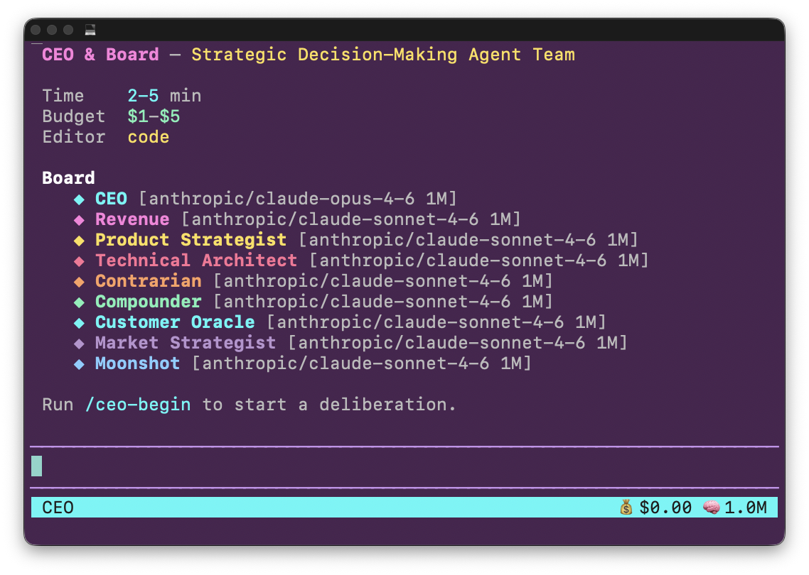
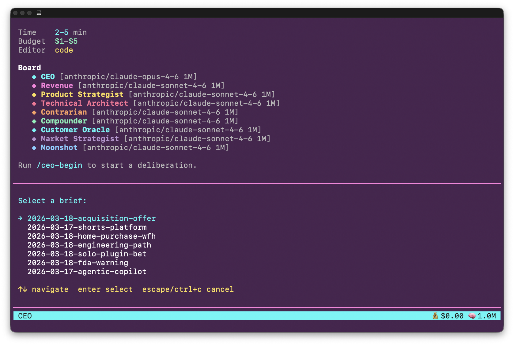
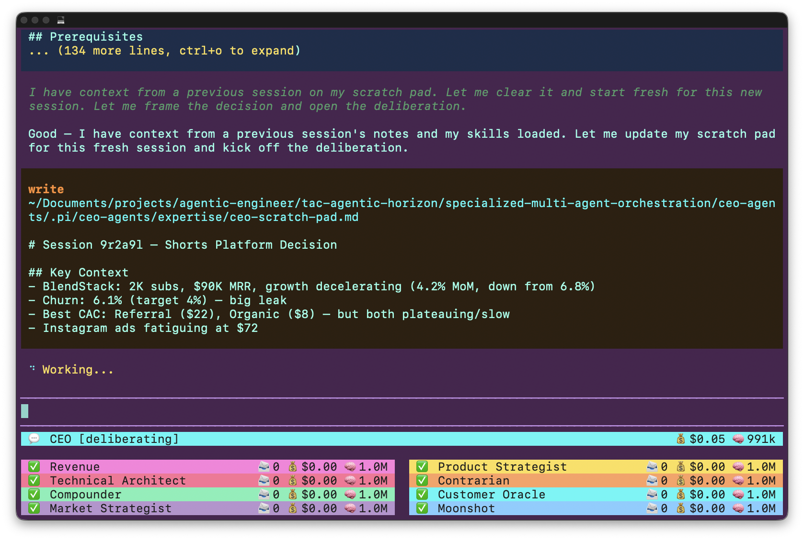
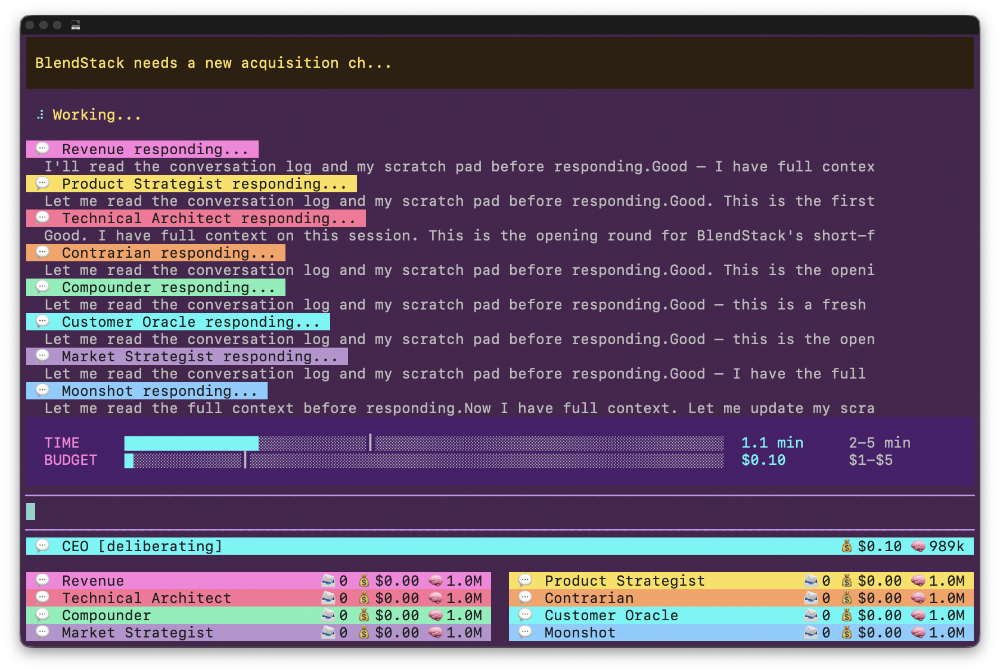
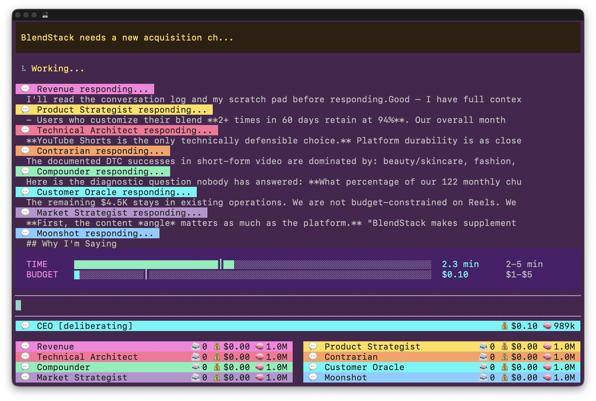
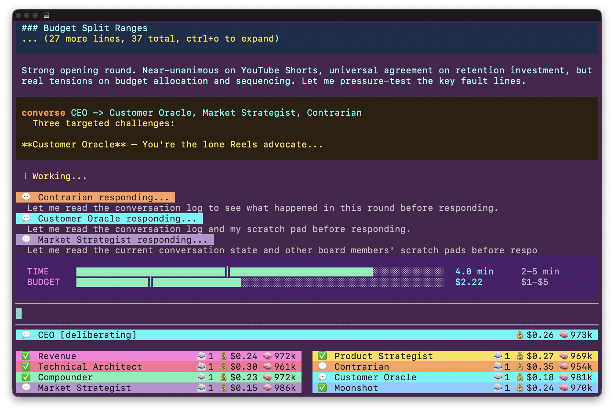

# CEO Agents

Make high-leverage strategic decisions with a dedicated CEO & Board of advisors.

Built on [Pi coding agent](https://pi.dev).

### CEO & Board Architecture


### Brief to Memo



### Deliberation Flow


### YAML Config Anatomy



## What This Is

A multi-agent deliberation system that turns uncertainty into decisions. You write a brief describing a strategic problem — a pricing decision, an acquisition offer, a career pivot, a technical architecture bet. A CEO agent orchestrates a board of specialist agents who debate, challenge, and stress-test the problem from opposing perspectives. The output is a structured memo with ranked recommendations, board stances, documented dissent, and next actions. Uncertainty in, decisions out.

Most engineers use agents as low-level workers — code generation, test scaffolding, planning docs. This system pushes agents into the highest-leverage activity: strategic decision-making. Board members are not worker bees. They are strategic advisors with controlled biases, opposing time horizons, and distinct objective functions. Revenue wants cash in 90 days. Compounder wants durable value over 24 months. Moonshot wants the 10x asymmetric bet. Contrarian attacks every assumption in the room. The tension between them IS the value — it exposes flaws in your mental model that you cannot see alone.

Three innovations make this possible: (1) **1 million token TRUE context windows** — the latest Claude models operate at full context without degradation cliffs or long-context surcharges, so entire briefs, financials, product overviews, and multi-round debates fit in a single session. (2) **A customizable agent harness** — Pi provides the extension system, subprocess management, persistent sessions, and TUI primitives that let you build orchestration patterns impossible with out-of-box agents. (3) **Agent expertise that compounds** — each board member maintains a persistent scratch pad that accumulates domain knowledge across sessions. Revenue tracks how to outmaneuver Compounder. Contrarian remembers which arguments held up. This is not memory — it is domain expertise.

## Prerequisites

- **[Pi coding agent](https://pi.dev)** — install and configure Pi (the agent harness)
- **[Bun](https://bun.sh)** — `curl -fsSL https://bun.sh/install | bash`
- **[just](https://github.com/casey/just)** — command runner (`brew install just`)
- **Anthropic API key** — set in `.env` (see Quick Start)

## Quick Start

```bash
# 1. Copy .env.sample and add your Anthropic API key
cp .env.sample .env

# 2. Install dependencies
cd apps/ceo && bun install && cd ../..

# 3. Launch the CEO & Board deliberation agent
just ceo

# 4. Inside the TUI, run the slash command to begin
/ceo-begin
```

Select a brief directory from the list. The system validates it, loads context files, and starts deliberation. You watch.





## How It Works

### The Flow

1. **Boot** — `just ceo` launches the Pi extension with the synthwave TUI
2. **Select brief** — `/ceo-begin` presents a list of brief directories
3. **Validate** — brief is checked against required sections (configurable). Missing sections block the meeting with clear instructions on what to write
4. **Load context** — all `.md` files from the brief directory are loaded into every agent's context window
5. **CEO frames** — the CEO agent reads the brief + context, frames the decision, and opens deliberation with a broadcast to all board members
6. **Board debates** — members respond with their positions. The CEO drives multiple rounds — targeted follow-ups, tension resolution, position challenges
7. **Constraints checked** — time and budget are evaluated after every `converse` call. When max is hit, the system forces a halt
8. **Final statements** — each board member delivers a closing position. Contrarian always speaks last (enforced)
9. **Memo** — the CEO synthesizes everything into a structured memo, generates a decision diagram (SVG), and speaks an audio summary (TTS). The memo opens in your configured editor



### User Controls

| Input           | Effect                                       |
| --------------- | -------------------------------------------- |
| `/ceo-begin`    | Start a new deliberation                     |
| `stop`          | Hard-stop the meeting immediately            |
| `wrap`          | End early — triggers final statements + memo |
| Any other input | Blocked with a notification                  |

### What You See

- **Live feed widget** — each board member's streaming response, pinned in config order
- **Constraint gauges** — TIME and BUDGET progress bars with min-threshold markers (just above input)
- **Footer** — CEO card + board member status cards with chat count, cost, and remaining context







## Directory Structure

```
.pi/ceo-agents/
├── ceo-and-board-configuration.yaml   # meeting config, board roster, brief validation
├── agents/                            # board member system prompts
│   ├── ceo.md                         # CEO — orchestrator
│   ├── revenue.md                     # Revenue — cash now, monetization
│   ├── product-strategist.md          # Product — long-term product thinking
│   ├── technical-architect.md         # Technical — feasibility, architecture
│   ├── contrarian.md                  # Contrarian — pokes holes, stress-tests
│   ├── compounder.md                  # Compounder — retention, compounding
│   ├── customer-oracle.md             # Customer Oracle — user voice
│   ├── market-strategist.md           # Market — competitive landscape
│   └── moonshot.md                    # Moonshot — nonlinear upside
├── briefs/                            # one directory per deliberation
│   ├── brief-template.md              # template for writing new briefs
│   ├── 2026-03-18-solo-plugin-bet/
│   │   ├── brief.md                   # the deliberation brief (required)
│   │   ├── product-overview.md        # context: product details
│   │   └── financials.md              # context: financial data
│   └── ...
├── expertise/                         # persistent scratch pads (agent expertise)
│   ├── ceo-scratch-pad.md
│   ├── revenue-scratch-pad.md
│   ├── contrarian-scratch-pad.md
│   └── ...                            # one per board member
├── deliberations/                     # .jsonl conversation logs (auto-generated)
└── memos/                             # output memos with YAML frontmatter (auto-generated)
```

```
apps/ceo/extensions/
├── ceo-and-board.ts                  # main entry point — pi extension orchestrator
└── modules/
    ├── types.ts                      # shared interfaces and type definitions
    ├── config.ts                     # YAML config parsing, board member loading
    ├── theme.ts                      # ANSI color helpers, TUI gauge and status rendering
    ├── subprocess.ts                 # board member pi subprocess spawning
    └── helpers.ts                    # utility functions (logging, budgets, constraints)
```

### Claude Code Tooling

```
.claude/
├── agents/
│   └── meta-pi-agent.md              # pi coding agent architect — builds extensions, themes, orchestration
├── commands/
│   ├── install.md                    # /install — check and install all dependencies
│   ├── prime.md                      # /prime — load full project context
│   ├── plan-w-team.md                # /plan-w-team — create implementation plans with team orchestration
│   └── build.md                      # /build — execute a plan from specs/
└── skills/
    ├── drive/                        # terminal automation via tmux — create sessions, run commands,
    │                                 # send keystrokes, poll output, take screenshots, manage processes.
    │                                 # essential for testing TUI agents like CEO & Board
    ├── svg-generate/                 # hand-craft production SVG diagrams and animations
    └── tts-eleven/                   # text-to-speech via ElevenLabs API — speak or save audio
```

## Configuration

All config lives in `.pi/ceo-agents/ceo-and-board-configuration.yaml`.

### Meeting Constraints

```yaml
meeting:
  constraints:
    min_time_minutes: 2    # floor — deliberation continues even if board feels "done"
    max_time_minutes: 5    # ceiling — hard stop, CEO moves to synthesis
    min_budget: $1         # floor — keep deliberating until spent
    max_budget: $5         # ceiling — hard stop
  editor: 'code'           # opens memo after meeting (code, cursor, etc.)
```

Time and budget constraints force the system to be efficient — just like real meetings. You don't want agents running forever. The min thresholds ensure enough depth. The max thresholds enforce discipline.

### Brief Validation

Required sections are configurable. If a brief is missing any, the meeting won't start — the user gets a notification showing each missing section and what to write under it.

```yaml
brief_sections:
  - section: "## Situation"
    description: "What is happening right now? State the facts. No opinion, no spin."
  - section: "## Stakes"
    description: "What's at risk? Upside if we get it right, downside if we get it wrong."
  - section: "## Constraints"
    description: "Budget, timeline, team capacity, technical, regulatory boundaries."
  - section: "## Key Question"
    description: "The single most important question you want the board to answer."
```

Matching is case-insensitive. Add, remove, or rename sections to fit your deliberation style.

### Board Members

Each board member has a name, path to their system prompt, and a TUI color:

```yaml
board:
  - name: Revenue
    path: .pi/ceo-agents/agents/revenue.md
    color: "#ff7edb"
  - name: Compounder
    path: .pi/ceo-agents/agents/compounder.md
    color: "#72f1b8"
```

Comment out members to deactivate them. The CEO model is read from `agents/ceo.md` frontmatter.

## Writing a Brief

Each brief lives in its own directory under `briefs/`. The directory must contain a `brief.md` with the required sections. Any other `.md` files in the directory are treated as **context files** — automatically loaded into every agent's context window at the start of the meeting.

### Template

```markdown
# Brief: <concise title — frame as a question the board will answer>

## Situation
<What is happening right now? State the facts. No opinion, no spin.
Include current state, key numbers, timeline, and what triggered this decision.>

## Stakes
<What's at risk? What's the upside if you get this right?
What's the downside if you get it wrong? What happens if you do nothing?>

## Constraints
- <Budget / financial limit>
- <Timeline / deadline>
- <Team capacity / headcount>
- <Technical / infrastructure>
- <Regulatory / legal / contractual>

## Key Question
<The single most important question you want the board to answer.
One sentence. Be specific. "Should I X or Y given Z?" is better than "What should I do?">
```

### Adding Context Files

Drop any `.md` files alongside `brief.md` — product overviews, financial data, competitive analysis, customer research. These get loaded into every agent via Pi's `@file` syntax on first contact, so the entire board is informed before deliberation begins.

If you template your engineering, your agents can do exactly what you did. The structured brief format is what makes deliberation productive — garbage in, garbage out.

## Board Members

| Member                  | Bias                  | Time Horizon | Default Stance                                                             |
| ----------------------- | --------------------- | ------------ | -------------------------------------------------------------------------- |
| **CEO**                 | Leverage & coherence  | 1-3 years    | Orchestrator — frames, drives, synthesizes                                 |
| **Revenue**             | Speed & monetization  | 30-90 days   | "I want a version customers will pay for in 90 days."                      |
| **Product Strategist**  | Problem selection     | This quarter | "I want the narrowest wedge with the strongest strategic pull."            |
| **Technical Architect** | System durability     | 6-18 months  | "I want the version that will survive contact with production reality."    |
| **Contrarian**          | Truth-seeking         | Variable     | "I want the room to prove it is not fooling itself."                       |
| **Compounder**          | Trust & retention     | 6-24 months  | "I want a version customers still trust in 12 months."                     |
| **Customer Oracle**     | User behavior reality | Next session | "I want the version real users actually adopt in their existing workflow." |
| **Market Strategist**   | Positioning & timing  | This quarter | "I want the version the market can understand and buy quickly."            |
| **Moonshot**            | Asymmetric upside     | 1-3 years    | "I want the room to avoid cowardly incrementalism."                        |

Every board member is a fully customizable system prompt with YAML frontmatter specifying model, expertise paths, skills, and domain constraints. Edit them. Rewrite them. Add new ones. The agent prompts in `.pi/ceo-agents/agents/` are the single source of truth for how each member thinks, argues, and decides.

## Outputs

### Conversation Log

Every deliberation produces a `.jsonl` file in `deliberations/` with every message, tool call, and constraint state. This is the full audit trail — you can replay any deliberation.

### Tool Use Log

A separate `tool-use.jsonl` tracks every tool invocation across all agents during the meeting.

### Memo

The CEO writes a structured memo to `memos/` with YAML frontmatter (date, duration, budget, board members, transcript path) and markdown body containing:

- Ranked recommendations (#1, #2, #3)
- Board member stances (position, reasoning, key concern per member)
- Dissent and unresolved tensions
- Trade-offs and risks table
- Next actions
- Deliberation summary

### SVG Diagrams

Board members generate SVG diagrams during deliberation to support their arguments — decision matrices, risk maps, trade-off visualizations. The CEO generates a final decision framework diagram alongside the memo.

### TTS Audio Summary

After the memo is written, the CEO speaks a 1-4 sentence audio summary of the final decision. The MP3 is saved alongside the memo. Requires `ELEVENLABS_API_KEY` in `.env` — get one at [elevenlabs.io](https://elevenlabs.io/app/settings/api-keys). If the key is not set, the deliberation still completes — you just won't get the audio summary.

## Architecture

The extension (`apps/ceo/extensions/ceo-and-board.ts`) turns Pi into a deliberation engine:

- **CEO** = the Pi agent itself, running with a custom system prompt
- **Board members** = Pi subprocesses with persistent sessions (`--session` flag), each with their own system prompt, model, and expertise files
- **Two custom tools**:
  - `converse(to, message)` — sends the CEO's questions to one or more board members and returns their responses with updated constraint state
  - `end_deliberation(message)` — collects final statements from all board members (Contrarian speaks last, enforced) and triggers memo synthesis
- **Constraint engine** — tracks elapsed time and budget spent, returns state on every `converse` call, forces halt when max thresholds are hit
- **TUI** — live streaming widget (all members in config order), constraint gauge bars, footer with CEO + board status cards showing chat count, cost, and remaining context

### Persistent Sessions & Expertise

Board members run as persistent Pi subprocesses. Their sessions survive across `converse` calls within a deliberation, maintaining full conversational context. The expertise scratch pads (`.pi/ceo-agents/expertise/`) persist across deliberations — each member reads and updates their scratch pad, accumulating domain knowledge over time.

## Example Briefs

| Brief               | Domain                     | Decision                                                             |
| ------------------- | -------------------------- | -------------------------------------------------------------------- |
| `shorts-platform`   | BlendStack (supplements)   | Which short-form video platform to lead with                         |
| `agentic-copilot`   | CodeLens (code review)     | Whether to build an autonomous engineering copilot                   |
| `acquisition-offer` | BlendStack                 | Take a $12M acquisition at 11x ARR or keep building                  |
| `fda-warning`       | BlendStack                 | Respond to FDA warning letter without killing growth                 |
| `solo-plugin-bet`   | LayoutForge (Figma plugin) | Quit freelancing to go all-in on a growing plugin                    |
| `engineering-path`  | Personal career            | Fastest path to a $120K+ software engineering career                 |
| `home-purchase-wfh` | Personal finance           | Buy a home now or wait — optimizing for remote work setup and career |

### High-Stakes Briefs

| Brief                               | Domain                       | Decision                                                             | Context Files                                      |
| ----------------------------------- | ---------------------------- | -------------------------------------------------------------------- | -------------------------------------------------- |
| `high-stakes-ai-lab-offer`          | AI career                    | Anthropic vs DeepMind vs OpenAI — which frontier lab offer to accept | offers, career profile                             |
| `high-stakes-350m-acquisition`      | Enterprise SaaS ($42M ARR)   | Accept $350M Datadog acquisition or pursue IPO                       | business metrics, product overview, deal terms     |
| `high-stakes-sovereign-ai-contract` | AI infrastructure ($28M ARR) | Take a $200M sovereign AI contract that redefines the company        | business metrics, product overview, contract terms |

## Three Innovations

### 1M True Context Windows

The latest Claude models operate at 1 million tokens without degradation cliffs and without long-context surcharges. This means entire briefs, financials, product overviews, multi-round board debates, and expertise scratch pads all fit in a single session without compaction hacks. The context window is the deliberation room — and it never runs out of space.

### Customizable Agent Harness

There are many coding agents, but this one is mine. Pi's extension system provides subprocess management, persistent sessions, custom tool registration, and TUI primitives. This lets you build orchestration patterns — like a CEO driving parallel board debates under time/budget constraints — that are impossible with out-of-box agents. Specialization beats general-purpose: customized agents with unique system prompts, expertise files, and constrained domains produce outlier results.

### Agent Expertise That Compounds

Each board member maintains a persistent scratch pad that accumulates domain knowledge across sessions. The CEO tracks which tensions resolved vs. stayed open. Revenue notes how to frame arguments against Compounder's long-term bias. Contrarian records which assumptions the room failed to challenge. Over time, the board gets sharper — not because the models improve, but because the expertise files give each agent a richer starting position for every new deliberation. This is not memory. It is domain expertise.

---

## License

Copyright 2026 IndyDevDan. All rights reserved.

This code is provided for **personal and educational use only**. You may study, modify, and use it in your own private projects. You may NOT republish, redistribute, or share this source code — in whole or in part — in any public repository, website, course, or distribution channel without explicit written permission from the author. Selling or sublicensing this code is prohibited.

For licensing inquiries: [agenticengineer.com](https://agenticengineer.com)
