# Multi-Team Agentic Coding

One agent is NOT ENOUGH.

If you've been building with agents and pushing what you can do with your agentic coding tool, you've realized something critical. A single agent, no matter how smart, hits a ceiling. Multi-Team Agentic Coding pushes beyond that ceiling with **specialized teams of agents** built on [Pi coding agent](https://pi.dev), where a user talks to an Orchestrator who delegates to specialized teams (Planning, Engineering, and Validation), each with a Lead and Members.

Depth-2 delegation: **User -> Orchestrator -> Team Leads -> Members.**

<p align="center">
  
</p>

## Why Multi-Team?

**Specialized agent teams give you a high-autonomy advantage.** Instead of one agent trying to be everything, you build agent experts, each with their own skills, expertise, and domain knowledge, that outperform any generalist agent. Then you scale that into a team of agents. Then you create multiple teams of agents. Then you add a SINGLE INTERFACE to talk to all of them: the Orchestrator. This way, your cognitive input doesn't increase as you add more specialists. You talk to the Orchestrator. It handles the rest. **The trick now is in teaching your Orchestrator, Lead Agents, and Worker Agents how to work together.**

Three converging trends make this possible right now:

1. **Increasing intelligence with massive context windows.** Claude's 1M true context window means your agents can load deep specialization and memory every session.
2. **Agent experts that remember.** Every agent maintains its own mental model that grows over time, compounding knowledge session after session.
3. **Customizable agentic harnesses.** Tools like Pi let you customize the entire agent experience down to the harness level, not just the prompt.

Move where the ball is going, not where it is. Tokens will get cheaper while intelligence per token increases. Learn how to use (more of) them now.

## Setup

<p align="center">
  
</p>

Claude Code (or any agent that can read and execute `.claude/commands/`) is the bootloader for this system. It handles installation, testing, and deploying teams into new codebases.

### Step 1: Install the Tool

Run `/install` inside this repo. It will:

- Check prerequisites (Claude Code, Pi, Bun, Node.js, just)
- Verify your `.env` and `ANTHROPIC_API_KEY`
- Install extension dependencies
- Validate team config and agent files
- Add a shell alias (default: `teams`) to your shell profile so you can launch Multi-Team Agentic Coding from any directory

```bash
/install
```

### Step 2: Test Locally (Optional)

After install, test the system against this source repo to verify everything works:

```bash
# See all available recipes
just

# Launch Multi-Team Chat in this repo
just team

# Or use your alias from any directory (recommended after deploying into a codebase)
teams
```

Type `ping` to verify the Orchestrator responds. Type `ping each team lead` to verify delegation works. Check the footer for cost and token tracking across all agents.

### Step 3: Deploy Into a Codebase

> Follow this process whenever you want to create a new team in a into a codebase.

Run `/install-into-codebase` to deploy a fresh team into any project. It will:

- Ask for your target codebase path
- Copy `agents/`, `skills/`, and `multi-team-config.yaml` into the target's `.pi/multi-team/`
- Create empty `expertise/` and `sessions/` directories. Agents build their own mental models from scratch for each codebase.
- Optionally add `sessions/` to the target's `.gitignore`

```bash
/install-into-codebase
```

After deploying, `cd` into the target and launch with your alias:

```bash
cd ~/my-project
teams
```

Then customize for your project:
- Edit `.pi/multi-team/multi-team-config.yaml` to add, remove, or rename teams and members
- Edit `.pi/multi-team/agents/*.md` to tailor system prompts to your domain

## Architecture

<p align="center">
  
</p>

```
User
  |
  v
Orchestrator (claude-opus-4-6)
  |
  |--> Planning Team
  |      |--> Planning Lead        -- routes to members, synthesizes output
  |      |--> Product Manager      -- requirements, prioritization, user stories
  |      '--> UX Researcher        -- user behavior, personas, journey mapping
  |
  |--> Engineering Team
  |      |--> Engineering Lead     -- routes to members, synthesizes output
  |      |--> Frontend Dev         -- UI components, client-side state, CSS
  |      '--> Backend Dev          -- APIs, databases, infrastructure
  |
  '--> Validation Team
         |--> Validation Lead      -- routes to members, synthesizes output
         |--> QA Engineer          -- test cases, regression, automation
         '--> Security Reviewer    -- threat modeling, auth, data protection
```

The Orchestrator classifies the user's request, delegates to **one team lead**, and synthesizes the result. Team leads can further delegate to their members. Each agent runs as a Pi subprocess with persistent sessions and JSON-mode streaming.

You always talk to the Orchestrator. The Orchestrator delegates to leads. Leads delegate to workers. Results bubble back up. One unified response.

## Agent Experts That Remember

<p align="center">
  
</p>

Every agent in the system maintains its own **mental model**, a personal expertise file that grows over time. When an agent boots up, it loads its mental model. As it works, it updates it. Session after session, knowledge compounds.

```yaml
expertise:
  - path: .pi/multi-team/expertise/backend-dev-mental-model.yaml
    use-when: "Read at task start. Update after completing work."
    updatable: true
    max-lines: 10000
```

This isn't Claude capturing memory from everything you've ever said. These are **specialized agents with specific purposes** building focused, relevant knowledge about their domain. Your backend dev remembers backend patterns, key risks, infrastructure decisions. Your QA engineer remembers test strategies, regression patterns, failure modes.

You don't touch these files. The agents maintain them on their own. You give guidelines via the mental model skill, then let go. This is the journey every engineer needs to make: teach your agents to operate as you would, then trust them.

You can also add **read-only expertise** for critical domain knowledge that should never be modified, like billing workflows, migration procedures, and deployment checklists:

```yaml
expertise:
  - path: .pi/multi-team/expertise/billing-workflow.yaml
    use-when: "Always reference when working on billing features."
    updatable: false
```

## Domain Locking

<p align="center">
  
</p>

Each agent has explicit **domain permissions** that control what files and directories they can read, write, and delete. This is how you safely scale to mid-to-large codebases.

```yaml
# Planning Lead: reads everything, writes only to expertise and plans
domain:
  - path: .pi/multi-team/
    read: true
    upsert: true
    delete: false
  - path: specs/
    read: true
    upsert: true
    delete: false
  - path: .
    read: true
    upsert: false
    delete: false
```

Leads can't execute raw file changes. They delegate. Workers are locked to their domain. Your frontend dev writes to frontend directories. Your backend dev writes to backend directories. They don't conflict.

No one touches the DevOps files except the DevOps agent. No one touches billing except the billing agent. This is the holy grail of operating large codebases with powerful agents.

## Skills System

Agent system prompts use YAML frontmatter to declare composable skills, markdown files that inject behavioral rules:

```yaml
skills:
  - path: .pi/multi-team/skills/conversational-response.md
    use-when: Always use when writing responses.
  - path: .pi/multi-team/skills/zero-micro-management.md
    use-when: Always. You are a leader -- delegate, never execute.
  - path: .pi/multi-team/skills/active-listener.md
    use-when: Always. Read the conversation log before every response.
```

Skills are shared when necessary. The `zero-micro-management` skill is shared between the Orchestrator and all leads. Don't micromanage, delegate the right work at the right time. The `conversational-response` skill keeps leads and the Orchestrator concise (like Slack messages), while workers stay verbose and detail-oriented. The `active-listener` skill ensures every agent reads the conversation log before responding.

By composing skills, you quickly modify capabilities across agents. Need an agent to stop reading conversation history and work independently? Remove one line.

## Configuration-Driven Teams

The entire team structure lives in a single YAML config. Add a team, remove a team, swap a member. One file change:

```yaml
teams:
  - team-name: Planning
    team-color: "#fede5d"
    lead:
      name: Planning Lead
      path: .pi/multi-team/agents/planning-lead.md
      color: "#fede5d"
    members:
      - name: Product Manager
        path: .pi/multi-team/agents/product-manager.md
        color: "#f0c674"
        consult-when: Requirements, feature prioritization, user stories
```

Want to drop a team? Delete the block. Want to add a DevOps team? Copy the pattern, point to new agent prompts. The Orchestrator picks up the change on next launch.

Leads run on the most powerful model (Opus). Workers run on Sonnet. Tune this however you like. If you're going all out, make everything the best model available.

## Preset Team Configs

The repo ships with several team configurations for different workflows:

| Command           | Config                                   | Teams                               |
| ----------------- | ---------------------------------------- | ----------------------------------- |
| `just team`       | `multi-team-config.yaml`                 | Planning + Engineering + Validation |
| `just team-eng`   | `engineering-config.yaml`                | Engineering only                    |
| `just team-pe`    | `planning-and-engineering-config.yaml`   | Planning + Engineering              |
| `just team-scale` | `plan-and-scale-engineering-config.yaml` | Planning + 3x Scaled Engineering    |
| `just team-oss`   | `opensource-team-config.yaml`            | Multi-provider (diverse models)     |

Point to any config with `just teamc <path>`:

```bash
just teamc .pi/multi-team/engineering-config.yaml
```

Run `just team-list` to see all available configs and their agent trees.

## Delegation Flow

1. **You type a message.** It goes to the Orchestrator.
2. **Orchestrator classifies** the domain and calls `delegate(team, question)`
3. **Team Lead receives** the question, decides whether to handle it or consult members
4. **Members execute**, reading files, writing code, and running commands within their domain.
5. **Lead synthesizes** member responses into a team position
6. **Orchestrator synthesizes** the team output into your answer

For multi-team workflows, the Orchestrator chains delegation sequentially: plan first, then engineer, then validate. Exactly as you'd expect.

## TillDone — Task Tracking

The Orchestrator uses a `tilldone` tool to break work into a visible task list before delegating. Team Leads mark tasks as they work. The footer shows live progress alongside the agent tree.

```
 lead-agents │ 4m 38s                       TillDone: Build ws-chat app [3/5]
 └─ ⚡ Orch 💰$0.42 🧠890K                   ✓ Write product spec and API contract ...
    ├─ ◆ Planning Lead 💰$0.15                ✓ Create project structure under apps/ ...
    ├─ ⚡ Eng Lead 💰$0.28                    ✓ Implement WebSocket server with room ...
    └─ ◆ Validation Lead 💰$0.12              ● Write validation coverage for connec ...
                                              ○ Harden server per Validation finding ...
```

**How it works:**

1. **Orchestrator creates the list** — `tilldone new-list` + `tilldone add` with team assignments before delegating
2. **Leads mark progress** — `tilldone start <id>` when taking a task, `tilldone done <id>` when complete
3. **Footer updates live** — two-column layout: agent tree (left), task progress (right)
4. **Nudge on incomplete** — if the Orchestrator's turn ends with tasks remaining, it's prompted to continue
5. **Dynamic tasks** — the Orchestrator can add tasks mid-session based on team output (e.g., hardening after Validation findings)

Only the Orchestrator and Leads have access to the `tilldone` tool. Workers never touch the task list.

## Conversation Awareness

<p align="center">
  
</p>

Every agent can see the full conversation. A shared JSONL log tracks every message (user, orchestrator, leads, members) with tool calls and system prompts. Agents load this context before responding, so they know what's already been discussed.

```
.pi/multi-team/sessions/<session-id>/conversation.jsonl   # Full conversation log
.pi/multi-team/sessions/<session-id>/<team>/              # Per-agent session files
```

## Directory Structure

```
.pi/multi-team/
|-- multi-team-config.yaml         # Team roster, colors, domain permissions
|-- agents/                        # System prompts for all agents
|   |-- orchestrator.md
|   |-- planning-lead.md
|   |-- product-manager.md
|   |-- ux-researcher.md
|   |-- engineering-lead.md
|   |-- frontend-dev.md
|   |-- backend-dev.md
|   |-- validation-lead.md
|   |-- qa-engineer.md
|   '-- security-reviewer.md
|-- skills/                        # Composable skill definitions
|-- expertise/                     # Agent mental models (grow over time)
'-- sessions/                      # Persistent agent sessions + conversation logs
```

## Tool Call Icons

The chat UI displays emoji indicators when agents use tools:

| Icon | Tool     |
| ---- | -------- |
| 📝    | write    |
| ✏️    | edit     |
| 📖    | read     |
| 💻    | bash     |
| 🔍    | grep     |
| 🔎    | find     |
| 📁    | ls       |
| 📂    | glob     |
| 🔀    | delegate |
| 📋    | tilldone |
| 🔧    | other    |

---

## License

Copyright 2026 IndyDevDan. All rights reserved.

This code is provided for **personal and educational use only**. You may study, modify, and use it in your own private projects. You may NOT republish, redistribute, or share this source code, in whole or in part, in any public repository, website, course, or distribution channel without explicit written permission from the author. Selling or sublicensing this code is prohibited.

For licensing inquiries: [agenticengineer.com](https://agenticengineer.com)
