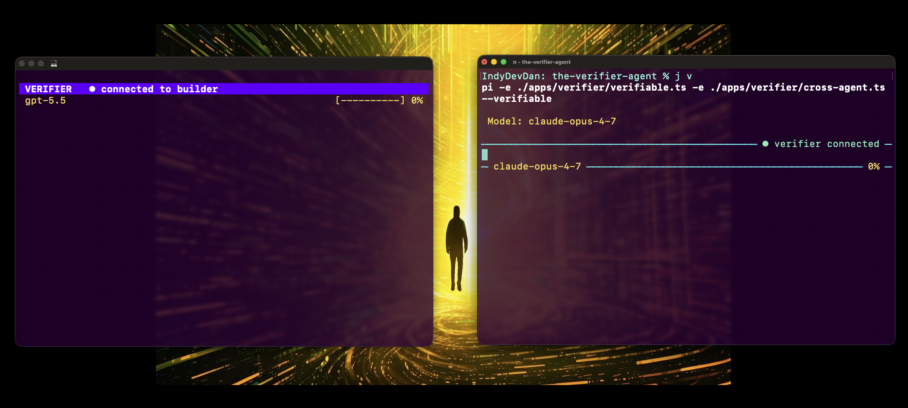
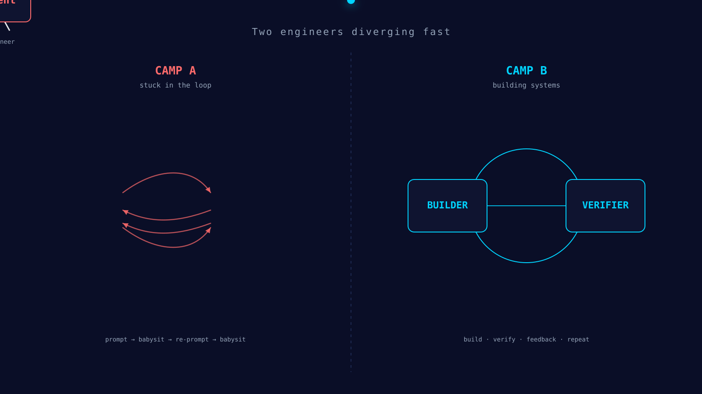

# Pi Verifier Agent

> A two-agent system with a custom pi agent harness that treats verification as a first-class problem, not an additional human-in-the-loop workflow.



## How it works

A two-agent observer system for the [Pi Coding Agent](https://pi.dev): a normal interactive **Builder** runs in your terminal; a sibling **Verifier** Pi runs in its own tmux window with input disabled. After every builder turn, the verifier independently re-runs the work using deterministic read-only tools and prompts the builder back with concrete corrective feedback when verification fails. It closes the review-constraint feedback loop so you can stop hand-checking every "✅ done."

## Quick start

### Agentic Installation

Open Claude Code or Pi Coding Agent (or any coding agent you want)

```bash
/install              # one-time — open Claude Code in this repo and run it
```

Then run

```bash
just v             # boot a generic verifier; or `just vpy` for python, `just vimg` for gpt-image-2, `just vsql` for a sqlite verifier
```

### Manual Installation

No Claude Code? See [Manual install (no agentic coding tool)](#manual-install-no-agentic-coding-tool) below.

### What you'll see on Startup:



1. The builder Pi opens in your current terminal. The default footer is hidden; instead, the **input box's borders carry the live status**:
   - Top-right border: `● verifier connected` (or `◌ spawning`, `✗ disconnected`, `⚠ error`)
   - Bottom-left border: active model id (e.g. `claude-sonnet-4-6`)
   - Bottom-right border: context-window utilization (e.g. `12%`)
2. **A new OS-level terminal window opens automatically.** If you're already inside `$TMUX`, you get a sibling tmux window instead. If your `$TERM_PROGRAM` is recognized (Ghostty / iTerm / Apple_Terminal / WezTerm), the launcher targets that emulator directly; otherwise it falls back to a Terminal.app window via `osascript do script` so engineers always see a real window — never a headless tmux session.
3. The verifier window comes pre-tuned: **mouse scroll enabled**, **bottom green tmux status bar hidden**, **10k-line scrollback**, **OSC52 clipboard** (mouse-drag → Cmd+V works natively). Tmux defaults are session-scoped — your other tmux sessions are untouched.
4. The verifier's input row is replaced by a colored full-width status bar — input is locked. The bar shows `VERIFIER · <phase> · <CONFIDENCE>` and updates live (e.g. `VERIFIER · ✓ verified · PERFECT`). The bar's **background color reflects the confidence grade**: green for PERFECT/VERIFIED, orange for PARTIAL/FEEDBACK, red for FAILED, purple while idle/verifying.
5. Type a normal builder prompt. After the builder finishes its turn, the verifier auto-runs verification.
6. If verification fails, the verifier calls `verifier_prompt` with concrete corrective feedback. The builder receives it as a follow-up user message (via `pi.sendUserMessage(deliverAs:"followUp")`) and runs another turn fixing the issue.
7. Loop repeats up to `max_loops: 3` (configurable per persona). On the 4th attempt, the builder surfaces an "escalating to human" message instead of auto-injecting another correction.
8. On `Ctrl+D` of the builder, the verifier window closes, the unix socket is unlinked, and the breadcrumb at `.pi/state/verifier-<sid>.sock.ref` is cleaned up. (`just clean` also force-tears-down anything stale from a prior crash.)

## What this two-agent system does

Engineers spend roughly half their time reviewing agent output. Every "I created the table," "I added the foreign key," "I applied the migration" has to be re-checked by hand. That review work is the binding constraint on agentic engineering throughput. The Pi Verifier Agent moves it onto a second agent.

The pattern is a **top-down observer**: the builder *doesn't know* the verifier exists. The verifier connects to the builder over a unix domain socket, listens for the builder's lifecycle ticks (`start` / `stop` / `error`), pulls the full transcript from the builder's session JSONL on disk, and runs verification through a single allowlisted astral-uv script (see `.pi/verifier/scripts/verify_python.py` for v1). When verification fails, the verifier calls its `verifier_prompt` tool — the only thing it can do that touches the builder — and the builder injects the message via `pi.sendUserMessage(deliverAs: "followUp")` and runs another turn. The loop repeats up to three times, then escalates to the human.

The verifier is **read-only by architecture**, not by prompt. Its persona declares no `write` or `edit` tools. Its bash policy is `mode: script-only` — every `bash` call is checked at the tool-call level and blocked unless it starts with the allowed runner + script. The script itself opens SQLite databases with `mode=ro&immutable=1` so even a mutation that somehow slipped through would be refused at the connection layer. Three independent layers (persona tools list, bash override, read-only DB connection) all have to be defeated before anything mutates state.

The verifier's job is orchestrating deterministic (and non-deterministic) checks; the agentic part is just glue. When verification can't be done — no oracle, no fixture, no script subcommand — the verifier explicitly says *"this is what I'd need from you to verify this next time."* That gap becomes the next thing you template into the script. *Verifier accuracy compounds.*

## What this unlocks

The verifier doubles your tokens per turn to give you two things one agent can't:

1. **Verification** — proof the builder did what it claimed.
2. **Review** — proof what got built is what you actually asked for.

If you optimize for tokens, this looks wasteful. If you optimize for *time*, it's the highest-leverage trade you can make. Tokens are cheap. Your time is not. Spend tokens to generate value and time.

This is the rare pattern that compounds on **both trust and scale**. Most agentic systems force a tradeoff between the two — review more deeply and you slow down (scale ↓), push more compute through the system and you erode the trust you have in any single output (trust ↓). The verifier doesn't trade. It scales the work (the verifier often burns 2–5× the builder's tokens per turn) AND increases trust (every atomic claim now has a deterministic check behind it before you ever read "✅ done"). More work + more proof. Both axes, simultaneously.

### The review constraint of agentic engineering

Agentic engineering has two binding constraints: **how much you can plan**, and **how much you can review**. Most engineers stall on review — half their day is spent re-checking "I created the table" / "I added the FK" / "I applied the migration" by hand. The verifier collapses that side of the constraint into a parallel agent whose entire job is re-checking, deterministically, with read-only tools.

The other side — planning — most engineers under-invest in. The verifier compounds there too: every claim it can't verify becomes an explicit ask ("you'd need a fixture for this next time"), which feeds back into the next iteration of the script and persona. The bottleneck stops being you.

A common objection: "won't adding agents just increase the error rate?" Only if you don't engineer them. With the right **core four** — context, model, prompt, tools — and full control over the agent harness, the math flips. You open the same agentic coding tool everyone else opens. Your results are different. Your results are *verified*.

### Template your verification engineering

The verifier is structurally un-promptable. Its input bar is locked; you cannot drop one-off instructions into it. The only thing that drives it is `verify_on_stop.md` rendered against the builder's `stop` event.

That sounds annoying. It's the point.

You can't fix bugs by typing at the verifier — you fix them by editing the persona, the script, or the prompt template. Improvements solve the entire problem class, not the one instance you happened to hit. Every gap turns into reusable engineering. One-off prompts solve the instance; templated verification solves the class.

The lock isn't friction-for-friction's-sake. It's the mechanism that makes templated engineering a habit *by force*. When the only available action is "improve the persona, script, or template," that's the action you take — every time. The lowest-hanging fruit of the generative-AI age (fire a one-off prompt and move on) is removed from the menu. What's left is the work that compounds.

This is how you build the system that builds the system.

### Two coordinated agents will always beat one



Look closely at any model benchmark — Opus 4.7, GPT-5.5, DeepSeek V4, GLM 5.1, Kimi K2.6, the Qwen series. They all make the same mistake from an engineer's perspective: each model is evaluated **in isolation**. The real frontier of intelligence isn't picking the best model. It's combinations. The right answer to "Opus 4.7 or GPT-5.5?" is **and**, not **or**. Stack them. Coordinate them. Specialize them. That's the move benchmarks can't measure but you can build.

A single agent reviewing its own output is one perspective at one moment in compute. Two coordinated agents give you a second perspective, doubled compute, and a hard architectural separation between writing and checking. The verifier has tools the builder doesn't (a domain script, a read-only persona). The builder has affordances the verifier doesn't (write, edit, generate). They don't compete; they specialize.

The trade is always the same: more tokens for more time back. If you can pay tokens to reclaim hours, take that trade every time. Your time is your most valuable resource — full stop.

### Specialized prompts at scale

The verifier sees the **original user prompt** via the builder's `start` event — the prompt you typed becomes part of the verifier's per-cycle context. Write claim-style prompts ("create the users table with these exact constraints, FKs to `org`, NOT NULL on `email`") and the verifier picks them up automatically as atomic propositions to check.

That changes what kind of prompt is worth writing. You stop writing prompts an agent might *do* and start writing specs an *engineered system* can verify. Plans. Contracts. Scaled prompts that do work no one else's stack can do — because you specialized yours.

## Architecture overview

```
   ┌──────────────────────────────┐         ┌──────────────────────────────┐
   │  Your Terminal               │         │  New OS Window  (or sibling  │
   │  (Ghostty / iTerm / ...)     │         │   tmux window if in $TMUX)   │
   │                              │         │                              │
   │  ┌────────────────────────┐  │         │  ┌────────────────────────┐  │
   │  │  pi  (BUILDER)         │  │         │  │  pi  (VERIFIER --child)│  │
   │  │  verifiable.ts         │◄─┼─unix────┼─►│  verifier.ts           │  │
   │  │  + socket server       │  │ socket  │  │  + status-bar editor   │  │
   │  │  + lifecycle forwarder │  │ JSONL   │  │  + bash override       │  │
   │  └─────────┬──────────────┘  │         │  │  + verifier_prompt tool│  │
   │            │                 │         │  └─────────┬──────────────┘  │
   └────────────┼─────────────────┘         └────────────┼─────────────────┘
                │                                        │
                │ writes session JSONL                   │ reads
                ▼                                        ▼
        ~/.pi/agent/sessions/<sid>.jsonl  ──────────────►   (builder transcript)

        ──────────────────────────────────────────────────────────────────
        verifier's only bash command:
            uv run --script .pi/verifier/scripts/verify_sqlite.py <db> "<sqlite3 cmd>"
        ──────────────────────────────────────────────────────────────────
```

One Pi binary, two roles. The builder owns a unix domain socket at `/tmp/pi-verifier/<sessionId>.sock` (short path so we sidestep macOS's 104-byte `sun_path` limit). The builder pushes lifecycle ticks only — never transcript content. The verifier pulls the substantive content it needs from the builder's session JSONL on disk and runs verification through the script.

### Direction matrix

The wire protocol is asymmetric — the verifier originates connection setup and corrective prompts; the builder pushes lifecycle events. Direction is enforced by `assertDirection()` in [`apps/verifier/_shared/ipc.ts`](./apps/verifier/_shared/ipc.ts):

```
verifier ──► builder           builder ──► verifier
─────────────────────          ──────────────────────
hello                          hello_ack            ← handshake
prompt   (correction text)     prompt_ack           ← receipt confirmation
report   (rendered inline)     (no reply needed)    ← informational
                               event                ← unified lifecycle channel

Bidirectional (both sides may send):
  ping / pong  — both run a 10s liveness interval and reply to the peer's pings
  bye          — either side may initiate a clean teardown
```

All envelopes are TypeScript discriminated unions on `type`, JSONL-framed (one JSON object per line, terminated by `\n` — split on `\n` only, never via Node's `readline` which would split on `U+2028` / `U+2029` embedded in JSON strings).

### Verifier state machine

```
                    ┌────────────────┐
                    │   connecting   │  ← session_start; net.createConnection
                    └────────┬───────┘
                             │ hello_ack
                             ▼
                    ┌────────────────┐
              ┌────►│   connected    │
              │     └────────┬───────┘
              │              │ event {name:"stop"}
              │              ▼
              │     ┌────────────────┐
              │     │   verifying    │
              │     └────────┬───────┘
              │              │ verifier's own agent_end → parseReport
              │              ▼
              │  ┌─────────┬─────────┬─────────┐
              │  ▼         ▼         ▼         ▼
              │ verified  failed   unsure    error
              │  │         │         │       (parse fail / no msg)
              │  └─────────┴─────────┴───────────┘
              │  next event {name:"start"} resets to connected
              │
              │     ┌────────────────┐
              └─────│  disconnected  │  ← socket close → 5s grace → ctx.shutdown()
                    └────────────────┘
```

The builder side keeps a simpler footer state: `idle` / `disconnected` / `spawning` / `connected` / `error`. It also tracks `loopCount` per genuine user prompt; on `loopCount > maxLoops` the next `prompt` is rejected with `prompt_ack { ok:false, error:"max loops exceeded" }` and the builder surfaces a `verifier-escalation` system message.

## Setup

Claude Code (or any agentic coding tool that can read and execute `.claude/commands/`) is the bootloader for this system. Open your agentic coding tool in this repo and run a single command to walk through the entire setup process:

```bash
/install
```

### Prerequisites

- **Node 20+** and `npm`
- **Python 3.11+** (the verifier script uses an inline PEP 723 `# /// script` header)
- **[astral uv](https://astral.sh/uv)** — `curl -LsSf https://astral.sh/uv/install.sh | sh`
- **tmux** — `brew install tmux` on macOS, `apt install tmux` on Debian/Ubuntu
- **sqlite3** CLI on PATH (used by the script for dot-commands like `.schema`)
- **[Pi Coding Agent](https://pi.dev)** (`pi` on your PATH), authenticated against an LLM provider. Default verifier model is `openai/gpt-5.5`.
- **just** — `brew install just` on macOS, `apt install just` on Debian/Ubuntu (every workflow recipe in this repo runs through justfile).
- macOS or Linux. Windows-native is untested — use WSL.

### What `/install` does

The `/install` command walks through, in order:

- Verifies critical CLIs are on PATH (`node`, `pi`, `tmux`)
- Verifies standard CLIs (`uv`, `python3`, `sqlite3`, `just`)
- Detects your terminal emulator (Ghostty / iTerm / Terminal.app / WezTerm) so the launcher's per-emulator dispatch is wired up
- Runs `cd apps/verifier && npm install` to pull the TypeScript deps
- Validates each domain persona (`verify_sqlite.md`, `verify_python.md`, `verify_image.md`, `verifier.md`) and the verifier scripts are executable
- Confirms a provider API key is reachable (env var or project-local `.env`); offers to stub out `.env` if one isn't present
- Type-checks the extension package (`npx tsc --noEmit`) — must exit 0

After install you can boot any verifier from the [Pick your verifier](#pick-your-verifier) table.

### Manual install (no agentic coding tool)

If you don't have Claude Code or another `.claude/commands`-compatible tool, run these by hand from the repo root.

**1. Required CLIs on PATH** — `node` (≥ 20), `pi`, `tmux` (3.x+), `uv`, `python3` (≥ 3.11), `sqlite3`, `just`:

```bash
# macOS (Homebrew)
brew install node tmux sqlite just
curl -LsSf https://astral.sh/uv/install.sh | sh
npm install -g @mariozechner/pi-coding-agent

# Debian/Ubuntu
sudo apt install -y nodejs npm tmux sqlite3
curl -LsSf https://astral.sh/uv/install.sh | sh
npm install -g @mariozechner/pi-coding-agent
# `just` — see https://github.com/casey/just#installation
```

**2. Install + type-check the verifier extension**:

```bash
cd apps/verifier && npm install && cd ../..
chmod +x .pi/verifier/scripts/verify_sqlite.py .pi/verifier/scripts/verify_python.py
cd apps/verifier && npx tsc --noEmit && cd ../..
```

**3. Provider key** — drop it into a project-local `.env` (see [`.env`](#env) below). Default verifier model is `openai/gpt-5.5`, so `OPENAI_API_KEY` is the canonical key. Boot any verifier with `just v` / `just vsql` / `just vpy` / `just vimg`.

### `.env`

Both the builder and the verifier load `.env` from your **current working directory** on `session_start` (using Node's built-in `process.loadEnvFile`). The verifier inherits the builder's env via tmux `-e KEY=VAL` flags AND independently loads `.env` from the same cwd as a defensive backstop — tmux's "new sessions inherit the server's env" behavior is unreliable when a tmux server is already running, so we don't trust it.

What this means: drop your provider API keys (`ANTHROPIC_API_KEY`, `DEEPSEEK_API_KEY`, `OPENAI_API_KEY`, etc.) into a project-local `.env` and **both agents see them automatically** — no shell-config gymnastics required. Existing `process.env` always wins; `.env` only fills gaps.

> `OPENAI_API_KEY` is also what powers the [`gpt-image-2` skill](#image-verifier-demo-the-gpt-image-2-skill) used in the `just vimg` demo — see below.

## Commands

```bash
just                  # list all recipes (default)
just clean            # kill stale verifier-* tmux sessions, sockets, breadcrumbs
just prime            # prime context in an interactive Claude Code session. Use 'primepi' for a pi coding agent. 
```

## Pick your verifier

Each recipe boots a builder Pi in your current terminal AND auto-spawns the matching verifier in a sibling window. Pick the one that matches what you're shipping:

| Recipe       | Persona                                      | Domain it verifies                                                                                                                            |
| ------------ | -------------------------------------------- | --------------------------------------------------------------------------------------------------------------------------------------------- |
| `just v`     | `.pi/verifier/agents/verifier.md`            | **Generic** — atomizes the user's prompt into claims and verifies each with `read`/`grep`/`find`/`ls`/`bash`. Good default when no domain fits. |
| `just vsql`  | `.pi/verifier/agents/verify_sqlite.md`       | **SQLite** — schemas, FKs, indexes, integrity. Bash locked to `verify_sqlite.py`; SQLite opened `mode=ro&immutable=1`.                          |
| `just vpy`   | `.pi/verifier/agents/verify_python.md`       | **Python** — type-checks (`uvx ty`), lints (`uvx ruff`), format-checks (`ruff format`), runs `pytest`. Bash locked to `verify_python.py`.       |
| `just vimg`  | `.pi/verifier/agents/verify_image.md`        | **Image** — vision-capable persona that proves a generated/edited image matches the user's prompt. No script (vision is the oracle).            |

Already running a builder solo (just `pi -e ./apps/verifier/verifiable.ts` without `--verifiable`)? Type `/verify` inside it to spawn the verifier mid-session.

If your domain isn't on the list, copy `verify_sqlite.md` + `verify_sqlite.py` and follow [How to author a new domain verifier](#how-to-author-a-new-domain-verifier).

### Image-verifier demo: the `gpt-image-2` skill

The `just vimg` recipe pairs with a Claude Code skill at [`.claude/skills/gpt-image-2/`](./.claude/skills/gpt-image-2/) — that's what the **builder** invokes to actually generate or edit images. The verifier persona ([`.pi/verifier/agents/verify_image.md`](./.pi/verifier/agents/verify_image.md)) is vision-capable, so it inspects the resulting file and decides whether the image matches the original prompt. Together they form the demo: builder generates → verifier looks at the pixels → verifier prompts a correction if the output drifts.

To run the demo end-to-end you need `OPENAI_API_KEY` set. Drop it into your project-local `.env` and both Pi processes pick it up automatically — same `.env` mechanism that handles your verifier-model API key. No other shell config required.

The skill is also what we used to generate the architecture animation embedded at the top of this README (`images/arch-loop.svg`), so it doubles as a general image-authoring helper inside any Claude Code session running in this repo.

A worked example from a recent run: the builder generated an architecture diagram via the skill. The verifier read the resulting file, decomposed the user's prompt into atomic visual claims (image exists, depicts the verifier two-agent system, **≤10 distinct text blocks per the persona's readability contract**, text legible at 1× scale), and discovered the diagram was overloaded with text — fourteen blocks, violating the readability rule baked into `verify_image.md`. It called `verifier_prompt` with concrete corrective feedback ("regenerate with fewer text blocks; the current draft has 14"). The builder ran a second turn, generated a cleaner diagram, and the next verification cycle came back `STATUS: VERIFIED · CONFIDENCE: PERFECT`. The human never touched the keyboard for the correction. The rule lives in the persona; the verifier enforces it on every image, every cycle, forever.

### The CONFIDENCE ladder

The verifier's persona instructs the agent to emit a `CONFIDENCE:` line under `STATUS:` on every Report. The grade encodes both completeness AND outcome:

| Level | Meaning | Bar color |
|---|---|---|
| `PERFECT` | Every claim verified, zero gaps, no feedback | 🟢 green |
| `VERIFIED` | All checked passed, minor non-blocking gaps | 🟢 green |
| `PARTIAL` | No failures, but significant unverifiable gaps | 🟠 orange |
| `FEEDBACK` | At least one claim failed, `verifier_prompt` called (system working as designed) | 🟠 orange |
| `FAILED` | Couldn't verify at all — escalating to human | 🔴 red |

If the agent omits the `CONFIDENCE:` line, the parser derives a fallback from STATUS so the bar always has a meaningful color.

## How it works mid-level details (1-min version)

- On `session_start`, the builder extension (`verifiable.ts`) runs `spawnVerifierChild()`. The launcher branches on `$TMUX`: if set, it creates the verifier as a sibling tmux window; if not, it creates a detached tmux session and opens a new OS window attached to it (per-emulator dispatch for Ghostty / iTerm / Terminal.app / WezTerm / gnome-terminal / konsole / kitty / alacritty / xterm).
- The builder owns a unix domain socket at `/tmp/pi-verifier/<sessionId>.sock`. The verifier connects, sends `hello`, waits for `hello_ack`.
- The builder forwards lifecycle ticks as `event` envelopes: `before_agent_start` → `start`, `agent_end` → `stop`, uncaught errors → `error`. No transcript content crosses the socket.
- On `stop`, the verifier renders a `🪝 builder event · stop · turn N · <iso>` system message in its scrollback, templates `.pi/verifier/prompts/verify_on_stop.md` with the turn metadata, and injects it via `pi.sendUserMessage`. The verifier's persona body tells it to read the builder's session JSONL, identify claims, and run the script.
- If verification fails, the verifier calls `verifier_prompt(session_id, message)`. That tool writes a `prompt` envelope to the parent socket and waits for `prompt_ack` (60s timeout). The builder calls `pi.sendUserMessage(message, { deliverAs: "followUp" })`.
- On the verifier's own `agent_end`, the extension parses the `## Report` block out of the last assistant message (extracts STATUS + CONFIDENCE + sections), ships it to the builder as a `report` envelope. The builder stashes it for max-loops escalation but does NOT echo it inline — the full Report is already visible in the verifier's window, and the builder side only needs the metadata. The verifier reads only the relevant slice of the builder's session JSONL using `<SESSION_FILE_START_LINE>`–`<SESSION_FILE_END_LINE>` line offsets passed in the `stop` event, so it doesn't scan the whole (possibly multi-MB) session file each cycle.

## How to author a new domain verifier

The pattern is two files per domain. Cloning is intentional — keep the script and the persona side-by-side so the bash policy and the script's CLI shape stay in sync.

1. **Clone the script.** Start from `.pi/verifier/scripts/verify_sqlite.py`. Keep the shebang `#!/usr/bin/env -S uv run --script`, the `# /// script` PEP 723 header, the `emit()` / `reject()` helpers, and the `main()` argparse skeleton. Replace the SQLite-specific routing (dot-commands / `SELECT` / `PRAGMA`) with whatever your domain needs:
   - HTTP / deploy verifier: probe endpoints with `httpx` or `urllib`; assert status codes, response shapes.
   - Playwright UI verifier: take screenshots, run accessibility snapshots, assert presence of expected DOM.
   - Type / coverage verifier: shell out to `mypy` / `tsc` / `coverage` and parse their output.
   Keep the rejection contract: every refusal prints a structured JSON object with `error`, `received`, `reason`, `allowed`, `hint` and exits non-zero. The agent reads that JSON as the bash tool result and self-corrects on the next step — *the error message is the documentation*.
2. **Clone the persona.** Start from `.pi/verifier/agents/verify_sqlite.md`. Update the frontmatter:
   ```yaml
   ---
   name: verify-<domain>
   description: <domain> verifier — <what it checks>. Read-only.
   tools: read, grep, find, ls, bash
   model: anthropic/claude-sonnet-4-6
   domain: <domain>
   max_loops: 3
   bash_policy:
     mode: script-only
     allowed_script: .pi/verifier/scripts/verify_<domain>.py
     runner: "uv run --script"
   verification_focus:
     - <focus area 1>
     - <focus area 2>
   ---
   ```
   Body: keep the meta-prompt 6-section structure (Purpose / Variables / Codebase Structure / Instructions / Workflow / Report). Update `### Tool policy` and `### Verification heuristics` for your domain. Keep the placeholders `<BUILDER_SESSION_ID>`, `<BUILDER_SESSION_FILE>`, `<DOMAIN>`, `<MAX_LOOPS>`, `<SOCKET_PATH>` — they're filled at spawn time. Keep the literal `## Report` block and the `STATUS:` line — the verifier extension parses it.
3. **Wire it in.** v1 hardcodes `.pi/verifier/agents/verify_sqlite.md` as the agent path in `verifiable.ts` (`attach()`); to drive a different domain today, point that constant at your new persona, or pass your own with the `/verify` slash command. A `--verifier-agent` flag is on the post-v1 list.

The `verify_on_stop.md` user-prompt template stays the same across domains — it just templates `<TURN_INDEX>` and `<TIMESTAMP>` and tells the agent to follow its system-prompt workflow.

## Agent security: how the bash tool is locked down

The verifier is **read-only by architecture**, not by prompt. An LLM that decides to run `rm -rf` does not get to. There is no clever jailbreak that unlocks `INSERT` for the SQLite verifier or `pip install` for the Python verifier — the policy is enforced *outside* the model.

There are **three independent layers** between the verifier's LLM and your filesystem. All three would have to fail before any state mutates:

### Layer 1 — persona tool allowlist (no `write`, no `edit`)

Every domain persona declares its `tools:` field as `read, grep, find, ls, bash, verifier_prompt` — and *only* those. The launcher passes that exact list to `pi --tools`, which means Pi's runtime tool registry simply does not register `write`, `edit`, or any mutation-capable tool for the verifier process. The model can't call what isn't there.

```yaml
# .pi/verifier/agents/verify_sqlite.md
tools: read, grep, find, ls, bash, verifier_prompt
```

The `verifier_prompt` tool is registered by the verifier extension itself and is the *only* outbound channel back to the builder — see [`apps/verifier/verifier.ts`](./apps/verifier/verifier.ts). It writes a `prompt` envelope to the parent socket; it cannot touch your files.

### Layer 2 — bash policy override (script-only)

`bash` is the one tool in the allowlist that *could* mutate state. We narrow it at the tool-call level via `pi.on("tool_call")` returning `{ block: true, reason }` for any invocation that doesn't match the persona's declared `bash_policy`.

```yaml
# .pi/verifier/agents/verify_sqlite.md
bash_policy:
  mode: script-only
  allowed_script: .pi/verifier/scripts/verify_sqlite.py
  runner: "uv run --script"
```

The hook is in [`apps/verifier/verifier.ts`](./apps/verifier/verifier.ts) (search for `bash_policy`):

```ts
const expected = `${state.bashPolicy.runner} ${state.bashPolicy.allowed_script}`;
if (cmd.startsWith(expected)) return; // allow.
return {
  block: true,
  reason: "Bash is restricted to the verifier script. ..."
};
```

A blocked command is *not* a silent failure. The block reason is fed back to the model as a structured teaching message that names the allowed form, lists examples, and tells the agent how to reformulate. The agent reads its own error and self-corrects on the next step. **The error message is the documentation.**

Per-domain enforcement today:

| Persona              | bash_policy           | Allowed bash invocations                                                                       |
| -------------------- | --------------------- | ---------------------------------------------------------------------------------------------- |
| `verify_sqlite.md`   | `script-only`         | `uv run --script .pi/verifier/scripts/verify_sqlite.py <db> "<sqlite3 command>"`               |
| `verify_python.md`   | `script-only`         | `uv run --script .pi/verifier/scripts/verify_python.py <subcommand> ...`                        |
| `verify_image.md`    | none (vision-only)    | Pi default bash surface — vision is the oracle; the persona body is the policy.                |
| `verifier.md` (generic) | none               | Pi default bash surface — the generic persona doesn't yet know which subcommands it'll need.   |

For the two personas that ship with `bash_policy`, every `bash` call **must** start with the exact `runner allowed_script` prefix. `cat /etc/passwd`, `psql`, `python -c "..."`, `sh -c '...'` — all blocked at the hook layer before they reach any subprocess.

### Layer 3 — the script itself enforces read-only

Even if the bash override were bypassed (e.g. by loading a malicious persona that overrides `allowed_script`), the script that *does* run is engineered to refuse mutations:

- **`verify_sqlite.py`** — opens the database with `sqlite3.connect(f"file:{path}?mode=ro&immutable=1", uri=True)`. SQLite itself refuses any write attempt at the connection layer. Dot-commands route through `sqlite3 -readonly <db>`. The script also enforces a **PRAGMA allowlist** — only introspective PRAGMAs (`integrity_check`, `foreign_key_list`, `foreign_key_check`, `index_list`, `index_info`, `table_info`, `table_xinfo`, `database_list`, `schema_version`, `user_version`) are accepted. Mutation-capable PRAGMAs like `writable_schema` and `journal_mode` are refused with a structured JSON error.
- **`verify_python.py`** — runs `uvx ty`, `uvx ruff check`, `uvx ruff format --check`, `uv run pytest --collect-only` / `pytest`. Each invocation is a pinned subprocess against tool binaries that don't mutate source files (or in the case of `format --check`, deliberately runs in check-only mode).

Every refusal returns a structured JSON object `{ error, received, reason, allowed, hint }` and exits non-zero. Same teaching contract as Layer 2: the agent reads the rejection and self-corrects.

### What this means in practice

Three layers — persona `tools:` allowlist, bash policy override, read-only script — all have to be defeated before anything mutates state. The first two run **before** any subprocess starts; the third runs inside a process whose only filesystem reach is what its CLI argparse accepts.

```
LLM decides to run a command
         │
         ▼
[Layer 1] Pi's tool registry — persona tools: list
         │   tools not in the list don't exist for this process
         ▼
[Layer 2] tool_call hook — bash_policy.allowed_script
         │   non-matching bash → block + teaching message
         ▼
[Layer 3] verify_*.py — argparse + ro-mode subprocess
         │   non-allowlisted action → structured JSON rejection
         ▼
   Allowed read-only operation runs
```

### Other security boundaries

- **Unix socket dir is `chmod 0700`.** The `/tmp/pi-verifier/` directory is created with mode 0700, so only the owning UID can connect to sockets inside it. That is the authentication — no token, no shared secret, nothing to leak in `ps`.
- **Defense-in-depth input lock.** The verifier replaces its editor with a `CustomEditor` subclass that swallows typing, *and* `pi.on("input")` rejects any non-extension-source input. Two independent layers prevent human keystrokes from driving the verifier — the only thing that drives it is `verify_on_stop.md` rendered against the builder's `stop` event.

### Threat model — what this is NOT

- **Not a sandbox.** The verifier still runs as your user. A malicious *builder*-side prompt that gets the **builder** to run `rm -rf` is unaffected by any of this — that's the builder's permission model, not the verifier's. The verifier's job is to never *itself* be the source of mutation.
- **Don't load untrusted personas.** Layers 1 and 2 are configured by the persona file. A persona you don't trust can declare a different `allowed_script` or omit `bash_policy` entirely. Pin your personas the same way you'd pin any other config that controls subprocess execution.

## Known limitations (v1)

- **One domain ships:** SQLite. Other domains follow the pattern above but aren't included. A stub `.pi/verifier/agents/verifier.md` is present as a non-functional placeholder.
- **Multi-verifier fan-out is not supported.** One verifier per builder, enforced server-side (a second connection on the same socket gets a `bye {reason: "duplicate connection"}` and is dropped).
- **Late-attach across processes is not supported.** Use `/verify` from the same builder Pi to spawn its own verifier; you can't `/attach <id>` to a builder running in another shell.
- **Windows-native is untested.** Use WSL.
- **The new-OS-window dispatch covers Ghostty / iTerm / Terminal.app / WezTerm / gnome-terminal / konsole / kitty / alacritty / xterm.** Other emulators fall through to a `tmux attach -t verifier-<sid>` instruction printed to stderr; the detached tmux session is the source of truth so you can attach manually.
- **Domain selection via `--verifier-agent <name>`.** Defaults to `verify_sqlite`. The flag value is the bare persona name (no `.md`, no path) and is resolved under `.pi/verifier/agents/`. Only the SQLite persona ships with v1, but you can author and select a sibling persona without editing source.
- **The verifier's persona body is rendered into `--system-prompt` as a full overwrite.** Pi's default system prompt is replaced, not appended to — by design. Don't expect Pi's standard "coding agent" affordances to be available in the verifier.

## Working in this codebase

When you open a fresh Claude Code session in this repo, run `/prime` first. That custom slash command (at `.claude/commands/prime.md`) walks the agent through this README, the runtime extensions, and the SQLite domain contract — gets you full context in one shot.

## License

Educational Use License — see [LICENSE](./LICENSE) for the full terms.
