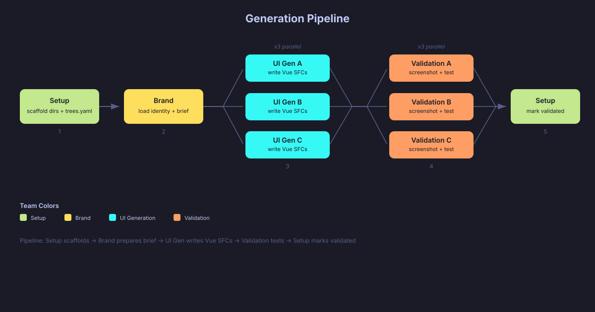
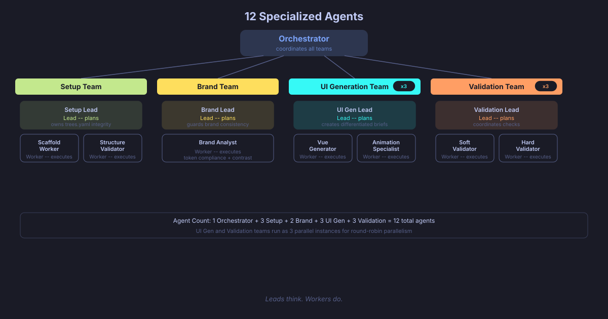
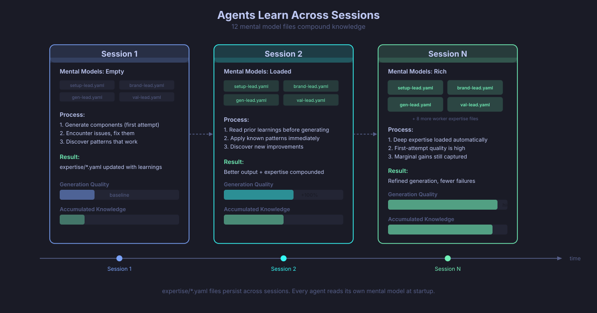

# Infinite UI Agents
> Stop solving one off tasks with agents. Build systems (agent teams) that solve entire problem classes. This Infinite UI Agents project is a showcase of this.

Infinite brand-consistent UI generation powered by multi-team agent orchestration. Define a brand identity once, then generate unlimited UI variants — landing pages, dashboards, pricing pages, components — all visually cohesive, all browseable in a single app.

Third asset in the Agentic Horizon trilogy: **ceo-agents** → **lead-agents** → **ui-agents**.

<p align="center">
  
</p>

## Setup

Claude Code (or any agentic coding tool that can read and execute `.claude/commands/`) is the bootloader for this system. Open your agentic coding tool in this repo and run a single command to walk through the entire setup process:

```bash
/install
```

### Prerequisites

UI Agents runs on top of the **Multi-Team Agentic Coding** system. You need the Pi coding agent and the `teams` shell alias set up first. If you don't have them, download the Multi-Team Agentic Coding codebase from [member assets](https://agenticengineer.com/tactical-agentic-coding/member-assets) and run `/install` there.

### What `/install` Does

The `/install` command will:

- Verify Pi coding agent and the `teams` alias are available
- Check prerequisites (Claude Code, Bun, Node.js, just, uv)
- Confirm `ANTHROPIC_API_KEY` is set
- Install Vue app dependencies
- Validate team config and all agent files
- Verify dev server readiness

### Run

After install, start the app and the multi-team system:

```bash
# Start the Vue app
just dev

# Start multi-team chat (talk to the Orchestrator)
just team

# Generate your first UI
just new-brand mybrand "A bold fintech brand"
just generate mybrand myproduct landing 3 "Hero sections with dynamic typography"

# See what's already here
just list-brands
```

## How It Works

<p align="center">
  
</p>

A multi-team agent system generates Vue components that use CSS custom properties derived from a brand config. Four specialized teams collaborate through an orchestrator:

- **Setup Team** — scaffolds brands, products, trees, branches. Maintains the `trees.yaml` manifest. Validates filesystem integrity via Zod schemas.
- **Brand Team** — guards brand identity. Reads `brand.yaml`, produces generation briefs with token guidance, checks contrast ratios and compliance.
- **UI Generation Team** — writes Vue 3 SFC components using Composition API. All styling via CSS custom properties. Handles layout, animations, and micro-interactions.
- **Validation Team** — screenshots components via Playwright, checks brand compliance, tests responsiveness at breakpoints, verifies accessibility (focus rings, keyboard nav, contrast).

## The Hierarchy

<p align="center">
  
</p>

<p align="center">
  
</p>


```
Brand → Product → Tree → Branch → Leaf

aegis/                          ← brand
├── brand.yaml                  ← brand identity (global)
└── products/
    └── app/                    ← product
        ├── brand.yaml          ← product override (optional, deep-merged)
        ├── trees.yaml          ← manifest of all trees/branches
        └── trees/
            ├── landing/        ← tree (purpose category)
            │   ├── hero-v1/    ← branch (variant)
            │   │   └── index.vue  ← leaf (generated component)
            │   ├── hero-v2/
            │   └── hero-v3/
            └── pricing/
                └── ...
```

- **Brand** — organizational container. Has a `brand.yaml` defining palette, typography, spacing, motion, shadows, breakpoints, identity, and media assets.
- **Product** — unit of work within a brand. Optionally overrides the brand config. Has its own `trees.yaml` manifest.
- **Tree** — purpose category (landing, dashboard, pricing, etc.)
- **Branch** — variant within a tree. Each has a status: draft, generating, validating, validated, failed.
- **Leaf** — the actual Vue component at `index.vue`. Uses only CSS custom properties from the brand config.

## brand.yaml — Brand Identity

<p align="center">
  
</p>

Each brand has a `brand.yaml` defining the full visual identity. Products can optionally override fields with a partial `brand.yaml` that gets deep-merged on top.

Key sections: `palette` (13 colors), `typography` (fonts + scale), `spacing` (unit + radii + container), `breakpoints` (sm/md/lg/xl), `shadows` (sm/md/lg), `motion` (durations + easing), `identity` (mission, description, keywords, voice, avoid list), `assets` (logo, favicon, media array).

## The App

Single Vue app at `apps/infinite-ui/` serving all brands and products. One dev server, one port.

```
just dev                    # start the app
```

### Routes

```
/                                      → Workspace (all brands)
/:brand                                → Brand view (products + palette preview)
/:brand/:product                       → Canvas (VueFlow tree graph)
/:brand/:product/gallery               → Gallery (tree cards)
/:brand/:product/gallery/:tree         → Tree view (branch cards + status)
/:brand/:product/gallery/:tree/:branch → Leaf (rendered component)
```

### Navigation

- **Breadcrumb bar** — floating at top, clickable segments, toggleable with `Ctrl+H`
- **Sidebar** — overlay with brand editor (color pickers, sliders, dropdowns), filesystem tree explorer, settings. Toggle with `Ctrl+S` or ☰ menu icon
- **Canvas** — VueFlow node graph showing the full hierarchy with dagre auto-layout. Click a branch to preview.
- **Live CSS updates** — every component uses CSS custom properties from the brand config. Edit a color, font, or spacing value in the sidebar brand editor and all rendered components update instantly — no rebuild, no refresh. Change `brand.yaml` and the entire product rebrands in real time.

## Workflow Commands

Reusable prompts in `.pi/prompts/multi-team/` that the orchestrator follows:

| Command                                                          | What it does                            |
| ---------------------------------------------------------------- | --------------------------------------- |
| `/new-brand <name>`                                              | Create brand from template              |
| `/new-product <brand> <product>`                                 | Create product from template            |
| `/new-tree <brand> <product> <tree> <desc>`                      | Add a tree                              |
| `/new-branch <brand> <product> <tree> <branch> <brief>`          | Scaffold + generate one branch          |
| `/generate <brand> <product> <tree> <count> <brief>`             | Generate N variant branches             |
| `/fork-leaf <brand> <product> <tree> <branch> <count> <changes>` | Fork existing leaf with changes         |
| `/rebrand <brand> [product]`                                     | Cascade brand changes to all components |
| `/validate <brand> <product> [tree] [branch]`                    | Run validation pipeline                 |
| `/status <brand> <product>`                                      | Show tree/branch status report          |

## Justfile Recipes

```bash
just team                   # start multi-team chat interactively
just dev                    # start Vite dev server
just list-brands            # list all brands
just list-products <brand>  # list products in a brand
just list-trees <b> <p>     # list trees in a product
just list-branches <b> <p> <t>  # list branches with status
just list-leaves <b> <p>    # list all leaf components
```

## Agent Architecture

<p align="center">
  
</p>

```
Orchestrator (Sonnet)
├── Setup Team
│   ├── Setup Lead (Sonnet) — owns trees.yaml, coordinates scaffold + validate
│   ├── Scaffold Worker (Sonnet) — creates dirs, stubs, copies templates
│   └── Structure Validator (Sonnet) — Zod validation, filesystem-manifest sync
├── Brand Team
│   ├── Brand Lead (Sonnet) — guards brand consistency, produces briefs
│   └── Brand Analyst (Sonnet) — token compliance, contrast checks
├── UI Generation Team
│   ├── UI Generation Lead (Sonnet) — translates requests to briefs, differentiates variants
│   ├── Vue Generator (Sonnet) — writes Vue SFCs with brand tokens
│   └── Animation Specialist (Sonnet) — CSS transitions, micro-interactions
└── Validation Team
    ├── Validation Lead (Sonnet) — coordinates soft + hard validation
    ├── Soft Validator (Sonnet) — Playwright screenshots, brand compliance
    └── Hard Validator (Sonnet) — interaction testing, responsive, accessibility
```

Agents maintain mental models (`.pi/multi-team/expertise/*.yaml`) that compound across sessions — each generation round improves the next.

<p align="center">
  
</p>

## Project Structure

```
ui-agents/
├── apps/infinite-ui/           # Single Vue app
│   ├── src/
│   │   ├── schemas/            # Zod schemas (brand + trees)
│   │   ├── stores/             # Pinia (brand, trees, canvas, sidebar)
│   │   ├── brand/              # Token injection + theme CSS
│   │   ├── layout/             # Sidebar, breadcrumb, editors
│   │   ├── workspace/          # Brand + product picker views
│   │   ├── canvas/             # VueFlow node graph
│   │   ├── gallery/            # Tree/branch browsing
│   │   └── brands/             # All brand/product data (agents write here)
│   │       ├── _template/      # Copy source for new brands
│   │       └── aegis/        # Example brand
│   └── vite.config.ts          # Dev server + API middleware
├── .pi/
│   ├── multi-team/
│   │   ├── multi-team-config.yaml  # Team definitions
│   │   ├── agents/             # 12 agent system prompts
│   │   ├── expertise/          # Agent mental models (auto-maintained)
│   │   ├── skills/             # Shared behavioral rules
│   │   └── sessions/           # Conversation logs
│   ├── prompts/multi-team/     # 9 workflow commands
│   └── settings.json           # Pi config
├── scripts/list.py             # CLI for listing brands/products/trees/branches
├── specs/                      # Architecture specs
│   ├── init.md                 # Original build plan
│   └── refactor-single-app.md  # Single-app refactor plan
├── justfile                    # Task runner
└── CLAUDE.md                   # Project conventions
```

## Quick Start

```bash
# Start the app
just dev

# Start the team system
just team

# Create a brand and product
/new-brand mybrand
/new-product mybrand myproduct

# Generate 3 landing page variants
/generate mybrand myproduct landing 3 "Hero sections with bold typography"

# Check status
just list-branches mybrand myproduct landing
```


## License

Copyright 2026 IndyDevDan. All rights reserved.

This code is provided for **personal and educational use only**. You may study, modify, and use it in your own private projects. You may NOT republish, redistribute, or share this source code, in whole or in part, in any public repository, website, course, or distribution channel without explicit written permission from the author. Selling or sublicensing this code is prohibited.

For licensing inquiries: [agenticengineer.com](https://agenticengineer.com)
